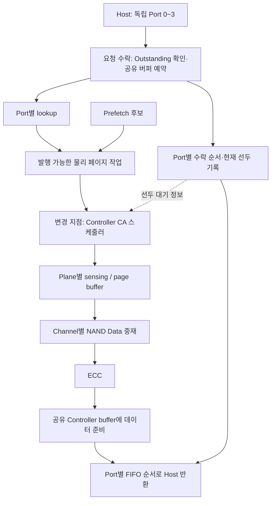

# 컨트롤러 스케줄링 적용점과 평가 결과

현재 모델은 **컨트롤러의 NAND 명령·주소(CA) 발행 단계에서, 이미 처리 가능한 물리 페이지들의 내부 처리 순서를 조정**한다. 같은 Plane의 연속 물리 주소를 우선해 Long sensing을 줄이고, 필요할 때 오래 기다린 port 선두 요청을 먼저 준비한다. Host가 제시하는 주소 순서와 port 내부 응답 순서는 유지한다.

현재 실행용 설정은 **A1: `head_locality`·우회 32회·선두 대기 48.64μs**, **A2/B1/B2/B3: `locality`·우회 32회**다. 모델 기본값은 재현성을 위해 `fifo`로 남아 있으므로, 아래 프로파일을 명시해야 이 설정이 적용된다.

이 문서는 `b5c195b` 시점의 기준 정책과 결과를 보존한다. 이후 추가한 PF 제한 우선·NAND Data 선두 우선 및 자원 재평가는 [후속 적용과 튜닝](13_controller_followup_ko.md), [단계별 결과](../results/znand/scheduling_next/RESULTS_KO.md)를 따른다. 아래 후속 후보 중 Data 중재 변경은 이 추가 평가에서 구현했다.

- 정리일: 2026-10-10, Asia/Seoul
- 구현 기준: [`znand/model.py`](../znand/model.py), 커밋 `b5c195b`
- 모델 SHA-256: `cebec697da50ce9dba53e0681b5e06a44e9bd8096f20862a2dd5c1cac9b0a15a`
- 범위: 구현된 스케줄링, 버퍼·순서 제약과의 관계, 저장된 시뮬레이션 결과. 이 문서를 작성하면서 새 성능 실험이나 모델 변경은 하지 않았다.

## 1. 어디에 적용했는가

4개 port는 독립적인 요청·응답 주체이며 4개 NAND channel을 공유한다. Port와 channel은 고정 1:1 연결이 아니다. 각 Read의 물리 주소가 channel과 Plane을 결정하므로, 한 port도 여러 channel을 사용할 수 있다.

아래는 신규 NAND Read의 대표 흐름이다. 같은 물리 페이지를 읽는 요청은 하나의 내부 작업으로 병합할 수 있다.



| 단계 | 현재 동작과 적용점 | 코드 위치 |
|---|---|---|
| Host 수락·버퍼 예약 | Port별 Outstanding을 제한하고, 신규 물리 페이지 작업의 공간을 수락 시 예약한다. CA 정책을 바꿔도 이 규칙은 동일하다. | `admit()`, `capacity()` |
| Lookup·Demand 판정 | 연결된 Host 요청 중 lookup이 완료된 요청이 있으면 Demand로 분류한다. 이미 생성된 PF 작업도 이 조건을 만족하면 Demand 우선순위를 받는다. | `lookups()`, `demand()`, `run()`의 `lookup` |
| Port 선두 추적 | 빈 FIFO에 수락하거나 이전 선두의 반환이 끝났을 때 `head_since`를 기록한다. 선두 우선 기능에 필요한 상태를 추가했다. | `admit()`, `run()`의 `returned` |
| Plane 내부 CA 후보 선택 | FIFO, 연속 주소 우선, 선두 요청 우선 정책을 선택한다. Age와 연속 우회 한도를 적용한다. | **`ca_candidates()`** |
| Channel 내 Plane 간 CA 중재 | Plane별 대표 후보 중 하나를 고른다. `head_locality`는 이 단계에서도 오래 기다린 선두를 고려한다. | **`ca_candidates()`** |
| 실제 CA 발행 | 선택된 작업을 발행하고 Plane을 점유한다. 이때만 해당 Plane의 우회 계수를 갱신한다. | **`dispatch()`의 CA 선택 부분** |
| NAND Data 중재 | 준비된 Demand 우선, 같은 등급은 전송 준비 시각 순서다. CA 정책과 별도이며 이번 변경에서 유지했다. | `dispatch()`의 Data 선택 부분 |
| Host 반환 | 각 port의 FIFO 선두만 반환한다. 후속 요청의 데이터가 먼저 준비돼도 해당 port의 앞선 응답을 추월하지 않는다. | `return_data()`, `run()`의 `returned` |

구현 파일은 모두 [`znand/model.py`](../znand/model.py)에 있다. 제어 주체는 컨트롤러 내부 스케줄러다. Host의 주소 발행 방법을 바꾸는 기능과는 구분한다.

## 2. 후보를 고르기 전에 지키는 조건

CA 후보는 `state=waiting`이고 `eligible` 시각이 정해진 작업이다. 여기에 다음 자원 조건을 모두 적용한다.

- 대상 channel의 CA 경로가 비어 있어야 한다.
- 대상 Plane이 다른 Read에 점유돼 있거나 내부 작업으로 사용 불가능한 상태이면 제외한다.
- 버퍼 공간은 해당 작업 생성·수락 단계에서 이미 확보되어 있어야 한다.
- Host Demand는 lookup 완료 후 후보가 된다. PF는 이미 생성된 후보만 사용한다.

Busy Plane의 작업은 대기열에 남겨 두고 발행 가능한 다른 Plane을 탐색한다. 발행 가능한 Demand가 있으면 PF보다 먼저 고른다. 발행 가능한 Demand가 없는 channel에서는 PF가 진행할 수 있다. 이미 시작한 sensing이나 NAND Data 전송을 선점하지 않는다.

**선택 단위는 `(channel, plane, q)`로 표현한 16KiB 물리 페이지 작업**이다. `q`는 Plane 내부 물리 페이지 순번이다. 여러 64B/4KiB Host 요청이 한 작업을 공유할 수 있으므로, Host 요청 수와 CA 발행 수는 같지 않다.

여기서 `oldest`는 현재 선택 등급의 후보 중 내부 작업 생성 순번 `seq`가 가장 작은 작업이다. PF 생성·Demand 병합이 있으므로 Host 요청 도착 순번과 항상 같지는 않다. Demand 후보가 있는 Plane에서는 Demand끼리, 없으면 PF 후보끼리 oldest를 정한다.

## 3. 적용한 세 가지 CA 정책

### 3.1 `fifo`: 기존 대조 정책

각 channel의 발행 가능한 작업 중 Demand를 먼저 고르고, 같은 등급에서는 `seq`가 작은 작업을 선택한다. 물리 주소의 연속성이나 port 선두 대기는 우선순위에 반영하지 않는다. 자원을 사용할 수 없는 작업 때문에 channel 전체가 멈추지는 않는다.

### 3.2 `locality`: 같은 Plane의 연속 물리 주소 우선

각 Plane에서 다음 순서로 대표 작업 하나를 고른다.

1. 발행 가능한 Demand가 있으면 Demand만 대상으로 삼는다. 없으면 PF를 대상으로 삼는다.
2. Oldest가 `locality_age_us` 이상 기다렸으면 oldest를 선택한다.
3. 해당 Plane의 연속 우회 계수가 `locality_max_bypass`에 도달했으면 oldest를 선택한다.
4. 현재 NAND page buffer에 같은 물리 페이지가 남아 있으면 그 작업을 우선한다.
5. 그다음은 **같은 Group에서 마지막 sensing 페이지의 `q+1`**인 작업을 우선한다.
6. 해당 후보가 없으면 oldest를 선택한다. 같은 우선순위에서는 `seq`로 결정한다.

Channel 안에서 Plane끼리 경쟁할 때는 각 Plane이 대표하는 **oldest의 `seq`**를 사용한다. 연속 주소를 골랐다고 그 작업의 늦은 생성 순번으로 Plane 간 순서까지 바꾸지는 않는다. 이 단계에서도 Demand가 PF보다 우선한다.

현재 모델에서 같은 Group의 `q→q+1` 전환은 Short 2μs 또는 Mid 2.08μs이며, 비연속 전환은 Long 12.16μs다. 최초 Read와 Group 전환은 20.69μs다. Page buffer 적중은 sensing을 생략한다. 따라서 CA 순서를 바꾸면 `tR` 상수를 바꾸지 않고도 Long 발생 횟수를 줄일 수 있다. 이 시간은 모델 입력값이다.

논리 주소가 연속인지가 아니라 **매핑된 물리 주소와 해당 Plane의 이력**으로 판단한다. Group 경계를 넘는 `q+1`은 연속 우선 대상으로 삼지 않는다. 아직 들어오지 않은 다음 주소를 기다리거나 scheduler가 미래 요청을 만들어 내지는 않는다.

### 3.3 `head_locality`: 오래 기다린 port 선두를 추가로 고려

Port 내부 in-order 때문에 앞선 요청이 늦으면, 후속 요청들이 준비돼도 Host 반환이 막힌다. 이를 줄이기 위해 CA 대기 중인 port 선두 페이지에 우선순위를 줄 수 있게 했다.

선두 대기는 다음 시각부터 계산한다.

```text
head_wait_start = max(실제 port FIFO 선두가 된 시각, 해당 요청의 lookup 완료 시각)
head_wait       = 현재 시각 - head_wait_start
```

`head_wait >= head_wait_us`이고 해당 페이지가 아직 CA 대기 중이면 선두 우선 후보가 된다. 같은 물리 페이지를 여러 port의 선두가 기다리면 가장 오래 기다린 선두를 기준으로 한다. 해당 port가 이미 응답을 전송 중이거나, 페이지가 이미 sensing·Data 전송 중이면 새로운 선두 CA 후보로 고르지 않는다.

**Plane 내부 순서는 `age 보호 → 우회 한도 보호 → 오래 기다린 선두 → page buffer 적중 → 같은 Group의 q+1 → oldest`**다. Channel의 Plane 간 선택에서도 선두 후보를 우선하되, age 한도에 도달한 Demand 후보를 먼저 보호한다. 발행 가능한 선두 후보가 없으면 기존 locality의 Plane 간 순서를 따른다.

이 조건들은 스케줄러가 후보를 고르는 시점에 평가한다. 임계시간에 도달했다고 진행 중인 동작을 중단하거나 즉시 CA를 강제 발행하는 기능은 아니다.

| 보호 기준 | 시간·횟수의 기준 | 의미 |
|---|---|---|
| `locality_age_us` | 해당 oldest 작업의 `eligible` 이후 경과 시간 | 오래된 내부 작업의 추가 우회를 제한 |
| `locality_max_bypass` | 같은 Plane에서 oldest 이외의 작업을 연속으로 실제 발행한 횟수 | 연속 주소·선두 우선 선택의 연속 우회 제한 |
| `head_wait_us` | 실제 port 선두와 lookup 완료 중 늦은 시각 이후 | Host 반환을 막는 선두의 CA 우선 후보 자격 |

PF로 먼저 생성된 작업의 `eligible`은 PF 생성 시각이며 Demand가 연결돼도 초기 시각을 유지한다. 세 기준은 서로 다른 상태를 측정한다. Busy·maintenance·다른 Plane과의 경쟁까지 포함한 절대 완료시간이나 PF의 최대 대기시간을 보장하지 않는다.

## 4. ‘우회 32회’의 정확한 동작

우회는 **같은 Plane의 현재 선택 등급에서 oldest를 남겨 두고 다른 작업을 먼저 CA 발행하는 것**이다. 계수는 `(channel, plane)`별로 하나씩 관리한다. Port별·AXI ID별 계수가 아니다.

다음은 우회 한도를 2로 줄여 보인 예시다. 모든 작업은 같은 Plane·같은 Group의 발행 가능한 Demand이고, 마지막 sensing은 P0이다. Age 보호나 선두 우선은 개입하지 않는다고 가정한다.

```text
작업 생성 순서: P100 → P1 → P101 → P2 → P102 → P3 → …
```

| CA 선택 시점 | 현재 oldest | 실제 발행 | 이유 | 우회 계수 |
|---|---|---|---|---|
| 1 | P100 | P1 | P0 다음 연속 물리 페이지 | 0 → 1 |
| 2 | P100 | P2 | P1 다음 연속 물리 페이지 | 1 → 2 |
| 3 | P100 | P100 | 한도 2에 도달하여 oldest 선택 | 2 → 0 |
| 4 | P101 | P101 | Oldest 자체가 P100의 다음 페이지 | 0 → 0 |

실제 설정 32도 같은 방식이다. **32는 연속 페이지를 최대 32개만 읽는다는 뜻이 아니다.** Oldest 자체가 연속 페이지라면 우회가 아니므로 계수는 0으로 유지되고 연속 처리를 계속할 수 있다.

- 최종적으로 CA를 발행할 때만 증가하거나 초기화한다. 후보 검사, channel 중재에서 탈락, Busy 대기는 횟수에 포함하지 않는다.
- 선택 작업이 oldest이면 0으로 초기화한다. Oldest 이외이면 1 증가한다. `head_locality`의 선두 우선 선택도 동일하게 센다.
- 특정 요청 하나가 추월당한 누적 횟수를 따로 세는 방식은 아니다. 각 선택 시점의 oldest와 비교하는 Plane 단위 연속 계수다.
- NAND page buffer의 재출력도 CA 발행이므로 계수 갱신 대상이다. 여러 Host 요청이 controller buffer에서 함께 응답받는 것은 새 CA 발행이 아니다.
- 내부에서 P1/P2를 먼저 준비해도 같은 port의 앞선 응답을 추월하지 않는다. 준비된 데이터는 controller buffer에서 자신의 반환 차례를 기다린다.

## 5. 버퍼·병렬성·외부 순서와의 관계

| 자원 또는 규칙 | 현재 모델의 처리 |
|---|---|
| Plane별 NAND page buffer | Plane당 1개. 다른 물리 페이지를 sensing하면 내용이 바뀐다. NAND Data 전송 완료만으로 내용이 사라지지는 않는다. |
| Plane 점유 구간 | CA 시작부터 해당 NAND Data 전송 완료까지. 같은 Plane의 다음 Read는 그 뒤에 시작한다. ECC·Host 반환 완료까지 Plane을 묶어 두지는 않는다. |
| Channel CA/Data | 각각 독립 경로이며 조건이 맞으면 서로 중첩한다. 같은 channel의 CA끼리, Data끼리는 직렬화한다. 다른 Plane의 sensing은 병렬로 진행할 수 있다. |
| NAND Data 중재 | 전송 준비된 Demand 우선. 같은 등급은 `transfer_ready`, 그다음 `seq`. 시작한 16KiB 전송은 중단하지 않는다. |
| 공유 controller buffer | 미도착 데이터의 예약과 준비된 payload를 함께 관리한다. 연결된 모든 Host 응답이 끝나면 해당 항목을 해제한다. 사용 후 보존하는 LRU cache는 도입하지 않았다. |
| 미사용 PF 회수 | 공간 부족 시 연결 요청이 없고 ready 상태인 항목을 오래된 ready 시각 순으로 회수한다. 진행 중이거나 응답이 연결된 항목은 보호한다. |
| 선두 공간 보호 | 아직 수락된 요청이 없는 활성 port에 대해 공간을 보호하여 첫 요청의 진입을 돕는다. 오래 기다린 선두의 **CA 우선순위**와는 별도 기능이다. |
| 응답 ordering | 각 port는 ID와 무관하게 수락 순서대로 반환한다. 다른 port 사이에는 전역 반환 순서를 강제하지 않는다. |

버퍼를 크게 하면 보유 가능한 페이지뿐 아니라 수락·PF 진입 범위도 달라진다. 따라서 더 큰 버퍼에서 먼저 준비한 후속 데이터가 많이 쌓이거나 물리 접근 순서가 달라질 수 있다. 현재 모델은 물리 용량과 admission 예약 한도가 결합되어 있다. 버퍼 확대 결과를 물리 용량 하나의 효과로 해석하지 않는다.

## 6. 현재 적용할 설정

### 모델 기본값과 평가 프로파일의 차이

| 설정 | `Config` 기본값 | 현재 실행용 프로파일 |
|---|---|---|
| `ca_policy` | `fifo` | A1은 `head_locality`, 나머지는 `locality` |
| `locality_max_bypass` | 8 | 32 |
| `locality_age_us` | 1,000μs | 1,000μs |
| `head_wait_us` | 12.16μs | A1 48.64μs; locality에서는 사용하지 않음 |
| `outstanding` | 128/port | 2,048/port |
| `buffer_pages` | 512 = 공유 8MiB | 2,048 = 공유 32MiB |
| `ports / channels / planes` | 4 / 4 / 8 | 동일. `planes`는 channel당 수이므로 총 32Plane |
| `prefetch` | OFF | ON, 합성 정확도 100%, lead 10μs, 미사용 후보 상한 128 |

| Workload | Host 요청 | Channel stripe | 프로파일 |
|---|---|---|---|
| A1 | 순차 4KiB | 4KiB | [A1.json](../results/znand/head_locality/profiles/A1.json) |
| A2 | 페이지 간 순서 변경 4KiB | 16KiB | [A2.json](../results/znand/head_locality/profiles/A2.json) |
| B1 | 페이지별 순차 64B | 4KiB | [B1.json](../results/znand/head_locality/profiles/B1.json) |
| B2 | 페이지 간 순서 변경 64B | 4KiB | [B2.json](../results/znand/head_locality/profiles/B2.json) |
| B3 | 페이지 재방문 포함 64B | 16KiB | [B3.json](../results/znand/head_locality/profiles/B3.json) |

64B 단위 물리 분산은 제외한 상태다. A2/B2의 요청열은 1→3→2의 지역 순열이며, B3의 재방문은 같은 논리 페이지의 다른 64B 위치를 읽는다. 패턴의 ‘페이지’와 스케줄러의 16KiB 물리 페이지를 구분한다. 배치·원문 대응은 [튜닝 문서](07_prefetch_tuning_ko.md)를 따른다.

프로파일은 개별 workload에 대한 오프라인 선택이다. 실행 중 workload를 자동 판별하거나 정책을 자동 전환하는 기능은 없다.

## 7. 지금까지 확인한 성능 효과

모든 처리량은 유효 Host payload 기준 decimal GB/s다. 아래 비교의 기본 길이는 port당 8,192개 요청이며, 4port·32Plane·seed 7·port별 비중첩 주소를 사용했다. p99는 별도 표기가 없으면 **요청 제시부터 최종 반환까지**의 지연이다. 표의 비교 조건이 다른 결과끼리 개선률을 계산하지 않는다.

### 7.1 FIFO → locality: Long sensing 감소

A2·16KiB stripe·PF ON·QD2,048/port에서 버퍼별로 같은 조건을 비교했다. 이때 locality 우회 한도는 8이었다.

| 공유 버퍼 | FIFO GB/s | Locality GB/s | FIFO Long 비율 | Locality Long 비율 |
|---|---:|---:|---:|---:|
| 8MiB | 69.282 | 74.030 | 11.14% | 6.68% |
| 16MiB | 50.765 | 113.966 | 58.29% | 9.38% |
| 24MiB | 45.745 | 103.995 | 62.82% | 9.34% |
| 32MiB | 37.083 | 118.257 | 91.81% | 10.57% |

32MiB에서 p99도 3,057.47→610.74μs로 줄었다. 이 실험은 CA 선택 정책 변경이 Long sensing과 성능에 미치는 효과를 보여 준다. [전체 보고서](../results/znand/locality/RESULTS_KO.md)는 동일 조건 locality 56개와 FIFO 대조군 4개를 포함한다.

### 7.2 Locality 적용 후 버퍼 확대: 용량만으로 해결되지 않음

우회 8회·QD2,048/port·PF ON에서 공유 버퍼를 32→40→48→56→64MiB로 늘렸다. A1은 4KiB stripe, A2는 16KiB stripe다.

| 패턴 | 32MiB GB/s | 40~64MiB GB/s | 40~64MiB 예약 peak | 같은 범위의 버퍼 수락 실패 |
|---|---:|---:|---:|---:|
| A1 | 118.780 | 110.653 | 34.234MiB | 0회 |
| A2 | 118.257 | 111.147 | 34.062MiB | 0회 |

이 조건에서는 40MiB보다 큰 공간이 추가로 사용되지 않았고 Long 비율과 반환 대기가 늘었다. 따라서 다음 단계로 내부 발행 정책과 우회 한도를 조정했다. 물리 버퍼 확대 자체가 항상 느리다는 결론은 아니다. 높은 QD 및 B계열의 별도 조건을 포함한 45개 비교는 [버퍼 확대 보고서](../results/znand/buffer_growth/RESULTS_KO.md)에 있다.

### 7.3 우회 8→32회 및 선두 우선 적용

공유 32MiB·QD2,048/port·PF ON을 고정했다. Stripe는 위 실행용 프로파일과 같다. ‘현재 설정’은 A1만 선두 우선 ON이며 나머지는 OFF다.

| 패턴 | 이전 locality·우회8 GB/s | 현재 설정 GB/s | 변화 | 이전 p99 μs | 현재 p99 μs |
|---|---:|---:|---:|---:|---:|
| A1 | 118.780 | 134.339 | +13.10% | 605.75 | 474.87 |
| A2 | 118.257 | 135.035 | +14.19% | 610.74 | 469.73 |
| B1 | 2.139 | 2.522 | +17.91% | 965.78 | 818.43 |
| B2 | 2.123 | 2.499 | +17.71% | 972.87 | 824.21 |
| B3 | 2.740 | 3.235 | +18.08% | 753.01 | 635.83 |

이 개선에는 우회 한도 변경 효과가 포함된다. **선두 우선 기능 자체의 효과**는 우회 32회끼리 비교해야 한다.

| 패턴 | 선두 OFF GB/s | 선두 ON·48.64μs GB/s | 선두 기능의 추가 효과 | 적용 판단 |
|---|---:|---:|---:|---|
| A1 | 129.174 | 134.339 | +4.00% | ON |
| A2 | 135.035 | 135.456 | +0.31% | 긴 요청열 확인까지 고려하여 OFF |
| B1 | 2.522 | 1.272 | −49.56% | OFF |
| B2 | 2.499 | 1.588 | −36.46% | OFF |
| B3 | 3.235 | 1.736 | −46.34% | OFF |

선두를 너무 빨리 우선하면 물리 연속성을 자주 끊을 수 있다. A1/A2에서 선두 대기 0μs를 적용한 조건들은 Long 비율이 약 70%, 처리량이 약 35GB/s였다. 선두 대기 시간과 전체 처리량 사이의 균형이 필요하다.

Port당 **16,384개**로 늘린 별도 확인에서는 A1이 선두 OFF 140.417→ON 143.352GB/s(+2.09%), A2가 143.164→143.143GB/s(−0.01%)였다. 요청 수뿐 아니라 port별 주소 범위도 늘어나므로 앞 표와 동일 길이의 비교는 아니다. 이번 범위의 권장 프로파일 처리량은 각각 A1 143.352, A2 143.164GB/s다.

상세 자료는 [선두 우선 평가 보고서](../results/znand/head_locality/RESULTS_KO.md), [47개 원본 결과](../results/znand/head_locality/sweep.csv), [비교 지표](../results/znand/head_locality/comparisons.csv), [검증 기록](../results/znand/head_locality/validation.json)에 있다. 저장된 검증 기록은 모델 테스트 51개 통과, 기존 우회 8회 대조군 2개 일치, 47개 결과 검증을 포함한다.

## 8. 결과를 확인할 지표와 실행 방법

| 확인 항목 | 읽는 방법 |
|---|---|
| Host GB/s와 p99 | 처리량과 제시→반환 지연을 함께 비교한다. 수락→반환 지연만 보면 admission 대기를 놓친다. |
| `count_tr_*` | First/Short/Mid/Long/Group 발생 횟수. Long 비율은 sensing 발생 중 Long의 비율이다. Page buffer hit는 sensing을 하지 않는다. |
| `count_ca_selection_*` | `oldest`, `locality`, `age`, `bypass_limit`, `head` 규칙으로 선택한 횟수. `head` 횟수가 모두 기존 정책과 다른 순서를 만들었다는 뜻은 아니다. |
| 예약 peak·buffer 수락 실패 | 예약량은 ready payload만의 크기가 아니다. 실패 계수는 수락 시도 횟수이며 시간 비율이 아니다. |
| Return wait·HOL idle | Return wait에는 정상적인 응답 직렬화 대기도 포함된다. HOL idle은 선두 데이터가 없고 준비된 후속 요청이 있는 구간으로 구분한다. |
| Port별 완료 시각 | 일부 port의 지연·편중을 전체 GB/s와 함께 본다. 전체 성능 증가가 모든 port의 지연 감소를 의미하지는 않는다. |

저장소 루트에서 현재 A1 프로파일을 재실행하는 명령이다. 결과는 기존 평가 자료와 분리해 저장한다.

```sh
python3 -m znand.run --config results/znand/head_locality/profiles/A1.json --pattern A1 --per-port 8192 --out results/local/scheduling_A1 --trace
```

다른 패턴은 설정 파일명과 `--pattern`을 함께 바꾼다. 요청별 `requests.csv`의 수락·lookup·`head_since`·ready·반환 시각과 `events.json`의 CA/sensing/Data 이벤트를 연결하면 내부 재정렬과 외부 반환 순서를 확인할 수 있다. `ca_start` 이벤트만으로 선택 사유를 직접 읽을 수는 없으며, 사유별 계수는 결과 요약을 사용한다.

개발 검증과 전체 선두 우선 비교를 다시 실행할 때는 다음 명령을 사용한다. 이 문서 정리 작업에서 재실행한 명령은 아니다.

```sh
python3 -m unittest test_znand test_znand_expansion test_znand_locality test_znand_head -q
python3 -m znand.head_sweep --workers 8
python3 -m znand.head_report
```

## 9. 후속 튜닝으로 남긴 적용점

| 후보 | 조정할 위치 | 평가할 내용 | 현재 상태 |
|---|---|---|---|
| 물리 버퍼와 admission 예약 window 분리 | `capacity()`·`admit()` | 물리 용량을 유지하면서 진입 범위를 제한하고 Long·HOL·예약량 비교 | 정식 설정으로 미구현. 제한된 대조 실험만 수행 |
| Workload별 동적 정책 | CA 스케줄러의 정책 선택 | 연속성·선두 지연·요청 크기에 따라 head 개입 조절 | 오프라인 프로파일만 제공 |
| PF 진입량·정확도·lead 재튜닝 | 후보 생성·예산·수락 | 잘못된 PF와 Demand의 자원 경쟁, 연속성 변화 | 기존 조절값은 있으나 이번 CA 정책과의 결합 탐색은 후속 |
| Age·우회·head 임계시간 범위 확대 | `ca_candidates()`·`urgent_heads()` | 처리량·p99·port별 공정성의 균형 | 이번 평가 범위 밖은 미확인 |
| NAND Data 중재 변경 | `dispatch()`의 Data 선택 | 이미 sensing된 선두 페이지의 전송 우선 여부 | 현재 Demand/준비 시각 순서 유지 |
| Controller cache | 항목 해제·보존·회수 | 사용 후 재방문 적중과 점유 비용 | 미구현, 임시 버퍼링 유지 |
| 64Plane·1~4port·주소 중첩·L2P 변화 | 자원 구성·요청열·매핑 | 새 정책의 병렬성·부하 편중 민감도 | 일부 진행성 테스트와 별개로 새 정책의 성능 확장 평가 필요 |

세부 튜닝 합의는 [Prefetch 배치와 L2P 튜닝 기준](07_prefetch_tuning_ko.md)을 따른다. 이번 수치는 고정 입력과 seed의 유한 요청열 결과다. 합성 PF 후보 생성은 미래 요청을 아는 가정이며, 실제 예측기·동적 L2P·실제 GC·Die/LUN 공유 제약·상세 UCIe 프로토콜을 반영한 제품 실측 결과는 아니다.
