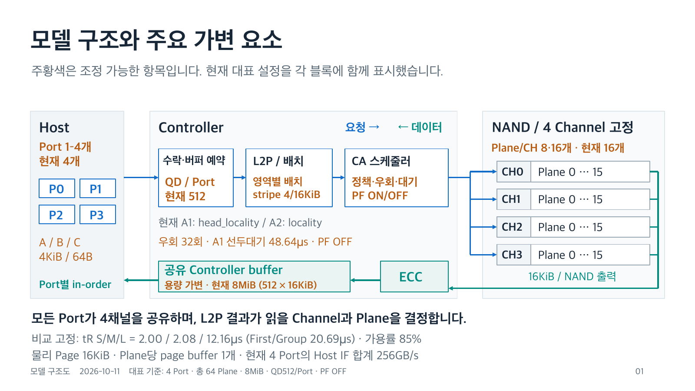
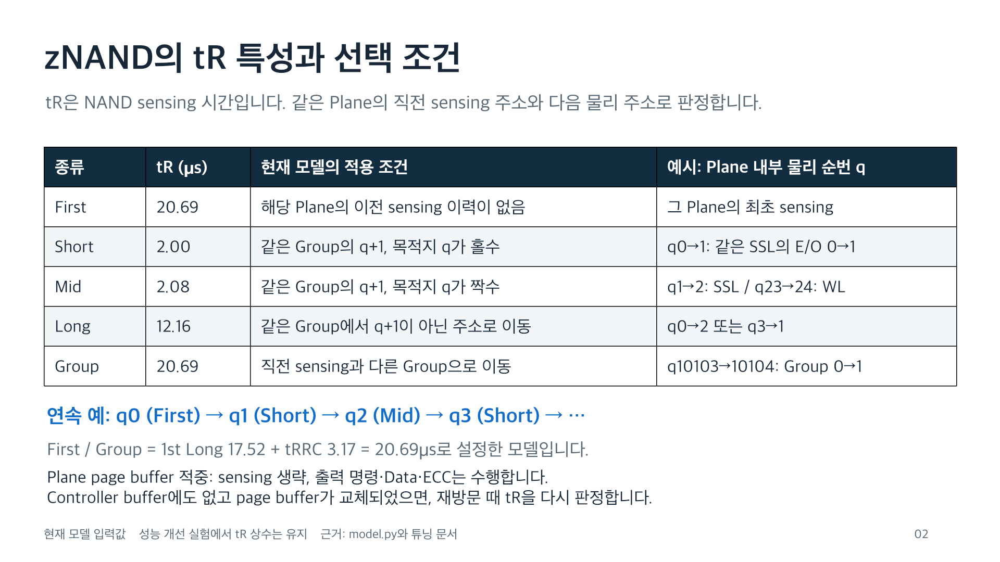
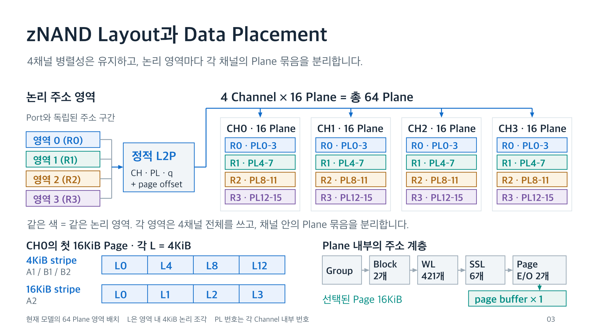

# 성능 개선 핵심 3가지

2026-10-11까지의 실험에서 효과를 확인한 항목은 **컨트롤러 스케줄링**, **Plane 확장과 데이터 배치**, **버퍼와 Port별 Outstanding의 공동 조정**이다. 이 문서는 저장된 결과를 정리하며, 새 성능 실험이나 모델 변경은 포함하지 않는다.

- [발표 자료 PPTX](performance_key_items/performance_key_items_with_diagram_ko.pptx)
- [공유용 PDF](performance_key_items/performance_key_items_with_diagram_ko.pdf)
- [수치 원자료와 출처 해시](performance_key_items/evidence.json)
- [슬라이드 생성 소스](performance_key_items/build.mjs)

자료는 **13장**이다. 첫 페이지는 요청·데이터 경로와 주요 가변 요소의 블록 다이어그램, 2페이지는 zNAND의 tR 특성, 3페이지는 Layout과 Data Placement의 블록 다이어그램, 4페이지는 구조별 상세 동작과 자원 제약이다. 5~11페이지는 핵심 개선과 비교 조건, 마지막 12~13페이지는 A·B 워크로드 정의와 유효 데이터량의 차이를 설명한다.

**세 항목의 수치는 서로 다른 실험에 속한다. 각 실험 안의 전후 비교는 유효하지만, 증가율을 합산하거나 하나의 누적 개선 과정처럼 연결하지 않는다.** 1번은 PF ON의 32 Plane 유한 요청열, 2번은 PF OFF의 32/64 Plane 유한 요청열, 3번은 PF OFF의 64 Plane 지속 부하다.

## 전체 구조와 데이터 흐름



구조도에서 파란 화살표는 읽기 요청과 CA 발행 경로, 초록 화살표는 NAND 출력·ECC·공유 버퍼·Host 반환 경로다. 주황색은 Port 수, QD, 버퍼 용량, L2P/stripe, 스케줄링, PF, Plane 수 등 주요 가변 항목이다. 도식의 공통선은 자원의 공유 관계를 나타내며 물리 배선의 폭이나 개수를 정의하지 않는다.

현재 대표 조합은 **4 Port, 4채널 × 16 Plane, 공유 8MiB, QD512/Port, PF OFF**다. A1은 4KiB stripe와 `head_locality`, A2는 16KiB stripe와 `locality`이며 영역별 L2P 배치를 사용한다. 우회 한도는 32회이고, 선두대기 48.64µs는 `head_locality`에 적용한다. 최근 B1/B2의 지속 부하는 A1 프로파일을 사용한다. tR, 가용률, Host IF도 모델 입력이지만 이번 개선 비교에서는 고정했으므로 그림 하단에 분리해 표시했다. 전체 파라미터와 후속 후보는 [튜닝 문서](07_prefetch_tuning_ko.md)를 참고한다.

4개의 독립 Port가 4개 NAND Channel 전체를 공유한다. Port와 Channel의 고정 1:1 연결은 없으며, 읽기 주소를 매핑한 결과로 Channel과 Plane을 선택한다. AXI ID도 Port별로 구분하고, 응답은 각 Port 내부에서 수락 순서를 지킨다.

| 처리 구간 | 동작 | 주요 자원과 제약 |
|---|---|---|
| Host IF | Port 0~3에서 독립적으로 읽기 요청 | Port당 512bit·1GHz, 64GB/s, 합계 256GB/s |
| Controller 수락 | QD 확인, 신규 물리 페이지 작업의 공유 버퍼 예약, L2P 조회 | 대표 설정은 공유 8MiB와 QD512/Port |
| CA 스케줄링 | 이미 발행 가능한 물리 페이지 작업 중 처리 순서 선택 | 연속 물리 주소 우선, 필요 시 오래 기다린 Port 선두 우선 |
| NAND Read | 선택한 Plane에서 sensing | 4채널 × 16Plane = 64Plane, 물리 페이지 16KiB, Plane당 page buffer 1개 |
| NAND Data와 ECC | 채널 Data 경로로 16KiB를 출력하고 ECC 수행 | 준비된 데이터는 공유 Controller buffer에서 Host 반환을 기다림 |
| Host 반환 | 각 Port의 FIFO 선두만 반환 | 연결된 마지막 응답이 끝나면 해당 Controller buffer 공간 해제 |

NAND page buffer는 Plane별 자원이고, Controller buffer는 여러 Port가 공유하는 임시 보관 공간이다. 소비 후에도 계속 보관하는 demand cache나 LRU 정책은 적용하지 않았다. 위 구조는 현재 시뮬레이션 모델의 처리 흐름이며 UCIe의 모든 프로토콜 계층을 상세 구현한 회로도를 뜻하지 않는다. [구현과 적용 위치](12_controller_scheduling_ko.md).

## zNAND의 tR 특성: 두 번째 슬라이드



**tR은 NAND sensing 구간의 시간이다.** 아래 값과 규칙은 현재 모델에 적용한 입력·가정이며, 제품 보증치를 의미하지 않는다. `q`는 각 `(Channel, Plane)` 내부의 물리 페이지 순번이다. 고객 A/B 패턴의 4KiB 논리 Page 번호와 구분한다. 다른 Plane을 읽어도 해당 Plane의 직전 sensing 주소 이력은 바뀌지 않는다.

| 종류 | tR | 현재 모델의 적용 조건 | 예시 |
|---|---:|---|---|
| First | 20.69µs | 해당 Plane의 이전 sensing 이력이 없음 | 해당 Plane의 최초 sensing |
| Short | 2.00µs | 같은 Group에서 직전 `q`의 다음 페이지, 목적지 `q`가 홀수 | `0→1`: 같은 SSL의 E/O `0→1` |
| Mid | 2.08µs | 같은 Group에서 직전 `q`의 다음 페이지, 목적지 `q`가 짝수 | `1→2`: 다음 SSL, `11→12`: 다음 Block, `23→24`: 다음 WL |
| Long | 12.16µs | 같은 Group에서 바로 다음 페이지가 아닌 곳으로 이동 | `0→2` 또는 `3→1` |
| Group | 20.69µs | 직전 sensing과 다른 Group으로 이동 | `10103→10104`: Group `0→1` |

First와 Group은 **1st Long 17.52µs + tRRC 3.17µs = 20.69µs**로 설정했다. 실제 코드는 합산한 `first_us`와 `group_us`를 사용한다. Group 변경은 Short/Mid보다 먼저 검사하므로, `10103→10104`처럼 순번이 정확히 1 증가해도 Group 지연을 적용한다. 반대로 `0→2`는 목적지가 짝수여도 바로 다음 페이지가 아니므로 Mid가 아니라 Long이다.

Plane 내부 물리 주소는 **E/O `0→1` → SSL `0→5` → Block `0→1` → WL `420→0` → 다음 Group** 순으로 생성한다. 한 Group은 `421 × 2 × 6 × 2 = 10,104`개의 16KiB 물리 페이지를 포함한다. 같은 Group에서 순서대로 읽으면 다음과 같다.

```text
q0                 q1                 q2                 q3
First 20.69µs  →    Short 2.00µs  →    Mid 2.08µs    →    Short 2.00µs → …
```

Short와 Mid가 같은 횟수로 섞인 연속 구간의 평균은 2.04µs다. 다만 초기 First, Group 전환, Long이 포함되면 실제 평균은 각 종류의 sensing 횟수로 가중해야 한다.

```text
평균 tR = [20.69 × (N_First + N_Group)
           + 2.00 × N_Short + 2.08 × N_Mid + 12.16 × N_Long] / N_sensing
```

### 버퍼 재사용과 tR 생략

Controller buffer에 같은 물리 페이지 작업이 남아 있으면 기존 작업에 요청을 연결한다. 새 NAND 작업이 필요해도 해당 Plane의 page buffer에 같은 물리 페이지가 남아 있으면 sensing을 생략한다. 이때 출력 CA, NAND Data 전송, ECC와 Host 반환은 여전히 필요하다. Page buffer hit는 새로운 sensing을 수행하지 않으므로 위 평균의 `N_sensing`에 포함하지 않는다.

Plane당 page buffer는 하나다. 같은 Plane에서 다른 페이지를 sensing하면 이전 페이지가 교체된다. 이후 이전 페이지에 재방문하면 직전 sensing 주소와의 관계로 다시 분류한다. 예를 들어 같은 Group에서 `q1→q3→q1`을 읽고 이전 Controller buffer 작업도 해제되었다면, 두 전환 모두 Long이다. 다른 Plane의 Read만으로 이 Plane의 page buffer가 교체되지는 않는다.

### Host 읽기 지연과의 관계

Host 읽기에는 수락·버퍼 대기, lookup, CA, sensing, Data 경로 대기와 전송, ECC, Port 내부 in-order 대기, Host 반환 시간이 반영된다. 현재 설정은 lookup 0.5µs, CA 0.1µs, ECC 0.2µs다. 16KiB NAND Data 경로 점유는 `16KiB / 80.1125GB/s + turnaround 0.05µs ≈ 0.254512µs`이고 자원 대기는 별도다. 따라서 tR 2µs가 곧 Host 응답 2µs를 뜻하지 않는다.

64B Host 요청이라고 tR이 4KiB 요청의 1/64로 줄어들지는 않는다. 같은 물리 페이지의 데이터라면 버퍼 상태에 따라 sensing을 공유할 수 있다. 성능 개선에서 조정한 것은 **물리 배치와 CA 발행 순서를 통해 Long 발생 빈도를 줄이는 것**이며, 위 tR 상수는 유지했다.

근거: [모델의 Config·address·tr_kind와 버퍼 상태 전이](../znand/model.py), [주소 순회 규칙과 지연 입력](07_prefetch_tuning_ko.md), [기존 실험의 tR 유지 확인](../results/znand/host_ceiling/timing_validation.json).

## zNAND Layout과 Data Placement: 세 번째 슬라이드



위쪽은 **논리 영역 → 정적 L2P → 4개 Channel의 Plane 묶음**으로 이어지는 매핑 관계다. 같은 색은 같은 논리 영역을 뜻한다. 각 Channel 안에서 영역 0은 PL0–3, 영역 1은 PL4–7, 영역 2는 PL8–11, 영역 3은 PL12–15에 배치한다. 영역마다 네 Channel을 모두 사용하므로 Channel 병렬성을 유지하고, 한 Plane에 서로 먼 영역의 요청이 섞이는 일을 줄인다. 색은 Port ID가 아니며, 어느 Port에서 같은 주소를 읽어도 같은 물리 위치를 선택한다.

L2P snapshot은 기존 Channel·16KiB 패킹·페이지 내부 offset을 보존하고, 물리 페이지의 Plane과 Plane 내부 순번 `q`를 다시 배정한다. 그림의 화살표는 주소의 매핑 관계를 나타낸다. 실제 CA/Data 배선 개수나 Die/LUN 구성은 이 도식으로 정의하지 않는다.

아래쪽 왼편은 두 stripe 방식의 **16KiB 물리 페이지 내부 데이터 구성**이다. `L0`, `L1` 등은 해당 논리 영역의 시작을 0으로 놓은 4KiB 조각이며, 영역 시작이 64KiB 배치 주기에 정렬되어 CH0부터 시작하는 예시다.

| Stripe와 현재 사용 패턴 | CH0의 첫 물리 Page | CH1의 첫 물리 Page | CH2의 첫 물리 Page | CH3의 첫 물리 Page |
|---|---|---|---|---|
| 4KiB: A1/B1/B2 | L0, L4, L8, L12 | L1, L5, L9, L13 | L2, L6, L10, L14 | L3, L7, L11, L15 |
| 16KiB: A2 | L0, L1, L2, L3 | L4, L5, L6, L7 | L8, L9, L10, L11 | L12, L13, L14, L15 |

4KiB stripe는 4KiB마다 Channel을 순환시킨 뒤 같은 Channel의 조각 네 개로 물리 페이지를 채운다. 16KiB stripe는 연속된 4KiB 네 개를 한 물리 페이지로 묶고 16KiB마다 Channel을 순환시킨다. 이는 저장 배치 단위다. B1/B2가 각 논리 조각에서 요청하는 양은 64B이고, 현재 NAND 출력량은 16KiB 전체 페이지다.

아래쪽 오른편은 **하나의 Plane 안의 주소 계층**이다. 현재 모델은 Group마다 Block 2개, Block마다 WL 421개, WL마다 SSL 6개, SSL마다 E/O 2개의 16KiB Page를 둔다. Group당 `2 × 421 × 6 × 2 = 10,104`페이지다. Group 총개수나 전체 NAND 용량을 이 그림에서 고정하지는 않는다. 선택한 페이지를 sensing하면 그 Plane의 page buffer 한 개에 준비한다.

계층 구조와 페이지를 순회하는 순서는 구분한다. 실제 `q`는 **E/O → SSL → Block → WL → Group** 순으로 변하며, WL은 420에서 0으로 내려간다. 배치와 CA 스케줄링이 각 Plane에서 `q+1` 접근을 이어가도록 하면 앞 페이지에서 설명한 Short/Mid를 더 많이 활용할 수 있다.

근거: [주소 패킹과 물리 순번 해석](../znand/model.py), [영역별 L2P 생성](../znand/host_ceiling.py), [배치 검증](../results/znand/host_ceiling/snapshot_validation.json), [주소 구조와 튜닝 기준](07_prefetch_tuning_ko.md). 유한 A2 요청열의 경계 공유 페이지 예외는 배치 검증에 기록되어 있다.

## 1. 연속 물리 주소를 우선하는 컨트롤러 스케줄링

### 바꾼 동작

컨트롤러의 NAND 명령·주소(CA) 발행 단계에서, 이미 발행 가능한 물리 페이지 작업의 선택 순서를 조정했다. 같은 Plane의 같은 Group에서 마지막 sensing 페이지의 다음 페이지인 `q+1`을 우선한다. 현재 모델에서 이 접근은 Short 2.00µs 또는 Mid 2.08µs를 사용하므로, 비연속 접근의 Long 12.16µs가 발생하는 횟수를 줄인다.

Host가 주소를 제시하는 순서와 Port 내부 in-order 반환은 유지한다. 아직 수락하지 않은 미래 요청을 만드는 기능도 아니다. 발행 가능한 후보 중 순서를 조정하고, 이미 sensing 중인 작업은 선점하지 않는다.

오래된 작업이 계속 밀리는 것을 막기 위해 age와 우회 횟수 제한을 둔다. 이후 우회 한도를 8에서 32로 확대했고, A1에는 오래 기다린 Port 선두 요청을 먼저 준비하는 `head_locality`를 적용했다. A2는 후속 비교에서 선두 우선의 추가 효과가 작아 `locality`를 유지했다.

### 효과

| A2 동일 조건 비교 | 기존 FIFO | 연속 주소 우선 |
|---|---:|---:|
| Host 처리량 | 37.083 GB/s | 118.257 GB/s |
| Long tR 비율 | 91.813% | 10.566% |
| 종류별 횟수로 가중한 평균 tR | 11.404µs | 3.182µs |

CA 정책을 바꾼 결과 처리량이 **218.90% 증가**했다. 개별 tR 상수를 단축한 결과가 아니라, 접근 종류의 구성이 달라진 결과다.

비교 조건은 4 Port, 총 32 Plane, 공유 버퍼 32MiB, QD 2,048/Port, stripe 16KiB, PF ON, seed 7, 8,192요청/Port이며 전체 완료 시간을 포함한 평균이다. 이 초기 비교의 locality 우회 한도는 8이다.

후속 A1 실험에서는 우회 한도 32의 `locality` 129.174GB/s와 `head_locality` 134.339GB/s를 비교했으며, 선두 우선 자체의 추가 이득은 4.00%였다. 우회 한도 확대까지 합친 증가분을 전부 선두 우선의 효과로 해석하지 않는다.

근거: [CA 정책과 적용 위치](12_controller_scheduling_ko.md), [동일 조건 CSV의 case 37](../results/znand/locality/matched_comparison.csv), [우회 한도와 선두 우선 평가](../results/znand/head_locality/RESULTS_KO.md).

## 2. 64 Plane 확장과 영역별 데이터 배치

### 바꾼 동작

먼저 4채널의 Plane을 채널당 8개에서 16개로 확대해 총 64 Plane으로 평가했다. 기존 32 Plane은 현재의 Plane 점유 모델에서 최단 주기와 가용률 100%를 가정해도 신규 데이터 공급 상한이 약 222.7GB/s다. 따라서 256GB/s의 Host IF에 접근하려면 물리 공급 여력이 필요했다.

다음으로 각 논리 영역이 4채널을 모두 사용하면서, 채널 안에서는 서로 다른 Plane 묶음을 사용하도록 정적 L2P 배치를 만들었다.

| 논리 영역 | Channel 0 | Channel 1 | Channel 2 | Channel 3 |
|---|---|---|---|---|
| 영역 0 | Plane 0–3 | Plane 0–3 | Plane 0–3 | Plane 0–3 |
| 영역 1 | Plane 4–7 | Plane 4–7 | Plane 4–7 | Plane 4–7 |
| 영역 2 | Plane 8–11 | Plane 8–11 | Plane 8–11 | Plane 8–11 |
| 영역 3 | Plane 12–15 | Plane 12–15 | Plane 12–15 | Plane 12–15 |

Plane 번호는 채널 내부 번호다. 동일한 번호라도 채널이 다르면 별도 자원이다. 이 실험에서 각 Port는 서로 다른 논리 영역을 읽는다. 한 Plane에 먼 영역의 요청들이 섞이는 일을 줄이면 각 Plane에서 물리 페이지 순서가 이어지기 쉬워진다. Channel 병렬성을 유지하면서 Long tR를 줄이는 이유다.

Port와 Channel을 고정 연결한 구조는 아니다. 어느 Channel과 Plane을 읽는지는 주소가 결정한다. 64B 단위의 물리 분산도 추가하지 않았다.

### 효과

| A2 구성 | 기존 배치 | 영역 배치 | 같은 Plane 수에서 증가율 |
|---|---:|---:|---:|
| 총 32 Plane | 137.212 GB/s | 174.788 GB/s | 27.39% |
| 총 64 Plane | 189.324 GB/s | 234.988 GB/s | 24.12% |

64 Plane A2에서 총 8,196회 sensing 중 Long은 **1,142회에서 3회**로 감소했다. 같은 geometry의 각 쌍은 전체 Config 중 `snapshot`만 다르다. 32에서 64 Plane으로 바꾸는 비교는 별도로 물리 자원 증가를 포함한다.

비교 조건은 4 Port, 32MiB, QD 2,048/Port, PF OFF, A2 `locality`, stripe 16KiB, seed 7, 8,192요청/Port이며 전체 완료 평균이다. 이 값과 현재의 지속 부하 255GB/s를 직접 이어 붙여 배치 효과로 해석하지 않는다.

근거: [물리 상한과 배치 설명](../results/znand/host_ceiling/RESULTS_KO.md), [측정 CSV](../results/znand/host_ceiling/sweep.csv), [tR·설정 비교 검증](../results/znand/host_ceiling/timing_validation.json).

## 3. 버퍼 크기와 Port별 Outstanding의 공동 조정

### 바꾼 실행 기준

버퍼와 QD를 함께 바꾸며 지속 부하에서 실제로 수락된 요청 수와 Port별 분포를 확인했다. QD가 작으면 NAND 병렬성을 채울 후보가 부족하고, 너무 크면 공유 버퍼 예약이 일부 Port에 편중될 수 있다.

현재 admission은 Port 0, 1, 2, 3 순서로 처리하며 신규 물리 페이지 작업의 공간을 수락 시 예약한다. 버퍼가 유한한데 앞선 Port의 QD가 크면 그 Port가 공간을 먼저 사용한다. 다른 Port의 실제 outstanding이 작아지면서, 전체 수락 요청 수가 많아도 병렬성이 충분히 나오지 않는다.

이번 결과는 admission 공정성 알고리즘을 새로 구현한 것이 아니라, **기존 admission에서 버퍼와 Port별 QD를 조합한 결과**다. Controller buffer는 작업별 임시 버퍼로 사용하며 마지막 연결 응답이 끝나면 해제한다. 지속적인 cache나 LRU를 도입하지 않았다.

### 효과

| 8MiB 버퍼의 설정 QD/Port | A1 고정 평균 | A2 고정 평균 |
|---:|---:|---:|
| 128 | 151.702 GB/s | 149.689 GB/s |
| 256 | 241.067 GB/s | 241.976 GB/s |
| 512 | **255.366 GB/s** | **255.058 GB/s** |
| 1,024 | 131.224 GB/s | 133.259 GB/s |
| 2,048 | 68.858 GB/s | 71.889 GB/s |

| A1 설정 QD/Port | 실제 Port 0 평균 | Port 1 평균 | Port 2 평균 | Port 3 평균 |
|---:|---:|---:|---:|---:|
| 512 | 511.4 | 510.6 | 510.3 | 474.5 |
| 2,048 | 2,026.5 | 1.0 | 1.0 | 1.0 |

실제 outstanding은 디바이스가 수락했지만 마지막 응답이 아직 완료되지 않은 요청 수다. Host에서 수락을 기다리는 명령은 포함하지 않는다. 위 두 조건의 실제 outstanding 총합은 모두 약 2,000개지만 분포가 다르다.

공통 조건은 4 Port, 4채널 × 16 Plane, 영역 배치, PF OFF, 기존 tR, 가용률 85%, seed 7, Port 내부 in-order다. A1은 4KiB stripe와 `head_locality`, A2는 16KiB stripe와 `locality`를 쓴다. 2.2ms 동안 계속 요청을 공급하며 초기 200µs를 제외한 200–2,200µs의 고정 2ms 평균을 제시했다. 관측 종료 후 모든 요청을 완료시키는 drain은 분모에 넣지 않는다.

근거: [측정 정의와 Port별 시계열](../results/znand/saturation/RESULTS_KO.md), [전체 42개 조합 CSV](../results/znand/saturation/sweep.csv).

## 현재 선택 가능한 기준점

| 버퍼 | QD/Port | A1 고정 2ms 평균 | A2 고정 2ms 평균 | 해석 |
|---|---:|---:|---:|---|
| 4MiB | 256 | 234.484 GB/s | 239.904 GB/s | 측정 조합 중 두 패턴 모두 200GB/s를 넘긴 최소 버퍼 |
| 8MiB | 512 | 255.366 GB/s | 255.058 GB/s | Host IF에 근접하는 현재 실행 기준 |
| 16MiB | 512 | 255.372 GB/s | 255.211 GB/s | 동일 QD에서 8MiB와 처리량 차이가 작음 |

4MiB는 모든 슬롯 수와 모든 QD를 전수 탐색한 절대 하한이 아니다. 위 표는 버퍼별 QD를 함께 선택한 결과이므로 버퍼 단독 효과로 해석하지 않는다. 8MiB와 16MiB의 QD512 쌍은 동일 QD에서 직접 비교할 수 있다.

유지한 tR 입력값은 **Short 2.00µs, Mid 2.08µs, Long 12.16µs, First/Group 20.69µs**다. 가용률 85%도 유지했다. 가용률은 주기적 Plane 휴지 구간으로 모델링하며 실제 GC 쓰기·erase 요청열을 실행한 것은 아니다.

현재 B1/B2의 64B 부분 읽기는 같은 8MiB·QD512에서 약 4GB/s다. 물리 16KiB마다 각 4KiB 논리 페이지의 64B만 읽어 유효 256B를 사용하며, NAND는 전체 16KiB를 전송하기 때문이다. A의 255GB/s를 모든 작은 읽기에 적용하지 않는다. [B 패턴 결과](../results/znand/partial_saturation/RESULTS_KO.md).

앞으로 검증할 항목은 Port별 수락의 공정성, 주소 편향과 동적 L2P, 실제 GC와 Die/LUN 공유 자원이다. 기존 maintenance OFF 실험은 낙폭 원인을 확인한 대조군이며 기준 설정으로 채택하지 않았다.

## A·B 워크로드 정의

아래 `P1`, `P2`는 **4KiB 논리 페이지**다. NAND의 **16KiB 물리 페이지**와 구분한다. 페이지 번호는 설명을 위해 1부터 표시했으며, 실제 물리 위치는 L2P 배치로 결정한다.

| 패턴 | 요청당 Host 반환량 | 논리 페이지 순서 | 읽는 위치와 의미 |
|---|---:|---|---|
| A1 | 4KiB | P1, P2, P3, P4, … | 각 논리 페이지 전체를 순서대로 읽음 |
| A2 | 4KiB | P1, P3, P2, P4, P6, P5, … | 3개 묶음마다 순서를 바꿔 페이지 전체를 읽음 |
| B1 | 64B | P1, P2, P3, P4, … | 각 논리 페이지의 시작 64B만 읽음 |
| B2 | 64B | P1, P3, P2, P4, P6, P5, … | B1과 반환 크기는 같고 페이지 순서만 바꿈 |
| B3 | 64B | P1, P3, P1(재방문), P2, … | 첫 P1은 offset 0, 재방문은 offset +64B의 다른 데이터 |

A2/B2는 3개 단위의 국소 순열이며 전체 주소 공간의 균등 난수 패턴은 아니다. B1/B2는 한 페이지 안의 모든 64B를 이어서 읽는 부하가 아니다. B3 재방문은 같은 논리 페이지의 다른 데이터를 읽으며, 반드시 다른 NAND 물리 페이지를 뜻하지 않는다. Page buffer 또는 Controller buffer에서 재사용할 수 있는지는 당시 상태에 따른다.

최근 64 Plane의 고정 2ms 지속 부하 평가는 A1/A2와 B1/B2를 대상으로 했다. B3는 기존 유한 요청열 모델에 구현된 패턴 정의를 설명하며, 과거 32 Plane의 성능을 최신 지속 부하 결과에 혼합하지 않는다.

근거: [유한 요청열 정의](../znand/model.py), [A 지속 부하 생성기](../znand/saturation.py), [B 지속 부하 생성기](../znand/partial_saturation.py).

## A·B의 유효 데이터량과 현재 처리량

| 비교 항목 | A1 / A2 | B1 / B2 |
|---|---|---|
| Host 요청당 반환량 | 4KiB | 64B |
| 물리 16KiB당 유효 데이터 | 4개 요청 × 4KiB = 16KiB | 4개 요청 × 64B = 256B |
| 명목 유효 데이터 비율 | 100% | 1/64 = 1.5625% |
| 8MiB·QD512/Port 고정 2ms Host 평균 | A1 255.366 / A2 255.058GB/s | B1 3.995 / B2 4.001GB/s |

현재 모델은 64B만 요청해도 NAND에서 물리 페이지 전체 16KiB를 출력한다. B1/B2의 내부 NAND 전송은 각각 256.778/256.991GB/s이지만, Host가 실제로 사용하는 데이터는 일부다. 따라서 Host 유효 처리량은 약 4GB/s가 된다. 시간 구간의 경계와 버퍼 체류 때문에 측정한 Host/NAND 비율은 명목 1/64와 조금 다를 수 있다.

A1/B1은 동일한 4KiB stripe, `head_locality` 장치 설정과 매핑을 사용한다. A2는 16KiB stripe와 `locality`, B2는 4KiB stripe와 `head_locality`이므로 A2/B2 차이를 읽기 크기만의 효과로 단정하지 않는다.

필요 없는 데이터를 더 반환하는 것만으로 유효 성능이 늘지는 않는다. 같은 물리 페이지에서 실제로 사용하는 데이터량과 재사용률이 중요하다. [B 측정 원자료](../results/znand/partial_saturation/sweep.csv), [B 결과와 설정 대조](../results/znand/partial_saturation/RESULTS_KO.md).

## 자료 재생성

슬라이드의 표와 그래프는 편집 가능한 native 객체다. 생성기는 `@oai/artifact-tool`을 제공하는 Codex bundled runtime을 사용한다. 임시 빌드 폴더에 `build.mjs`를 복사하고 해당 runtime의 `node_modules`를 연결한 뒤, 저장소 절대 경로와 새 출력 폴더를 인수로 실행한다. 생성 소스 상단의 skill/runtime 경로는 실행 환경에 맞게 지정한다.

수치 출처는 `22d9b33f085991f33d5273fdd9ce5688fb429fa4` 기준 파일을 `evidence.json`에 보존했다. 각 파일의 SHA-256과 실제 전체 커밋은 해당 JSON을 기준으로 한다. 모델 원본과 성능 결과 파일은 변경하지 않았다.
