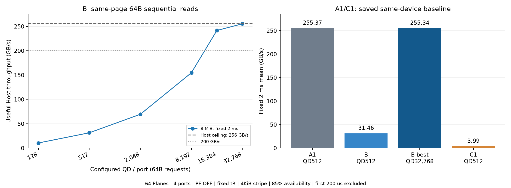
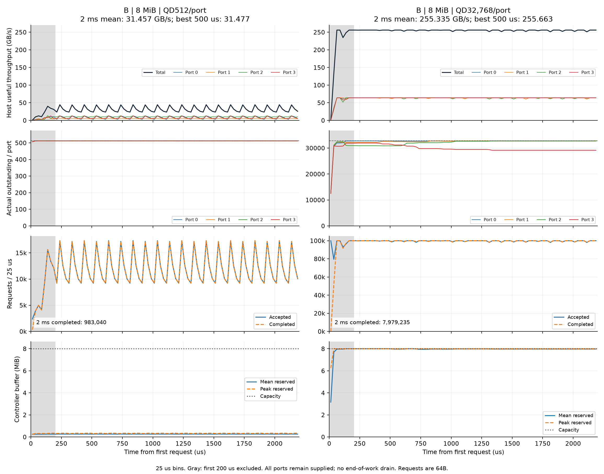

# 새 B: 페이지 내부 64B 연속 읽기 성능
> **2026-10-11 후속 교차 검증:** [최신 결론·17장 발표 자료·원자료](17_placement_qd_crosscheck_ko.md). 영역별 배치에서 A1/A2/B는 CA FIFO로 기존 최고 처리량을 유지했다. 큰 QD의 낙폭은 고정 수락 순서의 버퍼 편중과 연결되며, 같은 큰 QD에서도 순환 수락으로 회복했다. 아래의 과거 스케줄링 이득과 QD 결과는 각각의 실험 조건에 한정해 해석한다.

2026-10-11 측정. B는 4KiB 논리 페이지의 offset 0, 64, …, 4032를 요청 64개로 읽고 다음 페이지로 이동한다. 기존 희소 64B 읽기 B1/B2는 현재 C1/C2다.

## 결과

측정한 6개 조건 중 최고 고정 2ms 평균은 **255.335GB/s**다. 조건은 **8MiB·QD32,768/Port**, 고정 2ms 평균은 Host 상한 256GB/s의 99.74%다. 최고 연속 500µs는 **255.663GB/s**다. 이번 측정 중 200GB/s를 넘긴 최소 QD는 16,384/Port다. 측정하지 않은 중간 QD까지 포함한 정확한 경계값은 아니다.

| 버퍼 MiB | QD/Port | 2ms 평균 GB/s | 최고 500µs GB/s | 실제 outstanding 합계 | 버퍼 평균 MiB | 완료 요청 수 | Long tR |
|---:|---:|---:|---:|---:|---:|---:|---:|
| 8 | 128 | 10.486 | 10.879 | 512.0 | 0.128 | 327,680 | 0.000% |
| 8 | 512 | 31.457 | 31.477 | 2,048.0 | 0.260 | 983,040 | 0.000% |
| 8 | 2,048 | 69.468 | 69.720 | 8,192.0 | 0.625 | 2,170,880 | 0.000% |
| 8 | 8,192 | 154.680 | 154.728 | 32,768.0 | 2.161 | 4,833,735 | 0.000% |
| 8 | 16,384 | 241.611 | 242.319 | 65,536.0 | 4.197 | 7,550,354 | 0.000% |
| 8 | 32,768 | 255.335 | 255.663 | 127,441.2 | 7.981 | 7,979,235 | 0.000% |

공통 조건: 4Port 공유 4Channel, Channel당 16Plane(총 64), 16KiB NAND 물리 페이지, 4KiB stripe, 기존 개선 영역 배치, PF OFF, availability 85%, Port 내부 in-order, head_locality·bypass32·head_wait48.64µs. Controller buffer는 기존 임시 버퍼 정책이다.

## 무엇을 의미하나

1. **동일 QD512에서는 B가 31.457GB/s다.** 같은 장치 설정의 저장된 A1은 255.366GB/s, C1은 3.995GB/s다. A1은 요청당 4KiB, B/C1은 64B이므로 같은 QD라도 대기 데이터량이 다르다.
2. **B는 페이지를 전부 소비하지만, 충분한 병렬 요청을 확보해야 한다.** QD512의 B는 Port당 32KiB, A1은 2MiB다. B에서 2MiB를 확보하려면 QD32,768이 필요하다. B의 연속 64개 요청이 하나의 논리 페이지에 모이므로 QD 증가가 새로 보이는 NAND 페이지/Plane 수를 늘린다. 관측된 QD별 처리량 증가가 이 효과를 보여준다.
3. **낮은 QD의 첫 병목은 8MiB 버퍼 용량이 아니다.** QD512의 버퍼 평균 예약량은 0.260MiB다. 최고 측정 조건에서는 평균 7.981MiB, 전체 관측 중 최대 8.000MiB다. 버퍼 용량만 키우고 QD를 고정한 대조 실험은 이번에 수행하지 않았다.
4. **기존 C1의 낮은 유효 데이터 활용률과 구분한다.** 최고 B 조건의 구간 Host/NAND payload 비율은 99.737%이고 NAND read amplification은 1.0026배다. C1은 4KiB당 64B만 소비하여 명목 비율이 1/64다. B는 같은 물리 페이지에 패킹된 데이터를 끝까지 소비한다. 항상 cache hit을 강제한 결과가 아니다.
5. **tR은 바꾸지 않았다.** first/group 20.69µs, short 2.00µs, mid 2.08µs, long 12.16µs다. 최고 조건에서 측정 창 내 sensing 횟수는 {"first": 0, "short": 15624, "mid": 15622, "long": 0, "group": 0}, Long 비율은 0.000%다. Plane page-buffer hit는 sensing 횟수 분모에 포함하지 않는다.

## 작은 QD에서 드러난 재사용 조건

QD128/Port에서는 Host 10.486GB/s, NAND 41.943GB/s로 유효 활용률이 25%, NAND read amplification이 4배였다. 같은 논리 페이지를 64B씩 끝까지 읽더라도 4KiB stripe 배치에서는 물리 16KiB 안에 들어 있는 나머지 논리 페이지의 요청이 충분히 일찍 수락되어야 한다. 이 모델은 현재 연결된 요청을 모두 반환하면 임시 Controller buffer 항목을 해제한다. 다음 논리 페이지 부분이 늦게 도착하면 NAND에서 16KiB를 다시 전송한다. Plane page buffer가 남아 있으면 재전송 때 sensing tR은 생략할 수 있으므로, tR 감소와 NAND 출력량 감소는 별도 지표다.

QD512 이상에서 측정된 약 100% 활용률은 이러한 재전송이 크게 줄어든 결과다. 따라서 **B의 페이지 전체 소비가 항상 한 번의 내부 NAND 출력 또는 항상 cache hit을 보장하지는 않는다.** 아래 전송량은 동일한 고정 2ms 창으로 계산했다.

| QD/Port | Host GB/s | NAND GB/s | Host/NAND payload | NAND read amplification |
|---:|---:|---:|---:|---:|
| 128 | 10.486 | 41.943 | 25.000% | 4.0000배 |
| 512 | 31.457 | 31.457 | 100.000% | 1.0000배 |
| 2,048 | 69.468 | 69.468 | 100.000% | 1.0000배 |
| 8,192 | 154.680 | 154.673 | 100.004% | 1.0000배 |
| 16,384 | 241.611 | 241.639 | 99.988% | 1.0001배 |
| 32,768 | 255.335 | 256.008 | 99.737% | 1.0026배 |

## 측정 방식과 시간 변화

첫 요청부터 2,200µs까지 계속 요청을 공급한다. 초기 200µs를 제외한 **200–2,200µs 고정 2ms 평균**을 주 지표로 사용한다. 모든 명령의 처리 완료를 기다리거나 마지막 Port만 남는 drain 구간을 포함하지 않는다. 실제 outstanding은 AR 수락 후 최종 R 완료 전 요청 수다.

최고 조건의 실제 outstanding 합계 평균은 127,441.2, Port별 평균은 [32703.51, 32643.69, 32213.17, 29880.8]다. 2ms 동안 완료한 64B 요청은 **7,979,235개**, Port별 처리량은 [64.0, 63.714, 63.624, 63.997]GB/s다. 전반 1ms 대비 후반 1ms 변화는 -0.159%다.





그림은 25µs bin이다. 회색 초기 구간은 평균에서 제외한다. Port별 outstanding이 같으면 선이 겹친다. Host 처리량은 창과 겹치는 반환 바이트, 완료 요청 수는 창 안에서 최종 반환이 끝난 요청으로 계산한다. NAND는 창 안에서 완료한 16KiB 전송 바이트다. 창 경계 때문에 Host/NAND 비율이 소폭 100%를 넘거나 read amplification이 소폭 1보다 작을 수 있다.

## 계측 경계 수정과 실행 검증

QD32,768의 최초 실행은 시뮬레이션 종료 후 시간 bin 검증에서 중단되어 결과로 사용하지 않았다. 기존 계측은 bin 끝에서 1e-9µs보다 짧은 구간을 생략하면서, 그 구간에 일어난 완료 이벤트를 outstanding 끝값에 반영하지 못했다. 새 계측은 엄밀한 `[시작, 끝)` 기준으로 요청 카운터·점유율·NAND 전송을 함께 집계한다. 기존 NAND/controller core와 과거 계측 소스는 보존하고 새 `read64_observation.py`를 사용한다.

재실행의 `--fast-pf-off`은 PF OFF에서 존재할 수 없는 무참조 ready 항목의 퇴거 후보 스캔을 생략한다. 같은 capacity 부등식·Port 선두 예약·수락 순서를 유지한다. 새로 발행 가능한 NAND 작업을 만들지 않는 Host 반환·timer와 이미 eligible한 페이지의 반복 lookup 이벤트에서는 중복 dispatch 스캔도 생략한다. 실제 NAND/maintenance 이벤트와 최초 lookup에서는 기존 dispatch 함수를 그대로 호출한다. 이 최적화는 시뮬레이터의 CPU 계산량을 줄이며 장치 시간을 줄이지 않는다. 버퍼가 부족한 B/C 조건에서 **모든 요청 타임스탬프, 장치 카운터, 버퍼 예약 이벤트, sensing/전송 이벤트가 기존 실행과 정확히 같은지** 회귀 검증했다. 저장된 C1과 B·QD16,384의 전체 2ms 실행도 대조하여 장치 카운터와 정수 계측값은 모두 일치했다. 실수 계측값의 최대 차이는 C1 약 5.1e-11, B 약 1.3e-9였으며 처리량 평균은 일치했다.

앞서 완료한 다섯 조건의 기존 수치는 보존했다. `observer_v1_manifest.json`에 당시 hash를, 현재 manifest에 수정된 계측 hash를 기록한다. 마지막 QD32,768은 수정 계측으로 재실행한 값만 사용한다.

## 재현과 범위

```sh
python3 -m znand.b_sequential_measure --qds 128 512 2048 8192 16384 32768 --buffers 8 --workers 1 --fast-pf-off
python3 -m znand.b_sequential_measure --validate-only
python3 -m znand.b_sequential_report
```

그림 생성에는 requirements-znand-plot.txt의 matplotlib이 필요하다. 이미 존재하는 완료 결과는 덮어쓰지 않고 검증하여 사용한다. QD·buffer를 제외한 장치 설정이 A1 기준과 일치하는지, 시간 창 재계산, outstanding/요청 수 보존식, NAND 전송량, source hash를 확인했다. 전체 82개 테스트가 통과했다.

- [원시 결과와 실행 조건](../results/znand/b_sequential/)
- [검증 결과](../results/znand/b_sequential/validation.json)
- [A1/C1의 설정·배치 일치 검증](../results/znand/b_sequential/reference_validation.json)
- [전체 결과 CSV](../results/znand/b_sequential/sweep.csv)
- [모델·입력 hash](../results/znand/b_sequential/manifest.json)
- [계측 수정 및 기존 C1 대조 검증](../results/znand/b_sequential/observer_v2_validation.json)

모델 core SHA256: `755f822a6b7c1f44f65117b4892078419a766d4963ad4d49931e8aa1db679baf`. 기존 측정과 동일하다. 고정 seed 7과 정적 합성 L2P 배치의 시뮬레이션이며, 실제 하드웨어 측정 또는 모든 배치의 전역 최대값이 아니다. 큰 AXI outstanding의 요청 상태 메타데이터/구현 비용은 이 payload 버퍼 모델에 포함하지 않는다. 여기의 QD는 Port별 미완료 요청 수이며 AXI ID 개수를 직접 모델링한 값이 아니다. 4KiB stripe 외 배치 비교, 동일 QD에서의 버퍼 변경, 실제 동적 L2P는 후속 튜닝 항목이다.
