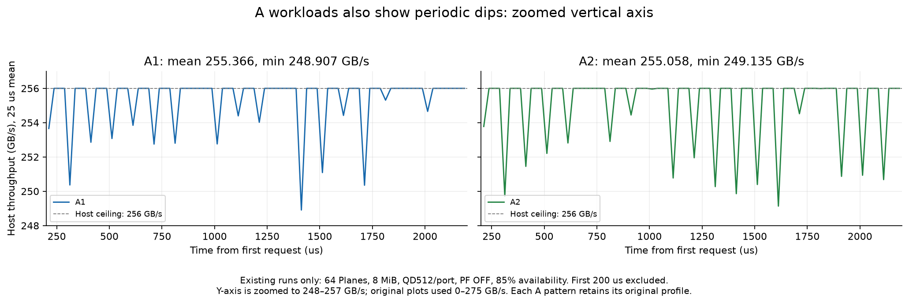

# A 워크로드에도 주기적 하락이 있는가

2026-10-11. 기존 A1/A2/B1/B2 8MiB·QD512/port 실행의 시간 데이터를 재분석했다. 새 모델 변경이나 수치 실험은 없다.

**A에서도 같은 100µs 간격의 작은 하락이 보인다.** 기존 A 그래프의 세로축이 0–275GB/s여서 작은 낙폭이 덜 드러났다.

64Plane, PF OFF, 가용률 85%, 초기 200µs를 제외한 200–2,200µs의 고정 2ms에서 25µs bin을 비교한다.

| 패턴 | 평균 GB/s | 최저 25µs GB/s | 최고 25µs GB/s | 표준편차/평균 |
|---|---:|---:|---:|---:|
| A1 | 255.3659 | 248.9071 | 256.0000 | 0.582% |
| A2 | 255.0583 | 249.1350 | 256.0000 | 0.767% |
| B1 | 3.9946 | 2.3347 | 5.2129 | 19.565% |
| B2 | 4.0007 | 2.4934 | 5.2045 | 17.221% |

A1/A2는 대부분 25µs 구간에서 Host 상한 256GB/s를 유지하고, 100µs 간격으로 몇 GB/s 내려간다. 기존 그림에서 하락이 없는 것으로 보였다면 세로축 범위와 상대 낙폭 차이를 함께 봐야 한다.

## 4KiB 반환이 지연을 흡수하는 방식

현재 port당 512bit·1GHz에서 A의 4KiB 응답은 64ns, B의 64B 응답은 1ns다. 앞선 ready 요청들을 반환하는 동안 NAND는 뒤쪽 요청의 데이터를 계속 준비할 수 있다. A는 반환에 더 긴 시간이 걸리므로 뒤쪽 요청이 선두가 될 때까지 준비할 시간이 더 많다. B는 준비된 작은 응답을 빠르게 소진해 미준비 선두에 더 빨리 도달하며, 준비 완료 후 누적 응답도 빠르게 반환한다.

예를 들어 한 port에 앞선 256개 요청이 연속해서 ready인 상황을 가정하면, 순수 Host 반환 시간은 A에서 `256×64ns=16.384µs`, B에서 `256×1ns=0.256µs`다. 그동안 뒤쪽 페이지의 유지보수·sensing이 진행되므로 선두 정지가 드러나는 정도가 달라질 수 있다. 이는 동작 설명용 예시이며 실제 모든 port에 항상 ready 256개가 있다는 가정은 사용하지 않는다.

A는 256GB/s Host 상한 근처에서 반환을 이어가고, B는 평균 유효 처리량 약 4GB/s에 비해 훨씬 빠른 Host IF로 ready 응답을 방출한다. 따라서 B의 짧은 구간에는 빠른 반환과 대기가 번갈아 나타나지만 장기 평균은 내부 유효 데이터 공급량에 맞춰진다. 큰 outstanding 수 자체는 그 요청들이 모두 ready라는 의미가 아니다.

## 비교 범위와 원인 근거

요청 크기의 효과는 **장치 설정과 mapping이 같은 A1/B1 쌍**을 기준으로 해석했다. A2는 기존 16KiB stripe/locality 프로파일, B2는 4KiB stripe/head_locality 프로파일이므로 A2/B2의 차이를 요청 크기만의 효과로 단정하지 않는다. A1/B1의 snapshot 경로 외 모든 장치 설정과 mapping hash가 동일함을 확인했다.

[B 유지보수 대조](../partial_dips/RESULTS_KO.md)에서는 maintenance를 끄면 큰 주기적 낙폭이 거의 사라졌고, in-order 선두 정지 중 이미 준비된 후속 요청도 관측했다. A에는 같은 가용률 모델이 적용되며 위 원시 시간 데이터에도 주기성이 보인다. 이번 A 재분석에서 maintenance OFF를 추가 실행한 것은 아니다.

기준 tR·85% 가용률·in-order는 그대로 유지한다. 현재 100µs 주기는 비효율을 구현한 모델 파라미터이며 실제 GC 주기를 뜻하지 않는다. 평균 성능과 함께 시간별 min/max·상대 변동·선두 대기를 후속 평가 지표로 유지한다.

재현: `python3 -m znand.a_b_dip_comparison` (그래프 생성에 matplotlib 필요). `manifest.json`에 원시 입력과 출력의 hash, `summary.json`에 집계 값을 보존한다.
