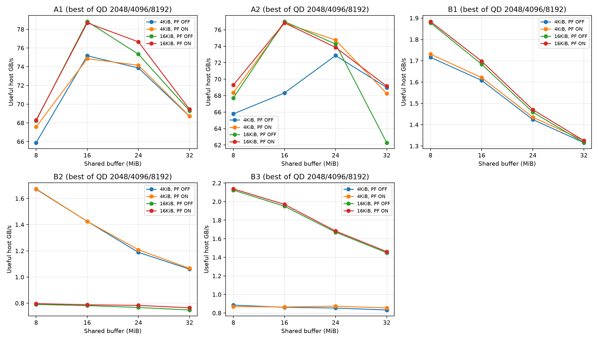

# 4port Controller buffer 확대 비교

기존 8MiB와 16·24·32MiB를 비교했다. 4port, port당 8,192개 요청, seed 7, NAND 가용률 85%, 동일 모델을 사용했다. 8MiB 60개는 해시가 일치하는 기존 extended 결과를 재사용하고 180개를 추가 실행했다. 모든 240행에 대해 별도 회계 검증을 통과했다.

각 버퍼에서 A1/A2/B1/B2/B3 × 4KiB/16KiB 분산 × Prefetch OFF/ON × Outstanding 2,048/4,096/8,192를 비교했다. Prefetch ON은 정확도 100%, lead 10μs, 미사용 후보 상한 128개다. 버퍼만 늘릴 때 후보 상한을 비례 확대하지 않았다.

## 패턴별 관측 최고값

각 칸은 해당 버퍼에서 배치·Prefetch·Outstanding을 비교해 고른 최고값이다. 따라서 버퍼 단독 효과는 아래 동일 조건 비교와 matched_comparison.csv를 사용한다. 단위는 유효 Host GB/s다.

| 패턴 | 8MiB | 16MiB | 24MiB | 32MiB |
|---|---:|---:|---:|---:|
| A1 | 68.290 | 78.824 | 76.659 | 69.441 |
| A2 | 69.282 | 77.001 | 74.749 | 69.150 |
| B1 | 1.884 | 1.698 | 1.471 | 1.326 |
| B2 | 1.674 | 1.425 | 1.208 | 1.066 |
| B3 | 2.137 | 1.970 | 1.683 | 1.461 |

## 최고 조건 상세

| 패턴 | MiB | GB/s | 분산 KiB | PF | QD/port | 실제 QD peak | p99 μs | offer 기준 평균 μs |
|---|---:|---:|---:|---|---:|---:|---:|---:|
| A1 | 8 | 68.290 | 16 | True | 2048 | 2048 | 236.682 | 802.174 |
| A1 | 16 | 78.824 | 16 | False | 4096 | 4084 | 477.613 | 751.272 |
| A1 | 24 | 76.659 | 16 | True | 8192 | 5844 | 654.915 | 837.357 |
| A1 | 32 | 69.441 | 16 | True | 8192 | 6464 | 853.842 | 964.925 |
| A2 | 8 | 69.282 | 16 | True | 2048 | 2048 | 229.162 | 784.914 |
| A2 | 16 | 77.001 | 16 | False | 4096 | 4084 | 477.903 | 773.641 |
| A2 | 24 | 74.749 | 4 | True | 8192 | 5856 | 654.867 | 856.531 |
| A2 | 32 | 69.150 | 16 | True | 8192 | 6464 | 853.841 | 968.104 |
| B1 | 8 | 1.884 | 16 | True | 2048 | 2048 | 231.303 | 684.220 |
| B1 | 16 | 1.698 | 16 | True | 4096 | 4096 | 461.628 | 804.866 |
| B1 | 24 | 1.471 | 16 | True | 8192 | 6144 | 695.664 | 953.848 |
| B1 | 32 | 1.326 | 4 | True | 8192 | 6656 | 935.464 | 1080.468 |
| B2 | 8 | 1.674 | 4 | True | 2048 | 2047 | 244.898 | 782.247 |
| B2 | 16 | 1.425 | 4 | True | 4096 | 4096 | 477.241 | 969.314 |
| B2 | 24 | 1.208 | 4 | True | 8192 | 6144 | 717.611 | 1148.941 |
| B2 | 32 | 1.066 | 4 | True | 8192 | 6272 | 949.171 | 1295.180 |
| B3 | 8 | 2.137 | 16 | True | 4096 | 2729 | 241.898 | 617.846 |
| B3 | 16 | 1.970 | 16 | True | 8192 | 5461 | 473.765 | 705.637 |
| B3 | 24 | 1.683 | 16 | True | 8192 | 6512 | 707.412 | 842.864 |
| B3 | 32 | 1.461 | 16 | True | 8192 | 6656 | 947.368 | 968.205 |

## 동일 조건에서 버퍼만 변경

8MiB 최고 성능을 낸 A계열 조건을 고정한 비교다.

고정 조건: A2, stripe 16KiB, PF True, Outstanding 2048/port.

| MiB | GB/s | 실제 QD peak | 예약 buffer peak MiB | p99 μs |
|---|---:|---:|---:|---:|
| 8 | 69.282 | 2048 | 8.000 | 229.162 |
| 16 | 50.765 | 2048 | 16.000 | 442.177 |
| 24 | 45.745 | 2048 | 24.000 | 680.950 |
| 32 | 37.083 | 2048 | 32.000 | 939.856 |

## 관찰과 다음 튜닝

- 4KiB 읽기인 A1/A2의 비교 범위 내 최고값은 16MiB였다. A1은 78.824GB/s(8MiB 최고 대비 +15.4%), A2는 77.001GB/s(+11.1%)다. 둘 다 16KiB 분산, PF OFF, QD4,096/port다.
- 24/32MiB가 16MiB를 넘지 못했고, B1/B2/B3는 각 용량에서 설정을 고른 최고값도 8MiB보다 낮았다. 현 정책에서 용량 증가를 일괄 적용할 근거는 없다.
- A1·16KiB 분산·PF OFF는 모든 조건에서 sensing 8,192회였다. 16MiB에서 QD2,048→4,096으로 늘리자 Long sensing이 4,963→1,337회, 처리량이 50.179→78.824GB/s로 바뀌었다. 요청 수보다 실제 발행 순서와 tR 구성이 중요하다.
- A1 최고 조건의 수락 이후 p99는 8MiB 236.682μs→16MiB 477.613μs로 늘었지만, 제시부터 반환까지의 평균은 802.174→751.272μs로 줄었다. 수락 시점이 달라지므로 p99만으로 사용자 체감 지연 전체를 판단하지 않는다.
- 현 모델에서 처리량 중심 A계열 후보는 16MiB·QD4,096이고 B계열은 8MiB 설정을 유지해 비교하는 편이 타당하다. 실제 최적값 확정 전 admission과 Plane-local locality를 유지하는 내부 중재를 함께 평가한다.
- 64MiB 및 64Plane 조합은 이번 범위에 포함하지 않았다. 사용자 요청의 16·24·32MiB 비교를 완료했으며, Word 문서의 64MiB 제안과 원격 64Plane 진단은 별도 후속 항목이다.

## 해석 시 주의

- 유한 길이 합성 trace이며 실제 제품의 최대 성능이나 정상 상태를 보장하지 않는다. 8,192 QD 설정은 port당 총 요청 수와 같아 trace 길이 제약을 확인해야 한다.
- 8MiB의 이전 전체 관측 최고 72.27GB/s는 port당 4,096개 요청 조건이다. 본 비교의 8MiB 기준은 같은 8,192개 요청 조건의 최고 69.28GB/s이며 두 trace를 섞지 않는다.
- buffer_peak_pages는 payload만이 아니라 Host 수락 시 예약 공간도 포함한다. 버퍼 확대는 수락·물리 발행 순서까지 바꾸므로 용량과 scheduling 효과가 함께 나타난다.
- Lookup slot 500/port, Plane 32개, CA/Data 자원과 Prefetch 후보 상한은 유지했다. 확대 후 병목이 다른 자원으로 이동할 수 있다.
- 캐시/LRU는 미도입이며 요청 반환 이후 버퍼 해제 정책을 유지했다.
- 1개 seed·비중첩 port 영역을 사용했다. 실험한 최대 버퍼가 실제 최적 용량이라고 단정하지 않는다.

원본: [sweep.csv](sweep.csv), [동일 조건 비교](matched_comparison.csv), [최고 조건](best_by_pattern.csv), [재현 입력](cases.json), [실행 검증](manifest.json).
