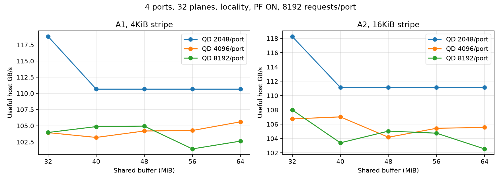

# Locality 정책에서 Controller buffer 8MiB 단위 확대

이번 비교 범위에서는 32MiB가 다섯 패턴 모두 가장 높은 처리량을 보였다. A1/A2는 QD2,048/port에서 각각 118.780/118.257GB/s였고, 40MiB부터는 각각 110.653/111.147GB/s로 6.84%/6.01% 감소했다. 같은 QD에서 40~64MiB의 예약 peak는 약 34MiB이며 수락 실패가 없어, 추가 용량으로 해소할 버퍼 제한이 남지 않았다. 이 결과만으로 물리 용량을 확대하기보다 reservation과 내부 발행 정책을 분리해 튜닝하는 쪽이 우선이다.

4port·32Plane·locality 정책·PF ON(합성 정확도 100%, 선행 10μs)·port당 8,192개 요청·seed 7·port별 비중첩 주소를 유지했다. 32·40·48·56·64MiB를 비교하며 A1/A2는 QD2,048/4,096/8,192를 모두 평가했다. B1/B2/B3는 QD8,192로 고정한 보조 비교다. Stripe는 A1/B1/B2가 4KiB, A2/B3가 16KiB로 고정했다. MiB는 1,048,576 bytes이며 공유 버퍼 전체 용량이다.

총 45개 비교 조건이다. 기존 동일 모델·동일 조건 6개를 재사용하고 신규 39개를 실행했다. 기존 결과의 모델 해시를 확인했고 저장된 45행의 요청량·대역폭 상한·지연 분해·자원 제한을 검증했다.

## 처리량 요약

A1/A2는 평가한 세 QD 중 최고값이며 B계열은 고정 QD8,192 결과다. 단위는 GB/s다.

| 패턴 | 32MiB | 40MiB | 48MiB | 56MiB | 64MiB |
|---|---:|---:|---:|---:|---:|
| A1 | 118.780 | 110.653 | 110.653 | 110.653 | 110.653 |
| A2 | 118.257 | 111.147 | 111.147 | 111.147 | 111.147 |
| B1 | 2.347 | 2.236 | 2.261 | 2.257 | 2.257 |
| B2 | 2.320 | 2.210 | 2.292 | 2.239 | 2.239 |
| B3 | 3.006 | 2.897 | 2.893 | 2.814 | 2.814 |



## A1/A2의 Outstanding별 비교

| 패턴 | QD/port | 32MiB | 40MiB | 48MiB | 56MiB | 64MiB |
|---|---:|---:|---:|---:|---:|---:|
| A1 | 2048 | 118.780 | 110.653 | 110.653 | 110.653 | 110.653 |
| A1 | 4096 | 103.937 | 103.195 | 104.191 | 104.267 | 105.606 |
| A1 | 8192 | 103.960 | 104.868 | 104.941 | 101.423 | 102.624 |
| A2 | 2048 | 118.257 | 111.147 | 111.147 | 111.147 | 111.147 |
| A2 | 4096 | 106.741 | 107.025 | 104.181 | 105.431 | 105.555 |
| A2 | 8192 | 107.993 | 103.400 | 105.035 | 104.749 | 102.549 |

## 각 용량의 최고 처리량 조건과 자원 사용

예약 peak는 실제 payload뿐 아니라 미도착 데이터의 예약 공간을 포함한다. QD peak는 port별 최댓값 중 최대이며 전체 port 합계가 아니다. Buffer stall은 실패한 수락 시도 횟수이며 시간 비율이 아니다. 평균·p99 offer 지연은 요청 제시부터 최종 반환까지로, 수락 대기도 포함한다.

| 패턴 | 용량 MiB | QD/port | 실제 QD peak/port | 예약 peak MiB | Buffer stall 횟수 | 평균 offer μs | p99 offer μs | Long % |
|---|---:|---:|---:|---:|---:|---:|---:|---:|
| A1 | 32 | 2048 | 2048 | 32.000 | 215713 | 371.10 | 605.75 | 10.53 |
| A1 | 40 | 2048 | 2048 | 34.234 | 0 | 422.19 | 688.74 | 11.85 |
| A1 | 48 | 2048 | 2048 | 34.234 | 0 | 422.19 | 688.74 | 11.85 |
| A1 | 56 | 2048 | 2048 | 34.234 | 0 | 422.19 | 688.74 | 11.85 |
| A1 | 64 | 2048 | 2048 | 34.234 | 0 | 422.19 | 688.74 | 11.85 |
| A2 | 32 | 2048 | 2048 | 32.000 | 169366 | 362.08 | 610.74 | 10.57 |
| A2 | 40 | 2048 | 2048 | 34.062 | 0 | 404.68 | 683.35 | 12.51 |
| A2 | 48 | 2048 | 2048 | 34.062 | 0 | 404.68 | 683.35 | 12.51 |
| A2 | 56 | 2048 | 2048 | 34.062 | 0 | 404.68 | 683.35 | 12.51 |
| A2 | 64 | 2048 | 2048 | 34.062 | 0 | 404.68 | 683.35 | 12.51 |
| B1 | 32 | 8192 | 6387 | 32.000 | 351803 | 485.75 | 880.90 | 4.04 |
| B1 | 40 | 8192 | 7040 | 40.000 | 324608 | 501.62 | 925.38 | 5.30 |
| B1 | 48 | 8192 | 7040 | 48.000 | 295369 | 491.25 | 914.65 | 5.18 |
| B1 | 56 | 8192 | 7040 | 56.000 | 266927 | 492.03 | 915.80 | 5.86 |
| B1 | 64 | 8192 | 7040 | 64.000 | 238118 | 492.03 | 915.80 | 5.86 |
| B2 | 32 | 8192 | 6356 | 32.000 | 351357 | 488.45 | 888.97 | 4.49 |
| B2 | 40 | 8192 | 7024 | 40.000 | 321426 | 503.84 | 934.01 | 5.46 |
| B2 | 48 | 8192 | 7040 | 48.000 | 291591 | 493.46 | 902.18 | 5.24 |
| B2 | 56 | 8192 | 7040 | 56.000 | 266391 | 493.10 | 921.43 | 5.86 |
| B2 | 64 | 8192 | 7040 | 64.000 | 237590 | 493.10 | 921.43 | 5.86 |
| B3 | 32 | 8192 | 6656 | 32.000 | 294302 | 382.97 | 687.17 | 5.26 |
| B3 | 40 | 8192 | 6656 | 40.000 | 257173 | 382.84 | 710.96 | 6.77 |
| B3 | 48 | 8192 | 6656 | 48.000 | 220846 | 380.13 | 712.71 | 6.77 |
| B3 | 56 | 8192 | 6656 | 56.000 | 186296 | 384.78 | 732.96 | 7.81 |
| B3 | 64 | 8192 | 6656 | 64.000 | 150696 | 384.78 | 732.96 | 7.81 |

## 버퍼 병목 판정

A1/A2의 기존 최고 조건인 QD2,048/port를 고정해 확인했다. 용량·case ID·출처 필드를 제외한 모든 저장 필드를 비교했으며 결과는 [capacity_check.json](capacity_check.json)에 보관한다.

- A1: 40~64MiB에서 예약 peak 34.234MiB, buffer 수락 실패 0회다. 모든 성능 지표·계수가 완전히 같으므로 이 조건에서는 40MiB를 넘는 추가 공간이 사용되지 않았다.
- A2: 40~64MiB에서 예약 peak 34.062MiB, buffer 수락 실패 0회다. 모든 성능 지표·계수가 완전히 같으므로 이 조건에서는 40MiB를 넘는 추가 공간이 사용되지 않았다.

32→40MiB의 같은 QD2,048 조건에서는 다음 변화가 관측됐다. Return wait는 데이터·조회 준비 후 R 시작까지의 시간이며 port in-order 선두 대기와 반환 경로 대기가 포함된다.

| 패턴 | 용량 MiB | GB/s | Long % | 평균 return wait μs | 평균 수락 대기 μs |
|---|---:|---:|---:|---:|---:|
| A1 | 32 | 118.780 | 10.53 | 87.08 | 141.95 |
| A1 | 40 | 110.653 | 11.85 | 127.97 | 169.16 |
| A2 | 32 | 118.257 | 10.57 | 78.08 | 134.25 |
| A2 | 40 | 111.147 | 12.51 | 104.34 | 155.83 |

용량 확대는 수락·Prefetch 진입 순서도 바꾼다. 이때 Long sensing 비율과 반환 대기가 함께 증가했다. 각 요인의 인과 기여도를 분리한 실험은 아니므로 Long tR 하나만으로 감소분 전체를 설명하지 않는다. Buffer 수락 실패가 0회여도 Outstanding 한도에 의한 수락 대기는 남을 수 있다.

다음 튜닝에서는 물리 용량과 예약 window를 분리하고, port 선두 응답 진행을 고려한 내부 발행 및 Prefetch 진입량을 비교한다. 외부 port 내부 in-order 반환은 유지한다. 요청 수·주소 범위를 늘려 현재 유한 요청열에 대한 민감도도 확인한다.

## 해석 시 주의

- 물리 buffer 용량과 admission 예약 한도는 기존 모델처럼 결합되어 있다. 변화에는 수락·발행 순서의 변화도 포함된다.
- 예약 peak가 용량에 도달했다고 처리량의 유일한 병목이 buffer라는 뜻은 아니다. 여유 공간, 수락 실패, QD 증가 효과와 처리량을 함께 본다.
- QD8,192는 port당 전체 요청 수와 같다. 본 결과는 유한 요청열의 비교이며 장시간 정상 상태나 전역 최대 성능을 보장하지 않는다.
- B계열은 QD8,192 단일 값으로 확인했으므로 B계열의 최적 QD를 탐색한 결과는 아니다.
- 32Plane·locality 우회 8회·age 1,000μs·PF 후보 상한 128개·평균 목표 가용률 85%를 유지했다. 64Plane 확장, 실제 GC, 동적 L2P, 실제 예측기는 평가하지 않았다.

## 재현

```sh
python3 -m znand.buffer_growth
python3 -m znand.buffer_growth_report
```

중간 결과가 있으면 조건과 모델 해시를 검증한 뒤 남은 조건만 실행한다. 그림 재생성에는 matplotlib이 필요하다. 원본: [sweep.csv](sweep.csv), [summary.csv](summary.csv), [cases.json](cases.json), [manifest.json](manifest.json).
