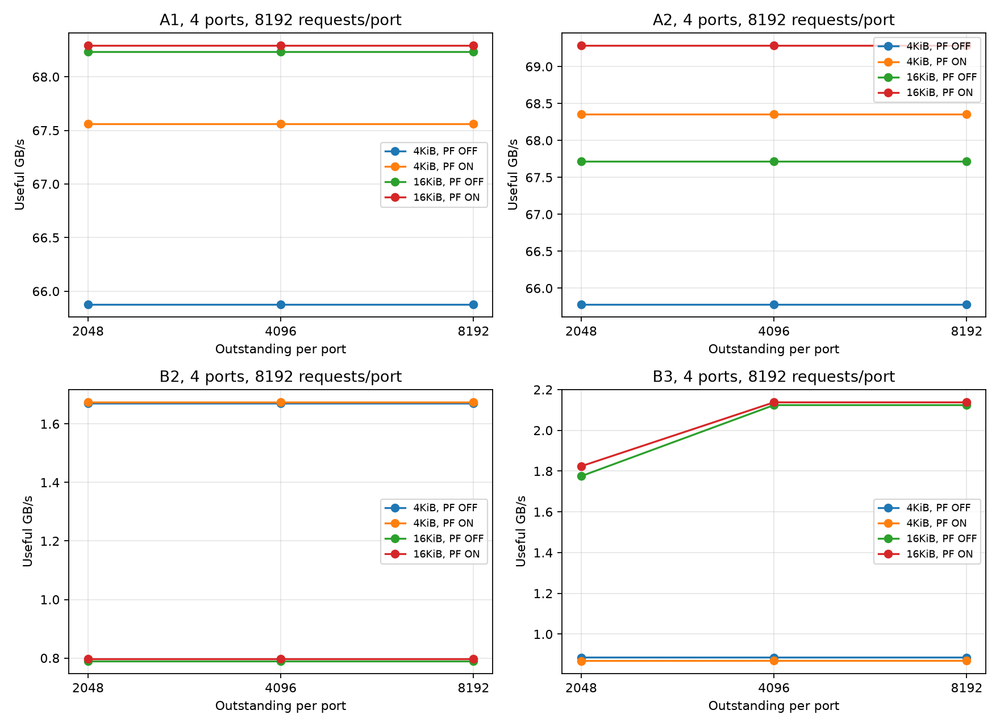
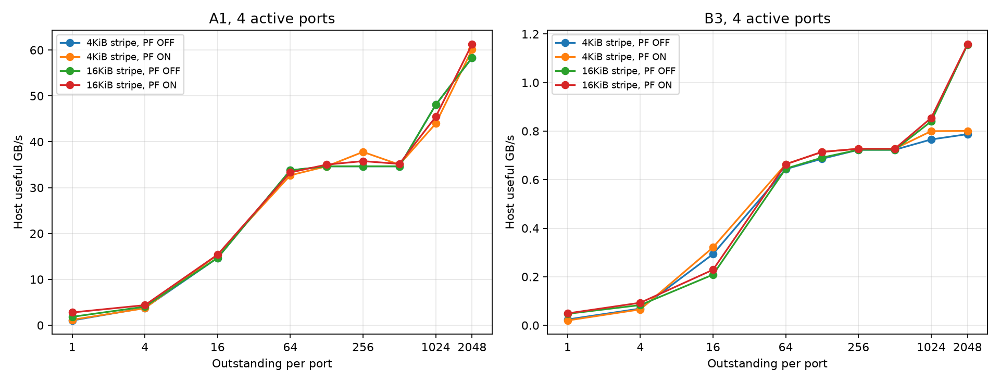
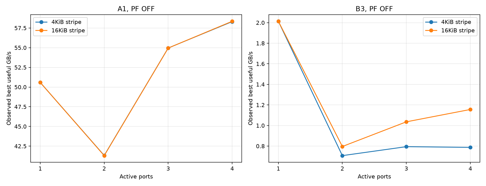
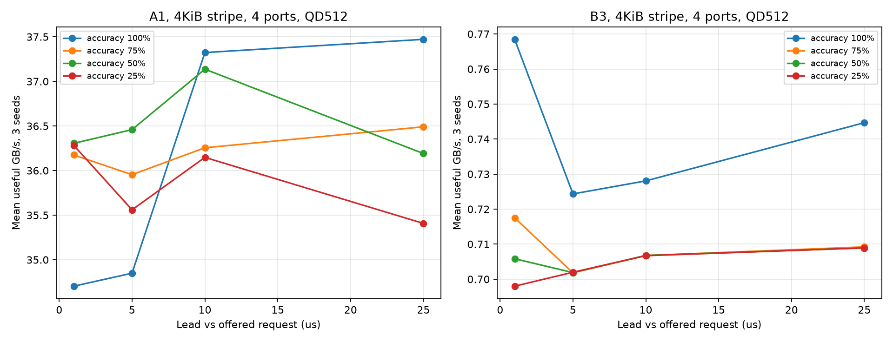

# zNAND Prefetch 모델 첫 평가 결과

합의한 초기 구조를 주소 기반 이벤트 모델로 구현하고 실행한 결과다. 실제 zNAND 측정값이나 구현된 예측기의 성능을 뜻하지 않는다. 원래 simulator 파일은 변경하지 않고 `znand/`에 별도 모듈을 추가했다.

- 전체 완료 실험: **1,488개**(기본·민감도 1,248개 + 상위 Outstanding 240개).
- 기본·민감도 실험: **1,248개**. 기본 trace는 port당 2,048개 요청이며 높은 Outstanding은 4,096개 요청으로 재확인했다.
- 기본 sweep: 고객 A-1/A-2/B-1/B-2/B-3, 활성 port 1~4, 4KiB/16KiB 분산, Prefetch OFF/ON, Outstanding 1~2,048.
- 추가 비교: 총 요청량 고정, port 간 50% 영역 중첩, 정확도·선행 시간, 버퍼 용량, 내부 작업 점유 주기, 합성 재배치, MQSim 사전 배치 변환.
- CSV의 bandwidth_gbps는 첫 Host 요청 제시부터 마지막 반환까지의 유효 데이터량/시간이다. Prefetch 사전 준비 시간을 포함한 지표는 inclusive_prefetch_gbps다.
- 지연은 요청 수락부터 마지막 반환까지이며, 수락 전 back-pressure는 mean_admission_wait_us와 mean_offer_latency_us에 별도 기록한다.

## 먼저 확인할 해석

- B2, 4port·PF OFF·QD2048: 4KiB 분산 0.938GB/s, 16KiB 분산 0.692GB/s. Long tR 횟수는 각각 869회와 1,393회다. NAND sensing 횟수는 2,052회와 2,054회다.
- B3, 4port·PF OFF·QD2048: 4KiB 분산 0.787GB/s, 16KiB 분산 1.156GB/s. Long tR 횟수는 각각 1,318회와 646회다. NAND sensing 횟수는 1,536회와 1,537회다.

이 비교에서는 읽기 횟수 차이보다 실제 발행 순서에 따른 Long 전환 차이가 크다. Outstanding 증가가 단순히 tR을 가리는 것뿐 아니라 버퍼 수락 순서와 port 간 물리 접근 순서를 바꿀 수 있다. 배치·스케줄링·부하 조건을 함께 평가해야 한다.

64B 패턴은 논리 4KiB 영역마다 일부만 요청하지만 NAND에서는 16KiB 전체를 가져온다. 따라서 NAND 전송 대역폭과 Host의 유효 대역폭을 혼동하지 않는다. 고정 후보 예산과 offered-time Prefetch 때문에 정확도 100%도 전체 요청을 미리 준비하는 이상적인 공급원이 아니다.

## 더 긴 trace와 상위 Outstanding 확인

추가 240개 조건에서 port당 8,192개 요청으로 QD2,048·4,096·8,192를 비교했다. **80/80개 그룹**에서 QD4,096→8,192 처리량 차이가 3% 미만이다. 실제 Outstanding peak도 함께 기록해 단순 설정값과 실현 동시성을 구분했다.

| 패턴 | 분산 | PF | 긴 trace 관측 최대 GB/s | 해당 QD | 실제 QD peak | p99 μs |
|---|---|---|---:|---:|---:|---:|
| A1 | 4KiB | OFF | 65.879 | 2048 | 2048 | 270.146 |
| A1 | 4KiB | ON | 67.563 | 2048 | 2048 | 228.549 |
| A1 | 16KiB | OFF | 68.235 | 2048 | 2048 | 270.214 |
| A1 | 16KiB | ON | 68.290 | 2048 | 2048 | 236.682 |
| A2 | 4KiB | OFF | 65.783 | 2048 | 2048 | 269.450 |
| A2 | 4KiB | ON | 68.357 | 2048 | 2048 | 227.836 |
| A2 | 16KiB | OFF | 67.717 | 2048 | 2048 | 269.650 |
| A2 | 16KiB | ON | 69.282 | 2048 | 2048 | 229.162 |
| B1 | 4KiB | OFF | 1.716 | 2048 | 2047 | 236.965 |
| B1 | 4KiB | ON | 1.731 | 2048 | 2048 | 231.303 |
| B1 | 16KiB | OFF | 1.877 | 2048 | 2048 | 237.216 |
| B1 | 16KiB | ON | 1.884 | 2048 | 2048 | 231.303 |
| B2 | 4KiB | OFF | 1.671 | 2048 | 2048 | 242.997 |
| B2 | 4KiB | ON | 1.674 | 2048 | 2047 | 244.898 |
| B2 | 16KiB | OFF | 0.790 | 2048 | 2048 | 241.978 |
| B2 | 16KiB | ON | 0.797 | 2048 | 2048 | 241.832 |
| B3 | 4KiB | OFF | 0.885 | 2048 | 2048 | 257.031 |
| B3 | 4KiB | ON | 0.869 | 4096 | 2729 | 256.247 |
| B3 | 16KiB | OFF | 2.124 | 4096 | 2729 | 242.039 |
| B3 | 16KiB | ON | 2.137 | 4096 | 2729 | 241.898 |

긴 trace 표와 아래 기본 trace 표는 요청량이 다르므로 수치 차이를 Outstanding만의 효과로 해석하지 않는다. 추가 원본은 `../extended/sweep.csv`, 요약은 `../extended/saturation.csv`다.



## 4port에서 관측한 최고 처리량

| 패턴 | 분산 | PF | 관측 최대 GB/s | 최대의 95% 도달 QD/port | 평균 지연 μs | p99 μs |
|---|---|---|---:|---:|---:|---:|
| A1 | 4KiB | OFF | 58.311 | 2048 | 124.789 | 275.376 |
| A1 | 4KiB | ON | 60.098 | 2048 | 115.543 | 236.682 |
| A1 | 16KiB | OFF | 58.355 | 2048 | 125.689 | 274.900 |
| A1 | 16KiB | ON | 61.299 | 2048 | 114.181 | 251.305 |
| A2 | 4KiB | OFF | 58.267 | 2048 | 125.203 | 274.603 |
| A2 | 4KiB | ON | 58.047 | 2048 | 117.472 | 232.526 |
| A2 | 16KiB | OFF | 56.437 | 2048 | 129.117 | 274.421 |
| A2 | 16KiB | ON | 59.417 | 2048 | 118.525 | 236.746 |
| B1 | 4KiB | OFF | 1.089 | 2048 | 114.800 | 254.556 |
| B1 | 4KiB | ON | 1.114 | 2048 | 112.217 | 243.818 |
| B1 | 16KiB | OFF | 1.091 | 2048 | 114.826 | 254.556 |
| B1 | 16KiB | ON | 1.114 | 2048 | 112.316 | 244.405 |
| B2 | 4KiB | OFF | 0.938 | 2048 | 131.794 | 254.781 |
| B2 | 4KiB | ON | 0.957 | 2048 | 129.150 | 253.722 |
| B2 | 16KiB | OFF | 0.692 | 2048 | 176.234 | 254.557 |
| B2 | 16KiB | ON | 0.692 | 2048 | 174.414 | 245.010 |
| B3 | 4KiB | OFF | 0.787 | 1024 | 194.551 | 269.529 |
| B3 | 4KiB | ON | 0.801 | 1024 | 190.495 | 258.732 |
| B3 | 16KiB | OFF | 1.156 | 2048 | 140.086 | 254.632 |
| B3 | 16KiB | ON | 1.159 | 2048 | 138.925 | 244.750 |

위 평균·p99는 관측 최대 처리량 조건의 값이다. QD95 지점의 지연과 같다고 해석하지 않는다. 정확한 조건은 saturation.csv와 sweep.csv에 있다.





## 포화 확인 범위

80개 기본 비교 그룹 중 **17개**에서 긴 trace의 QD1,024→2,048 처리량 차이가 3% 미만이었다. 이는 해당 workload·가정·유한 길이에서의 포화 후보이며 전체 제품의 전역 최대 성능 보장은 아니다.
조회 slot, 버퍼 수락 제약, in-order 대기, CA 및 Plane 처리율이 병목일 수 있다. Outstanding 증가로 처리량이 줄어드는 경우도 있으므로 가장 큰 QD를 최적값으로 정하지 않는다.

## Prefetch 결과 해석



100%는 미래 수요 페이지를 아는 합성 후보 정확도다. 후보는 물리 페이지별 최초 수요 시각에서 생성하며 동일 페이지 후보는 중복 제거한다. 선행 시간은 실제 수락 시각이 아니라 고정된 요청 제시 시각 기준이다. Outstanding으로 수락이 늦어지면 실효 선행 시간이 달라진다.
미사용 후보 상한 기본 128개이며 예산 초과 후보는 버린다. 따라서 100% 정확도라도 coverage가 100%라는 뜻이 아니다. 오예측은 별도 물리 주소에서 실제 NAND 작업을 수행하며 미래 정답을 이용해 즉시 폐기하지 않는다.

## MQSim 연동 범위

업스트림 MQSim을 지정 revision으로 빌드하고 사전 조건화의 실제 L2P를 CSV로 추출했다. 45,711개 중 전체 16KiB가 유효한 45,708개 매핑을 사용하고 부분 유효 3개는 제외했다. 출처 CSV·XML·추출 패치·revision·SHA256을 znand/mqsim에 보관했다.
입력은 4channel × 1chip × 4die × 2plane, 75% 초기 점유의 합성 streaming 사전 조건화다. 변환은 유효 LPA를 정렬해 조밀한 페이지 슬롯에 대응시키고 channel과 plane 위치를 보존한다. 물리 block/page는 q=block×64+page로 평탄화한 뒤 zNAND 주소 규칙으로 재해석한다. 따라서 네이티브 zNAND geometry나 GC 실행 이력을 그대로 재현한 결과가 아니다.
MQSim 결과의 latency를 사용하지 않는다. 변환한 배치에 우리 모델의 tR·SCA·조회·버퍼를 적용한다. 현재 데이터는 한 사전 상태의 예시이며 점유율·seed 확장이 필요하다.

## 초기 구현 가정과 제한

기존 multiport 기본 모델은 128channel·chip당 6plane의 공급 구성이었고 페이지의 데이터를 모두 소비하는 흐름이었다. 이번 모델은 합의한 4channel·총 32plane과 부분 Read를 사용하므로 이전 보고서의 256GB/s 부근 수치와 직접적인 개선·퇴보 비교를 하지 않는다.

- Channel당 8개의 독립 Plane 자원이며, Die/LUN의 추가 공유 제약은 적용하지 않았다. SCA CA와 Data는 분리했다.
- Page buffer 재출력도 CA 100ns를 가정한다. 신규 sensing 경로의 출력 명령 비용은 기존 단일 CA에 포함한 추상화다. 기존 turnaround 50ns와 ECC 200ns를 유지했다.
- 내부 작업은 Plane별 100μs 주기·15μs 점유, seed별 시차다. 진행 중 NAND 작업은 끊지 않고 점유 시작을 연기한다. 점유 중 page buffer 접근은 막되 내용은 유지한다. 상세 GC의 복사·erase·CA/Data 사용은 포함하지 않았다.
- 버퍼 교착 방지를 위해 Host 요청 수락 시 같은 물리 페이지의 공간 credit을 공유 예약한다. 새 페이지 공간이 없으면 수락을 지연한다. 이는 payload 도착이 아니라 admission bookkeeping이며, L2P lookup 지연을 없애는 것은 아니다. 실제 장치의 사전 주소 정보 가용성은 추가 검증해야 한다.
- 모든 NAND 읽기·page buffer 재출력은 16KiB를 controller로 전송한다. 연결 요청이 모두 반환되면 페이지를 해제한다. Controller 캐시와 LRU는 미도입이다.
- A2/B2는 고객 예시의 1→3→2 반복 순열이며 균등 무작위 주소 trace가 아니다. B3는 1→3→1(+64B)→2 이후 다음 그룹으로 이동한다.
- 통계의 middle_bandwidth_gbps는 중간 50% 완료 구간의 보조 지표이며 정상 상태를 입증하지 않는다. 평균 반환 대기는 앞선 요청 대기와 정상 R 직렬화 시간을 포함한다.
- 동시 Host 수락 경쟁은 고정 port 순서로 처리한다. 포화 시 공정성과 물리 발행 순서에 영향을 줄 수 있으므로 round-robin admission은 후속 비교 대상이다.
- 입력 workload는 read-only다. 실행 중 L2P 변화·실제 쓰기/erase 경합·UCIe 프로토콜 상세·전력은 평가 범위 밖이다.

## 파일과 재실행

- `sweep.csv`: 전체 실험 결과, 설정값 및 동작 계수.
- `cases.json`: 각 case의 재현 가능한 입력 설정.
- `saturation.csv`: 그룹별 관측 최대와 QD95, 긴 trace 포화 후보.
- `manifest.json`: 실행 환경과 모델 파일 해시.
- 상위 폴더 `tests_final.log`: 기존 및 신규 테스트 결과.

```sh
python3 -m unittest -q
python3 -m znand.run --pattern B3 --per-port 2048 --out results/znand/single --trace
python3 -m znand.sweep --workers 4 --snapshot znand/mqsim/snapshot.json
.venv/bin/python -m znand.report
```

상대 경로 명령은 NAND_Prefetch_Model 폴더에서 실행한다. 전체 튜닝 기준과 아직 미검증인 가정은 znand/README.md 및 별도 연구 저장소의 튜닝 문서에 기록한다.

## 검증

기존 회귀 테스트를 포함한 84개 테스트와 물리 주소 전환 8개 분석값 비교를 통과했다. 결과 CSV는 Host 전송 상한, 요청·byte 수, buffer와 Outstanding 한계, 지연 분해 합계, NAND 전송량을 별도 검증했다. 검증 기록은 `../tests_final.log`, `../accounting_validation.json`, `../microbench/transitions.csv`다.
