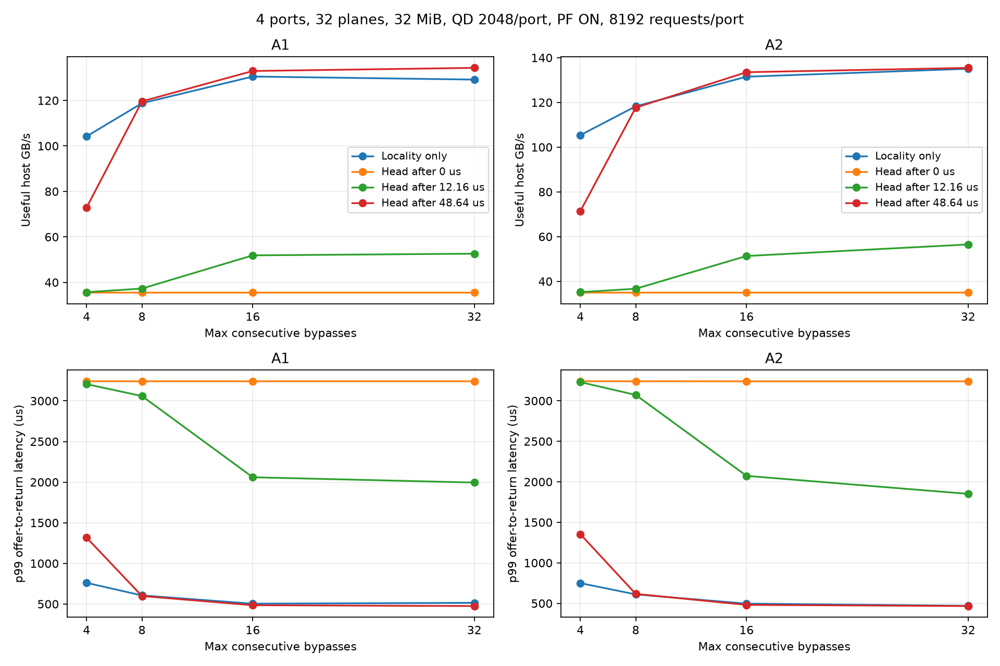

# Port 선두 요청 우선과 연속 주소 우선의 결합 평가

4port·32Plane·공유 32MiB·QD2,048/port·PF ON(합성 정확도 100%, 선행 10μs)·seed 7·port별 비중첩 주소를 고정했다. A1/B1/B2는 4KiB stripe, A2/B3는 16KiB stripe다. Host 수락·예약·lookup·Data 중재·port 내부 in-order 반환은 유지하고 CA 선택만 바꿨다.

## 결과에 따른 적용 설정

개선의 큰 부분은 연속 우회 한도를 8→32회로 늘린 효과다. 선두 우선 기능 자체는 A1에서 같은 우회 한도 대비 +4.00%, 긴 요청열에서 +2.09%였고, A2에서는 +0.31%/−0.01%로 추가 효과가 작았다. B1/B2/B3에서는 선두 우선이 같은 우회 한도 대비 36~50% 낮은 처리량을 보여 적용하지 않는다.

따라서 A1은 우회 32회·선두 대기 48.64μs, A2/B1/B2/B3는 기존 locality·우회 32회를 권장 프로파일로 저장했다. 모든 패턴은 별도로 실행하며, 혼합 workload를 자동 분류해 정책을 바꾸는 기능을 구현한 것은 아니다. 아래 값은 port당 8,192개 요청에서 기존 locality·우회 8회와 비교한 결과다.

| 패턴/설정 파일 | 선두 우선 | 기존 GB/s | 적용 GB/s | 처리량 변화 | 기존 p99 μs | 적용 p99 μs |
|---|---|---:|---:|---:|---:|---:|
| [A1](profiles/A1.json) | ON, 48.64μs | 118.780 | 134.339 | +13.10% | 605.75 | 474.87 |
| [A2](profiles/A2.json) | OFF | 118.257 | 135.035 | +14.19% | 610.74 | 469.73 |
| [B1](profiles/B1.json) | OFF | 2.139 | 2.522 | +17.91% | 965.78 | 818.43 |
| [B2](profiles/B2.json) | OFF | 2.123 | 2.499 | +17.71% | 972.87 | 824.21 |
| [B3](profiles/B3.json) | OFF | 2.740 | 3.235 | +18.08% | 753.01 | 635.83 |

위 프로파일은 이번 범위의 실행용 설정이다. 모델 기본값은 기존 재현성을 위해 그대로 두었다. A2의 선두 ON 후보는 [별도 설정](selected_head_A2.json)으로도 보관한다.

## 정책과 비교 방법

- `locality`: 기존 정책. 같은 Plane의 page buffer 재사용/연속 q+1을 우선하며 oldest의 age와 연속 우회 한도로 보호한다.
- `head_locality`: 실제 port 선두가 되고 lookup이 끝난 뒤의 대기가 `head_wait_us`를 넘으면, CA 대기 중인 선두 페이지를 우선한다. 진행 중인 sensing·전송은 선점하지 않는다.
- Plane 내부 age·우회 한도 보호는 먼저 적용한다. Channel의 Plane 간 선택에서도 오래 기다린 선두를 우선하되 age 한도에 도달한 Demand를 보호한다. 선두 후보가 없으면 기존 순서를 유지한다.
- A1/A2에서 우회 4/8/16/32회 × 기존 정책 및 선두 대기 0/12.16/48.64μs로 32개를 실행했다. 기존 우회 8회 대조군 2개는 저장된 이전 모델의 처리량·지연·계수와 정확히 일치했다.
- A1/A2의 기존 우회 8회 대비 처리량 비율의 기하평균이 가장 큰 선두 우선 후보를 선택했다. 동률일 때 p99를 비교한다. p99 악화가 없는 후보만 선택하는 규칙은 아니다.
- 선택한 후보를 우회 32회·선두 대기 48.64μs로 고정하고 B1/B2/B3 및 port당 16,384개인 A1/A2에서 확인했다. 기본 비교는 port당 8,192개다. 추가 확인에서도 QD는 2,048로 유지했다.
- 총 47개를 새로 실행하고 전 행의 요청량·자원 제한·지연 분해 및 port 응답 순서를 검증했다. 모델 테스트 51개가 통과했다.

## 핵심 구분: 우회 한도 조정과 선두 우선 기능

기존 우회 8회 대비 개선에는 우회 한도 변경 효과가 섞인다. 선두 우선 기능의 추가 효과는 반드시 같은 우회 한도의 기존 정책과 비교한다. 처리량은 GB/s이며 p99는 요청 제시부터 반환까지의 μs다.

| 패턴/요청 수 per port | 기존 우회8 GB/s | 같은 우회 한도·선두 OFF GB/s | 선두 ON GB/s | ON의 같은 우회 대비 변화 | OFF p99 | ON p99 |
|---|---:|---:|---:|---:|---:|---:|
| A1/8192 | 118.780 | 129.174 | 134.339 | +4.00% | 514.82 | 474.87 |
| A2/8192 | 118.257 | 135.035 | 135.456 | +0.31% | 469.73 | 466.63 |
| B1/8192 | 2.139 | 2.522 | 1.272 | -49.56% | 818.43 | 1635.80 |
| B2/8192 | 2.123 | 2.499 | 1.588 | -36.46% | 824.21 | 1290.73 |
| B3/8192 | 2.740 | 3.235 | 1.736 | -46.34% | 635.83 | 1187.29 |
| A1/16384 | 127.300 | 140.417 | 143.352 | +2.09% | 863.19 | 822.47 |
| A2/16384 | 125.236 | 143.164 | 143.143 | -0.01% | 826.51 | 826.78 |

## 선택 후보의 port 완료 시간 분산

같은 우회 한도에서 선두 우선 ON/OFF를 비교한다. 완료 시간은 각 port의 첫 요청 제시부터 마지막 반환까지다. 완료 시간 차이가 줄어도 모든 port의 개별 지연이 동시에 줄었다는 뜻은 아니다. Port별 p99는 원본 CSV에 보관한다.

| 요청열 | OFF 4port 완료 시간 μs | ON 4port 완료 시간 μs | OFF 최대−최소 μs | ON 최대−최소 μs |
|---|---|---|---:|---:|
| A1/8192 | 1039.0, 982.3, 985.0, 966.1 | 993.9, 996.6, 989.4, 999.1 | 72.92 | 9.70 |
| A2/8192 | 993.9, 988.5, 993.4, 993.1 | 983.1, 990.9, 990.2, 983.0 | 5.47 | 7.81 |
| A1/16384 | 1911.7, 1862.9, 1867.2, 1851.4 | 1870.7, 1865.1, 1868.7, 1872.6 | 60.34 | 7.47 |
| A2/16384 | 1849.2, 1868.3, 1875.0, 1862.1 | 1860.9, 1875.3, 1872.3, 1868.7 | 25.84 | 14.34 |



## A1/A2 전체 조건

| 패턴 | 정책 | 우회 한도 | 선두 대기 μs | GB/s | p99 offer μs | Long % | HOL idle % | 선두 우선 선택 횟수 |
|---|---|---:|---:|---:|---:|---:|---:|---:|
| A1 | locality | 4 | — | 104.205 | 760.52 | 16.63 | 49.13 | 0 |
| A1 | head_locality | 4 | 0.0 | 35.489 | 3240.84 | 70.86 | 84.40 | 257 |
| A1 | head_locality | 4 | 12.16 | 35.681 | 3205.55 | 70.02 | 83.97 | 249 |
| A1 | head_locality | 4 | 48.64 | 72.885 | 1317.27 | 23.03 | 67.04 | 48 |
| A1 | locality | 8 | — | 118.780 | 605.75 | 10.53 | 47.86 | 0 |
| A1 | head_locality | 8 | 0.0 | 35.489 | 3240.85 | 70.57 | 84.32 | 258 |
| A1 | head_locality | 8 | 12.16 | 37.281 | 3059.12 | 64.75 | 83.01 | 244 |
| A1 | head_locality | 8 | 48.64 | 119.605 | 597.95 | 10.72 | 49.05 | 7 |
| A1 | locality | 16 | — | 130.520 | 504.11 | 7.18 | 42.57 | 0 |
| A1 | head_locality | 16 | 0.0 | 35.490 | 3240.74 | 70.72 | 84.14 | 265 |
| A1 | head_locality | 16 | 12.16 | 51.878 | 2059.70 | 32.47 | 75.98 | 169 |
| A1 | head_locality | 16 | 48.64 | 132.958 | 485.25 | 7.15 | 42.36 | 7 |
| A1 | locality | 32 | — | 129.174 | 514.82 | 7.15 | 41.31 | 0 |
| A1 | head_locality | 32 | 0.0 | 35.490 | 3240.74 | 70.72 | 84.14 | 265 |
| A1 | head_locality | 32 | 12.16 | 52.619 | 1994.68 | 30.10 | 74.94 | 168 |
| A1 | head_locality | 32 | 48.64 | 134.339 | 474.87 | 7.32 | 43.13 | 8 |
| A2 | locality | 4 | — | 105.367 | 749.59 | 16.30 | 48.14 | 0 |
| A2 | head_locality | 4 | 0.0 | 34.963 | 3240.84 | 70.69 | 83.27 | 261 |
| A2 | head_locality | 4 | 12.16 | 35.195 | 3230.56 | 70.33 | 83.46 | 256 |
| A2 | head_locality | 4 | 48.64 | 71.361 | 1354.71 | 23.08 | 66.91 | 51 |
| A2 | locality | 8 | — | 118.257 | 610.74 | 10.57 | 46.79 | 0 |
| A2 | head_locality | 8 | 0.0 | 34.963 | 3240.85 | 70.45 | 83.21 | 263 |
| A2 | head_locality | 8 | 12.16 | 36.692 | 3072.52 | 64.56 | 82.05 | 249 |
| A2 | head_locality | 8 | 48.64 | 117.670 | 616.41 | 10.44 | 48.56 | 13 |
| A2 | locality | 16 | — | 131.496 | 496.47 | 7.27 | 42.69 | 0 |
| A2 | head_locality | 16 | 0.0 | 34.968 | 3240.32 | 70.56 | 83.11 | 270 |
| A2 | head_locality | 16 | 12.16 | 51.338 | 2073.39 | 30.38 | 74.61 | 171 |
| A2 | head_locality | 16 | 48.64 | 133.510 | 481.08 | 7.17 | 42.61 | 8 |
| A2 | locality | 32 | — | 135.035 | 469.73 | 7.21 | 42.97 | 0 |
| A2 | head_locality | 32 | 0.0 | 34.968 | 3240.32 | 70.56 | 83.11 | 270 |
| A2 | head_locality | 32 | 12.16 | 56.500 | 1851.31 | 22.99 | 71.63 | 154 |
| A2 | head_locality | 32 | 48.64 | 135.456 | 466.63 | 7.17 | 42.57 | 9 |

## 지표와 한계

- `HOL idle %`는 선두의 데이터가 아직 준비되지 않았고 같은 port에 준비된 후속 요청이 있는 구간의 비율을 port별로 구한 뒤 평균한 값이다. 일반적인 반환 직렬화 대기 전체와 구분한다.
- `p99_head_data_wait_us`는 실제 선두가 되고 lookup까지 끝난 뒤 데이터 준비까지의 대기다. 수락 이후 전체 대기나 offer 기준 p99와 다른 지표다.
- 많은 요청이 선두가 되기 전에 이미 준비되면 head 대기 p99가 0이어도 소수의 긴 선두 대기는 존재할 수 있다. HOL idle 구간과 선두 선택 횟수를 함께 본다.
- `count_ca_selection_head`는 선두 우선 규칙으로 선택한 횟수다. 그 페이지가 기존 정책에서도 선택됐을 가능성을 포함하며, 모든 선택이 발행 순서를 바꿨다는 뜻은 아니다.
- B계열은 QD2,048에서 동작 전이만 확인했다. 이전 버퍼 확대 보고서의 B계열 QD8,192 결과와 직접 섞지 않는다.
- 긴 요청열은 같은 생성 규칙으로 요청 수와 port별 주소 범위를 함께 늘린다. 동일한 짧은 요청열을 반복한 정상 상태 실험은 아니다. 선택한 한 후보에 대한 확인이며 새 길이에서의 전역 최적값을 탐색하지 않았다.
- 실제 예측기·동적 L2P·실제 GC·64Plane은 이번 비교에 포함하지 않았다. 고정 입력과 seed에서의 시뮬레이션 결과이며 제품의 실측 개선률이 아니다.

## 재현

```sh
python3 -m znand.head_sweep --workers 8
python3 -m znand.head_report
python3 -m znand.run --config results/znand/head_locality/profiles/A1.json --pattern A1 --per-port 8192 --out results/local/head_A1
```

모델 및 실행기 해시와 조건이 일치하는 checkpoint만 이어서 실행한다. 원본: [sweep.csv](sweep.csv), [비교 지표](comparisons.csv), [조건](cases.json), [선정 기준과 후보](selection.json), [manifest](manifest.json).
