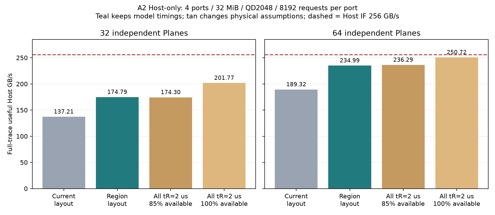

# Host IF 256GB/s 목표의 물리 한계와 개선 가능성

**현재 32Plane 모델에서는 신규 데이터 스트림의 256GB/s를 알고리즘만으로 달성할 수 없다. 64Plane에서는 공급 여력이 생기며, 기존 모델의 tR 값을 유지한 배치 변경으로 전체 235~236GB/s와 중간 완료 구간 약 255GB/s를 관측했다.** 64Plane에서 정확한 지속 256GB/s나 모든 workload의 달성을 입증한 결과는 아니다.

범위는 현재 모델의 A1/A2 4KiB 읽기, 4port·4channel·공유 32MiB·QD2,048/port·8,192요청/port·seed 7·PF OFF다. Port 내부 in-order, 16KiB 물리 페이지와 Plane당 page buffer 1개를 유지한다. 실제 장치의 Die 공유 제약이나 다른 내부 파이프라인은 별도 확인해야 한다.

## 최종 확인: 배치 개선 실험의 tR는 변경하지 않았다

**A1/A2 × 32/64Plane의 네 쌍을 같은 geometry 안에서 비교하면 전체 Config 가운데 `snapshot`만 다르다.** 요청열과 CA/Data 발행 정책, buffer, QD, 가용률 및 모든 tR 입력값은 같다. 32→64Plane 비교는 별도로 geometry가 바뀌므로 순수 배치 효과와 구분한다.

| tR 종류 / 설정 | 기존 배치 μs | 영역 배치 μs | 별도 모든 tR=2μs 진단 |
|---|---:|---:|---:|
| First / `first_us` | 20.69 | 20.69 | 2.00 |
| Short / `short_us` | 2.00 | 2.00 | 2.00 |
| Mid / `mid_us` | 2.08 | 2.08 | 2.00 |
| Long / `long_us` | 12.16 | 12.16 | 2.00 |
| Group / `group_us` | 20.69 | 20.69 | 2.00 |

첫 두 열이 본문의 배치 개선 결과다. 마지막 열은 물리 한계를 분리해 보기 위한 가상 대조군이며 기존 tR를 유지한 성능 개선으로 집계하지 않는다. `all_tr_2us`는 가용률 85%, `all_tr_2us_no_maintenance`는 100%다. 따라서 **모든 실험에서 tR가 동일했다고 해석하면 안 된다.**

| 고정 조건 | 값 |
|---|---|
| Host / NAND 연결 | 4port가 4channel 공유, Host 512bit·1GHz/port |
| 요청 / 물리 단위 | Host 4KiB, NAND 16KiB, Plane당 page buffer 1개 |
| 요청 수 / outstanding | 8,192개/port, 2,048개/port |
| Controller buffer | 공유 2,048페이지 × 16KiB = 32MiB |
| Prefetch / 반환 순서 | PF OFF / port 내부 strict in-order |
| CA / Data / turnaround | 0.1μs / 80.1125GB/s per channel / 0.05μs |
| ECC / lookup | 0.2μs / 0.5μs |
| 내부 작업을 반영한 가용률 | 85%, maintenance period 100μs, Plane별 위상 분산 |
| A1 주소 stripe / CA 정책 | 4KiB / `head_locality`, head wait 48.64μs |
| A2 주소 stripe / CA 정책 | 16KiB / `locality`, head wait 12.16μs |
| 우회 제한 / Data 정책 / seed | 32 / `ready` / 7 |

A1/A2의 기존 정책 차이는 유지했다. 모든 설정은 [실행 조건](cases.json)에 있으며, [tR 및 설정 대조 검증](timing_validation.json)은 네 배치 쌍의 유일한 설정 차이, 12개 결과의 입력 일치, sensing 종류별 횟수 합계, 실행용 프로파일 일치를 확인한다.

## 평균 tR가 낮아진 이유

`평균 tR = Σ(종류별 sensing 횟수 × 해당 종류의 고정 tR) / 전체 sensing 횟수`다. **Long의 12.16μs는 그대로이며, Long으로 분류되는 접근이 줄어 Short 2.00μs와 Mid 2.08μs가 더 많이 발생했다.** 아래는 A2·64Plane의 실제 이벤트 구성이다.

| 종류 | 고정 tR μs | 기존 배치 횟수 | 영역 배치 횟수 |
|---|---:|---:|---:|
| First | 20.69 | 64 | 64 |
| Short | 2.00 | 3,605 | 4,096 |
| Mid | 2.08 | 3,385 | 4,033 |
| Long | 12.16 | 1,142 | 3 |
| Group | 20.69 | 0 | 0 |

양쪽 모두 sensing 8,196회이며 평균은 3.594641→2.189029μs다. Long은 1,142→3회로 줄었다. 8,196회는 Host 요청 수가 아니라 NAND 물리 페이지 sensing 횟수이며, 원래 trace의 영역 경계 재접근도 포함한다.

이 개선을 얻으려면 해당 물리 주소 관계를 유지하는 배치가 필요하다. tR 분류 규칙이나 NAND 타이밍 자체를 단축한 것은 아니다. 아래 배치 설명과 적용 범위 제한을 함께 읽는다.

## 32Plane에서 알고리즘으로 넘을 수 없는 공급량

Host IF 명목 처리량은 `4 × (512bit / 8) × 1GHz = 256GB/s`다. 현재 모델은 Plane을 CA 시작부터 NAND Data 전송 완료까지 점유한다. ECC 0.2μs는 Plane이 해제된 뒤의 지연이다.

```text
16KiB Data service = 16384 / (80.1125 × 1000) + 0.05
                    = 0.254512404 μs
최단 Plane cycle    = CA 0.1 + tR 2.0 + Data service
                    = 2.354512404 μs
32Plane × 16KiB / cycle               = 222.674 GB/s
같은 공급량 × 평균 가용률 85%          = 189.273 GB/s
Short 2.00 / Mid 2.08 교대까지 반영    = 186.111 GB/s
```

최초·Long·Group 전환, Data 대기, 응답 순서 손실을 모두 없앤 낙관적 계산이다. **내부 점유를 0%로 없애도 최단 cycle 기준 222.7GB/s이므로 32Plane의 신규 데이터 공급은 Host IF 256GB/s에 못 미친다.** 85%를 곱한 값은 장시간 공급량 근사이며 유한 요청열의 정확한 상한은 아니다. 측정 결과에 15%를 다시 감산하지 않는다.

상한은 새 물리 데이터를 읽고 16KiB 전체를 Host 유효 데이터로 활용하는 경우에 적용한다. 이미 읽은 데이터를 반복 반환하는 workload의 Host byte 수에는 같은 상한을 그대로 적용하지 않는다. 반대로 일부 byte만 사용하는 64B 패턴은 유효 데이터 비율 때문에 더 낮아질 수 있다.

## 64Plane에서 남는 조건

64Plane의 Short/Mid 교대·가용률 85% 공급량 근사는 372.222GB/s다. 여기서는 공유 Data 경로가 더 낮은 제한이 된다.

`4 × 16KiB / (0.204512μs + 0.05μs) = 257.496GB/s`

Host 256GB/s를 유지하려면 Data 경로를 약 **99.42%** 채워야 한다. 원시 320.45GB/s와 비교해 여유가 충분하다고 해석하면 안 된다. 모델의 페이지별 turnaround 50ns가 이미 대부분의 여유를 사용한다.

Data 대기가 없다고 가정해도 64Plane의 평균 tR는 약 **3.127μs 이하**여야 256GB/s에 필요한 array 공급량이 나온다. 기존 64Plane Host-only A1/A2의 평균 tR는 약 3.60μs였으므로 Long을 줄이는 개선이 필요하다.

최단 tR만 고려한 필요 Plane 수는 약 43.28개이고, Short/Mid 교대까지 고려하면 약 44.02개다. 채널별 같은 정수 Plane 수라면 각각 최소 44개, 48개가 되는 산술적 필요조건이다. 해당 geometry를 시뮬레이션했거나 충분조건을 확인한 값은 아니다. 현재 모델이 지원하는 검증 geometry는 32/64Plane이다.

## 기존 tR 값을 유지한 배치 비교

요청 주소열과 CA/Data 정책은 그대로 두고 기존 snapshot 입력으로 16KiB 물리 페이지의 위치만 바꿨다. 각 논리 주소 영역은 모든 channel을 사용하면서 channel 안에서는 별도 Plane 그룹에 저장한다. 같은 Plane에서 멀리 떨어진 여러 영역의 q를 번갈아 읽는 일을 줄이는 실험이다.

| 총 Plane | 각 channel에서 영역0 | 영역1 | 영역2 | 영역3 |
|---:|---|---|---|---|
| 32 | PL0~1 | PL2~3 | PL4~5 | PL6~7 |
| 64 | PL0~3 | PL4~7 | PL8~11 | PL12~15 |

이 workload에서는 각 port가 주로 한 주소 영역을 읽는다. 주소 기반 정적 L2P 배치이며 port를 특정 channel에 연결하거나 런타임 스케줄러가 미래 요청을 보는 기능은 아니다. 다른 port가 같은 주소를 읽으면 같은 물리 위치로 간다. 4KiB의 page 내 offset과 channel, 기존 16KiB packing은 유지한다.

| 패턴 | Plane | 기존 전체 GB/s | 배치 변경 전체 GB/s | 변화 | 배치 변경 중간 구간 GB/s | Long 기존 → 변경 | 평균 tR 기존 → 변경 μs |
|---|---:|---:|---:|---:|---:|---:|---|
| A1 | 32 | 133.772 | 177.115 | +32.40% | 184.832 | 516 → 0 | 2.750 → 2.113 |
| A1 | 64 | 185.862 | 236.361 | +27.17% | 255.475 | 1147 → 0 | 3.602 → 2.185 |
| A2 | 32 | 137.212 | 174.788 | +27.39% | 184.839 | 469 → 3 | 2.691 → 2.116 |
| A2 | 64 | 189.324 | 234.988 | +24.12% | 255.041 | 1142 → 3 | 3.595 → 2.189 |

32Plane의 175~177GB/s와 중간 구간 약 184.8GB/s는 이상적인 Short/Mid 공급량 약 186.1GB/s에 접근하는 결과다. 64Plane은 전체 235~236GB/s, 중간 구간 약 255GB/s로 Host IF에 근접한다. 이 개선은 **주소 배치/L2P의 효과**이며 동일 배치에서 스케줄러 코드만 변경한 효과로 취급하지 않는다.

정적 영역 배치는 네 영역의 균형 부하를 이용한다. 한 영역에 부하가 몰리거나 port가 다른 영역을 읽는 경우, 실제 L2P 재배치 후에도 같은 이득을 유지하는지는 추가 검증 대상이다. 기존 실행용 프로파일은 교체하지 않고 이 배치는 진단 설정으로 보관한다.

A2의 기존 유한 trace는 마지막 1→3→2 순열 때문에 다음 영역 경계를 넘는 요청 3개가 있다. 이 요청과 공유 물리 페이지 3개를 그대로 유지했다. A1은 경계 공유가 없다. Snapshot은 물리 페이지별 1:1 대응과 요청별 channel·offset 보존을 전수 검증했으며 실제 SSD 또는 MQSim에서 얻은 배치라고 표시하지 않는다.

## 전체 평균과 Host IF 속도의 차이

현재 결과는 첫 Host 요청 제시부터 마지막 반환까지의 평균이다. PF OFF·빈 buffer에서는 최초 Read 준비 시간이 반드시 포함된다. 최초 데이터 준비의 낙관적 최소는 lookup 0.5 + CA 0.1 + 최초 tR 20.69 + Data 0.254512 + ECC 0.2 = 21.744512μs다.

Port당 8,192 × 4KiB를 읽을 때 이 최초 지연만 포함해도 전체 평균의 Host 경로 상한은 약 **245.805GB/s**다. 따라서 이 짧은 cold 실행 전체 평균을 정확히 256GB/s로 만드는 것은 올바른 목표가 아니다.

중간 완료 구간은 전체 완료 요청 가운데 절반의 byte/시간이다. 시작·종료 영향이 줄지만 정상 상태 지속 처리량을 보장하는 정의는 아니다. Buffer에 미리 쌓인 데이터가 있으면 짧은 구간의 반환량은 그 구간의 array 공급량보다 높을 수 있다. 장시간 지속 목표는 더 긴 trace와 측정 구간 내 자원 적분으로 검증해야 한다.

## 물리 가정을 바꾼 진단 대조군

다음 주황색 조건은 최초·Short·Mid·Long·Group tR를 모두 2μs로 고정했다. 추가로 내부 점유를 제거한 조건도 포함한다. 지원 사양이나 알고리즘 개선 결과가 아니라, 공급 병목과 반환 경로를 분리하는 진단이다.

| A2 조건 | Plane | 전체 GB/s | 중간 완료 구간 GB/s | p99 offer μs |
|---|---:|---:|---:|---:|
| 기존 물리 배치 | 32 | 137.212 | 153.394 | 453.95 |
| 주소 영역별 Plane 배치, 기존 tR 유지 | 32 | 174.788 | 184.839 | 232.45 |
| 모든 tR=2μs, 가용률85% | 32 | 174.304 | 191.357 | 245.80 |
| 모든 tR=2μs, 가용률100% | 32 | 201.766 | 198.156 | 140.99 |
| 기존 물리 배치 | 64 | 189.324 | 216.934 | 184.71 |
| 주소 영역별 Plane 배치, 기존 tR 유지 | 64 | 234.988 | 255.041 | 46.95 |
| 모든 tR=2μs, 가용률85% | 64 | 236.291 | 254.213 | 43.79 |
| 모든 tR=2μs, 가용률100% | 64 | 250.716 | 256.000 | 11.11 |



## 목표와 다음 비교

- **32Plane 유지:** 256GB/s를 목표로 스케줄러만 계속 조정하지 않는다. 이 가정의 신규 데이터 지속 공급량 약 186~189GB/s 안에서 배치·발행 순서·반환 대기를 개선한다.
- **256GB/s에 근접한 지속 목표:** Plane 수, tR, 가용률 또는 Plane의 sensing/출력 중첩 구조 등 물리 공급 조건이 필요하다. 64Plane에서는 주소 배치로 255GB/s 수준의 중간 구간을 관측했으므로 장시간·다른 seed·주소 편향·동적 L2P 조건으로 지속성과 적용 범위를 검증한다.
- **버퍼·QD 튜닝:** 상한을 올리는 수단과 상한까지의 손실을 줄이는 수단을 구분한다. 큰 buffer/QD가 부족한 array 공급량을 만들지는 않는다. 새 배치에서도 admission과 실제 payload 예약의 분리는 별도 비교할 수 있다.
- **장치 사양 확인:** Plane당 page buffer 1개와 다음 sensing 시작 시점, turnaround 50ns, 85% 가용률, 독립 Plane 가정을 확인한다. 이 값이 바뀌면 도달 가능성도 다시 계산한다.

## 재현과 검증

신규 8개와 이전 Host-only 대조군 4개를 합쳐 12개 조건이다. 모델·계측·실행기 소스 해시, 대조군의 모든 기존 지표, snapshot 1:1 대응·channel·offset 보존, PF OFF와 port 내부 순서를 검증했다. Simulator 소스나 기본 설정은 변경하지 않았다.

2026-10-10 최종 확인에서는 기존 실행 결과를 다시 대조하고 보고서와 검증 파일을 보강했다. 시뮬레이션을 재실행하거나 원본 결과를 변경하지 않았다. 재현 시 아래 첫 명령은 조건 실행/재사용, 둘째는 원본 검증, 셋째는 설정 대조 검증 및 보고서 생성이다.

검증한 모델 SHA-256: `755f822a6b7c1f44f65117b4892078419a766d4963ad4d49931e8aa1db679baf`. tR 분류 및 지연 적용 코드를 포함한 모델 전체가 최초 실행 manifest의 해시와 일치한다.

```sh
python3 -m znand.host_ceiling --workers 6
python3 -m znand.host_ceiling --validate-only
python3 -m znand.host_ceiling_report
python3 -m znand.run --config results/znand/host_ceiling/profiles/A2_64plane_region.json --pattern A2 --per-port 8192 --out results/local/A2_region64
```

Snapshots은 이 요청 주소 범위를 위한 유한 매핑이다. 요청 길이나 주소 범위를 늘릴 때는 매핑을 함께 다시 생성해야 한다.

[12개 원본 CSV](sweep.csv), [결과 JSON](rows.json), [상한 계산](bounds.json), [실행 조건](cases.json), [정적 배치](snapshots/), [배치 검증](snapshot_validation.json), [전체 검증](validation.json), [tR 및 설정 검증](timing_validation.json), [소스 해시](manifest.json).
기존 tR 유지 배치 설정: [A1 32Plane](profiles/A1_32plane_region.json), [A1 64Plane](profiles/A1_64plane_region.json), [A2 32Plane](profiles/A2_64plane_region.json), [A2 64Plane](profiles/A2_64plane_region.json).
