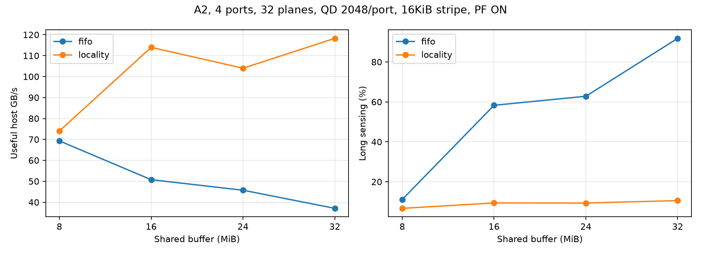

# 연속 물리 주소 우선 NAND 명령 발행 평가

기존 FIFO 순서와 locality 정책을 같은 요청열로 비교했다. 신규 60개 실행 중 FIFO 재현 대조군은 4개, locality는 56개다. 모든 조건은 4port·32Plane·port당 8,192개 요청·seed 7·주소 중첩 0%다. 저장된 FIFO 결과와의 비교에서 주소·버퍼·Outstanding·Prefetch·모든 지연 및 대역폭 설정을 유지했다.

## 구현 정책

- Controller의 CA 명령 선택만 변경했다. Host 요청 주소·시각, 조회, 버퍼 수명, NAND Data 중재, port 내부 strict in-order 반환은 유지했다.
- 이미 발행 가능한 같은 Plane의 Demand 요청 중 page buffer 재사용, 이어지는 q+1 주소를 우선한다. Group 경계를 넘는 q+1은 우선하지 않는다. Demand가 있으면 Prefetch는 그 뒤다.
- 오래된 요청을 연속 8회까지 우회할 수 있다. 한도에 도달하거나 가장 오래된 해당 우선순위 요청의 eligible 이후 대기가 1,000μs 이상이면 오래된 요청을 선택한다. 후보가 없는 경우 미래 요청을 기다리지 않는다.
- Channel 내 Plane 간 경쟁은 각 Plane에서 대표하는 가장 오래된 작업 순서를 유지한다. 이 제한은 CA 선택 시의 규칙이며 busy/maintenance가 포함된 절대 완료시간 보장이 아니다.
- 기본 `ca_policy`는 fifo이며, locality를 명시한 설정에서만 새 정책을 적용한다. 기존 모델 결과를 덮어쓰지 않았다.

## A2 동일 설정 비교

16KiB 분산·Prefetch ON·QD2,048/port를 고정했다. 유효 Host 처리량 단위는 GB/s다.

| Buffer MiB | FIFO | Locality | 변화 | FIFO Long 비율 | Locality Long 비율 |
|---|---:|---:|---:|---:|---:|
| 8 | 69.282 | 74.030 | +6.9% | 11.14% | 6.68% |
| 16 | 50.765 | 113.966 | +124.5% | 58.29% | 9.38% |
| 24 | 45.745 | 103.995 | +127.3% | 62.82% | 9.34% |
| 32 | 37.083 | 118.257 | +218.9% | 91.81% | 10.57% |



## 패턴별 동일 설정 비교

모두 16KiB 분산·PF ON·QD2,048/port다. 각 셀은 FIFO → Locality GB/s이며 다른 QD의 최고값과 혼합하지 않았다.

| 패턴 | 8MiB | 16MiB | 24MiB | 32MiB |
|---|---:|---:|---:|---:|
| A1 | 68.290 → 74.924 | 49.405 → 116.497 | 46.959 → 104.921 | 36.789 → 118.277 |
| A2 | 69.282 → 74.030 | 50.765 → 113.966 | 45.745 → 103.995 | 37.083 → 118.257 |
| B1 | 1.884 → 2.260 | 0.934 → 2.236 | 0.809 → 2.142 | 0.556 → 2.139 |
| B2 | 0.797 → 2.006 | 0.707 → 2.027 | 0.666 → 2.102 | 0.556 → 2.123 |
| B3 | 1.824 → 2.631 | 1.051 → 2.834 | 0.739 → 2.740 | 0.739 → 2.740 |

## 지연과 port 완료 시점

A2·16KiB 분산·PF ON·QD2,048/port. 수락 전 대기를 포함한 지표다. Port 완료 시점은 첫 요청 제시부터 해당 port의 마지막 반환까지이며 유한 trace의 완료 편차다.

| MiB | 평균 offer 지연 FIFO→Locality μs | p99 offer FIFO→Locality μs | Port 완료 min–max FIFO μs | Port 완료 min–max Locality μs |
|---|---:|---:|---:|---:|
| 8 | 784.91 → 663.00 | 1413.03 → 1288.80 | 765.23–1937.25 | 657.10–1813.03 |
| 16 | 1103.58 → 350.45 | 2119.68 → 653.48 | 1493.17–2643.90 | 688.71–1177.70 |
| 24 | 1327.74 → 366.13 | 2409.84 → 766.39 | 2444.34–2934.06 | 889.42–1290.62 |
| 32 | 1561.72 → 362.08 | 3057.47 → 610.74 | 3581.69–3619.35 | 1080.63–1134.96 |

## 비교 범위 내 최고값과 한계

최고 locality 처리량은 118.780GB/s다. 조건은 A1, buffer 32MiB, stripe 4KiB, PF True, QD2048/port이며 동일 FIFO 조건 37.189GB/s 대비 +219.4%다.
비교한 56개 조건 중 증가 56개, 감소 0개다. 나머지는 부동소수점 오차 허용 범위에서 동일하다.
실험은 PF ON·QD2,048의 패턴/배치/버퍼 40개와, 기존 FIFO에서 용량·패턴별 최고값을 냈던 추가 설정을 평가했다. 새 정책의 모든 QD·PF 조합을 탐색한 전역 최적화가 아니다. 우회 8회와 대기 1,000μs도 초기 튜닝 값이며 실제 fairness/SLA 보장은 별도 검증이 필요하다.
평균 sensing과 Long 비율은 원본의 count_tr_*와 함께 제공한다. Throughput 증가를 실제 제품 성능으로 해석하지 않는다. UCIe 상세와 Die/LUN 공유 제약, 실제 예측기는 기존과 같이 포함하지 않는다.
새 정책은 내부 재정렬이 가능한 controller를 가정한다. 순차 후보는 이미 lookup이 끝난 demand 또는 기존 prefetch에서만 고른다. 아직 알려지지 않은 미래 주소를 scheduler가 직접 참조하지 않는다. 기존 Prefetch 후보 생성 자체는 합성 oracle 가정을 유지한다.

## 재현과 검증

```sh
python3 -m unittest test_znand test_znand_expansion test_znand_locality -q
python3 -m znand.locality_sweep
python3 -m znand.locality_report
```

기존 동작 보존·내부 재정렬과 외부 순서 유지·우회 횟수·age 제한·Demand 우선·Group 경계·32/64Plane 진행성 검증을 포함한 테스트 42개를 통과했다. FIFO 대조군 4개는 기존 전체 길이 CSV의 처리량·sensing·Long 횟수·지연을 정확히 재현한다.
[매칭 비교 CSV](matched_comparison.csv), [원본 CSV](sweep.csv), [설정](cases.json), [실행 검증](manifest.json).
