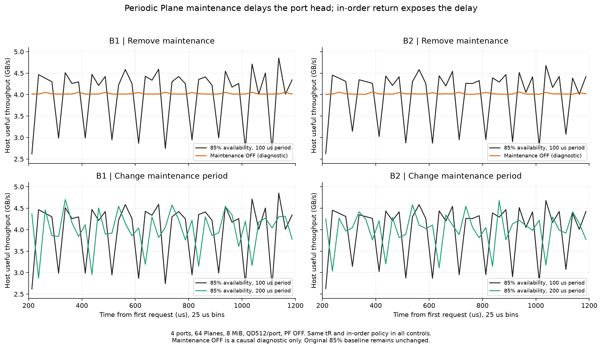

# B1/B2 시간 그래프의 주기적 하락 원인

**현재 명칭:** 아래 원자료의 B1/B2는 현재 C1/C2입니다. 새 B는 페이지 내부 64B 연속 읽기이며 별도 패턴입니다. [정의와 이름 대응](../../../docs/15_workload_naming_ko.md). 아래 기존 수치와 그래프는 당시 표기를 보존했습니다.

작성일: 2026-10-11. 직전 64B 지속 부하 실험의 파형 원인을 확인하는 진단이며 기준 모델의 변경이 아니다.

**주된 원인은 주기적 Plane maintenance 지연과 port 내부 in-order 반환이 결합한 Head-of-Line 대기다.** 내부 NAND Data 전송은 계속되지만, 늦은 선두 요청 때문에 이미 준비된 후속 응답을 반환하지 못한다.

## 대조 실험

4port·64Plane·8MiB·QD512/port·개선 영역 배치·PF OFF·기존 tR·기존 in-order를 고정했다. 다음 세 조건을 B1/B2 각각 실행했다.

- 기준: 가용률 85%, 100µs 주기, Plane당 명목 15µs off.
- 원인 제거 대조: 가용률 100%, maintenance OFF. 성능 기준선에 채택한 변경이 아니다.
- 주기 대조: 가용률 85% 유지, 200µs 주기, Plane당 명목 30µs off.

첫 요청부터 1.2ms까지 관측하고 초기 200µs를 제외한 **200–1,200µs의 고정 1ms**를 비교한다. 아래 평균은 이전 보고서의 고정 2ms 평균과 관측 길이가 다르다. 원래 85%/100µs 두 실행의 모든 25µs 계측 값은 이전 2.2ms 실행의 첫 1.2ms 구간과 일치했다.

| 패턴 | maintenance 조건 | Host 평균 GB/s | 25µs 최솟값 | 25µs 최댓값 | 25µs 표준편차 | NAND 평균 GB/s |
|---|---|---:|---:|---:|---:|---:|
| B1 | 100µs / 85% | 3.9916 | 2.6189 | 4.8535 | 0.6793 | 257.229 |
| B1 | OFF / 100% | 4.0233 | 4.0141 | 4.0550 | 0.0161 | 257.491 |
| B1 | 200µs / 85% | 4.0059 | 2.8672 | 4.7027 | 0.4381 | 256.311 |
| B2 | 100µs / 85% | 3.9937 | 2.6266 | 4.6797 | 0.6349 | 257.212 |
| B2 | OFF / 100% | 4.0232 | 4.0090 | 4.0627 | 0.0169 | 257.491 |
| B2 | 200µs / 85% | 4.0030 | 3.0362 | 4.6771 | 0.3930 | 256.524 |

Maintenance를 끄면 큰 주기적 낙폭이 거의 사라진다. 평균은 약 4GB/s로 비슷하지만 짧은 구간의 반환 분포가 크게 안정된다. 85%를 유지하면서 주기를 바꾸면 기존 100µs 위치에 모였던 낙폭의 모양도 달라진다. 따라서 기존의 규칙적 파형을 NAND 고유의 100µs 동작이나 실제 GC 주기로 해석하지 않는다.



## 실제 선두 요청의 정지 사례

B1 기준의 Port 2, 물리 주소 `(channel, plane, page)=(1, 8, 164)`에서 다음 동작을 관측했다. 시간은 첫 Host 요청을 0으로 둔다.

- 699.288µs: 해당 요청이 port FIFO의 선두가 되지만 데이터가 준비되지 않아 반환이 멈춘다.
- 해당 Plane의 maintenance 구간: 699.024–714.024µs.
- 선두 대기와 직접 겹친 maintenance 시간: 14.736µs.
- 대기 구간 중간 시점에는 뒤쪽 요청 **227개가 이미 반환 가능한 데이터로 준비**돼 있지만 port 내부 in-order 조건 때문에 기다린다.
- 717.676µs: 선두 데이터가 준비되어 반환을 시작한다. 선두로 인한 전체 반환 중단은 **18.389µs**다.

| 페이지 동작 | 시작 시각 µs | 세부 |
|---|---:|---|
| ca_start | 714.023572 |  duration=0.100000µs |
| sense_start | 714.123572 | mid duration=2.080000µs |
| data_start | 717.221622 |  duration=0.254512µs |
| ready | 717.676134 |  |

이 요청의 sensing은 **Mid tR=2.08µs**다. Long tR 증가로 이 정지 구간을 설명하지 않는다. 긴 부분은 Plane maintenance 대기이며, 이후 CA·sensing·NAND Data 대기/전송·ECC를 거쳐 준비된다. 다른 Plane의 미래 요청들은 그동안 진행할 수 있으므로 내부 NAND 총 처리량은 약 257GB/s를 유지한다.

동작 흐름은 `선두 페이지 지연 → 후속 ready 응답 누적 → port 반환 정지 → 선두 준비 → 누적 응답 반환`이다. 준비된 데이터가 한꺼번에 반환되는 구간에서는 25µs Host 처리량이 약 4GB/s의 장기 공급량보다 높아질 수 있다. 버퍼에 먼저 준비된 데이터를 방출하는 것이며 장기 공급 상한과 모순되지 않는다.

## B에서 왜 더 뚜렷한가

현재 Host 인터페이스에서 64B 반환은 1ns, 4KiB 반환은 64ns다. B 패턴은 준비된 작은 응답을 빠르게 반환한 뒤 다음 선두의 준비를 기다리는 동작이 드러난다. 준비가 밀리면 긴 공백이 생기고, 해소되면 쌓인 응답을 빠르게 반환한다. A/B의 크기 차이는 이 파형을 이해하는 요인이며, 이번 대조에서 직접 확인한 주된 원인은 maintenance에 따른 준비 시점 불균형과 in-order 선두 정지다.

25µs bin은 이 반환의 몰림과 공백을 보여 준다. 시간 폭을 100µs나 500µs로 넓히면 골과 봉우리가 평균에 함께 들어가 더 평평해 보이지만, 선두 정지 자체가 해결되는 것은 아니다. B1/B2 원래 패턴은 페이지를 한 번씩 방문하는 부분 읽기이며 이 낙폭을 cache miss나 PF 실패로 해석하지 않는다. PF는 OFF다.

## 현재 유지보수 모델의 의미와 후속 검토

가용률 85%는 실제 GC 작업열을 재생한 값이 아니라 Plane별 주기적 off로 구현된다. Plane별 초기 위상은 seed에 따라 다르며 모든 Plane이 동시에 15µs 멈추는 구조는 아니다. Plane이 busy이면 off 시작이 지연되고 대기 maintenance가 누적될 수 있다. 하지만 같은 100µs 주기를 반복하므로 이런 규칙적 낙폭이 만들어질 수 있다.

사용자가 정한 port 내부 in-order와 기준 85%는 유지한다. 후속 튜닝은 (1) 이미 수락한 선두와 가까운 미래 요청의 준비 우선순위, (2) 유지보수 시점의 분산 또는 실제 GC/프로그램/소거 trace를 이용한 비효율 모델링, (3) 반환 가능 데이터량·선두 정지 시간의 동시 계측으로 분리한다. 평균 가용률만 같은 모델끼리도 짧은 구간 파형은 달라질 수 있다. 실제 hardware GC가 이 주기로 발생한다고 주장하지 않는다.

## 검증과 재현

- 6개 실행의 설정 차이는 `availability` 또는 `maintenance_period_us` 하나뿐이다. 기준 두 실행은 차이가 없다.
- 두 기준 실행은 이전 결과의 전체 48개 bin과 모든 계측 항목이 일치했다. 관측용 trace만 추가했으며 이벤트나 실행 정책을 추가하지 않았다.
- NAND model.py, 기존 A/B harness, tR와 in-order는 그대로다. `validation.json`과 `manifest.json`에 설정 차이와 hash를 보존한다.
- `B1_100.json` 등 6개 JSON에 고정 구간 요약·원시 bin·실제 maintenance 구간·선두 정지 사례와 페이지 동작 기록을 저장한다. CSV는 bin 데이터다.

```sh
python3 -m znand.partial_dip_diagnosis
python3 -m znand.partial_dip_report
```
