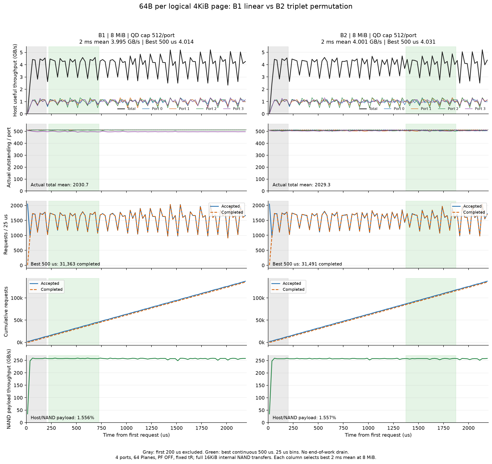
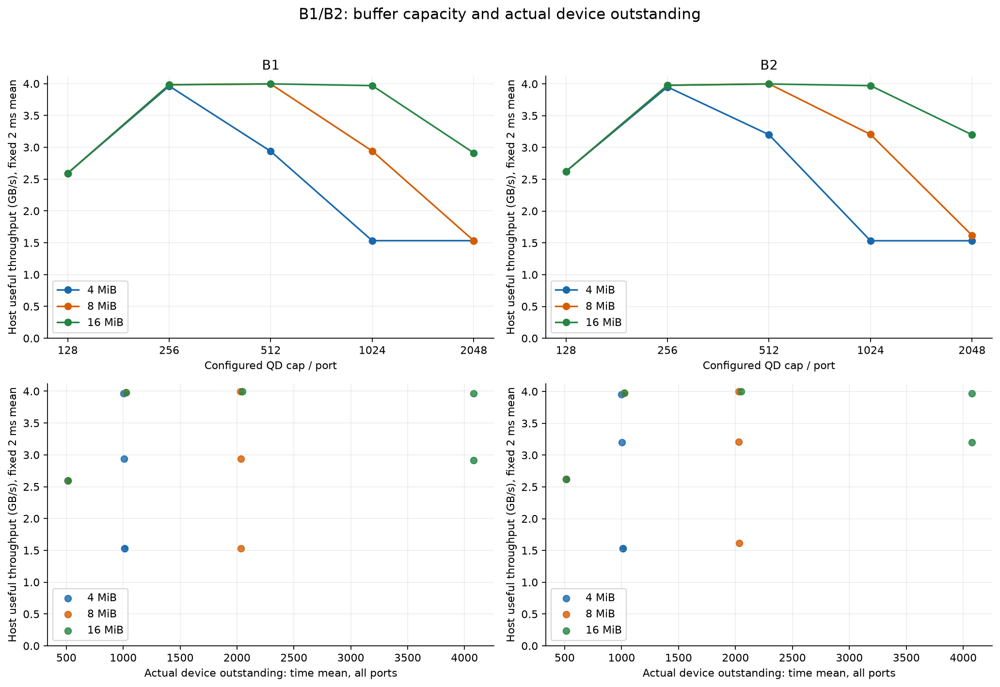

# B1/B2: 64B 부분 읽기의 지속 부하 측정

작성일: 2026-10-11 (Asia/Seoul). 제품 실측이 아니라 현재 모델의 실행 결과다.

## 결과

64Plane·개선 배치·PF OFF·기존 tR에서 64B 부분 읽기를 측정했다. 초기 200µs를 제외한 고정 2ms 평균을 주 지표로 하고, 최고 연속 500µs 평균도 함께 표시한다. 아래는 각 버퍼에서 고정 2ms 평균이 가장 높은 측정 QD다. 전역 최적값을 뜻하지 않는다.

| 버퍼 | 패턴 | QD 상한/port | 고정 2ms GB/s | 최고 500µs GB/s | 실제 outstanding 합계 평균 | MIOPS |
|---|---|---:|---:|---:|---:|---:|
| 4MiB | B1 | 256 | 3.9624 | 3.9782 | 1005.1 | 61.913 |
| 4MiB | B2 | 256 | 3.9517 | 3.9631 | 1000.3 | 61.745 |
| 8MiB | B1 | 512 | 3.9946 | 4.0145 | 2030.7 | 62.416 |
| 8MiB | B2 | 512 | 4.0007 | 4.0308 | 2029.3 | 62.511 |
| 16MiB | B1 | 512 | 3.9967 | 4.0183 | 2048.0 | 62.448 |
| 16MiB | B2 | 512 | 3.9987 | 4.0180 | 2048.0 | 62.479 |

측정한 전체 조건에서 최고 연속 500µs 평균만으로 선택하면 다음과 같다. 고정 2ms 최고 조건과 선택 기준이 다르다.

| 패턴 | 버퍼 MiB | QD/port | 최고 500µs GB/s | 구간 µs | 구간 완료 요청 수 | 고정 2ms GB/s |
|---|---:|---:|---:|---|---:|---:|
| B1 | 16 | 512 | 4.0183 | 1575–2075 | 31,393 | 3.9967 |
| B2 | 8 | 512 | 4.0308 | 1375–1875 | 31,491 | 4.0007 |

8MiB·QD512/port를 A 패턴과 동일한 대표 조건으로 유지한다. 4MiB·QD256부터 이 조건의 약 99%에 도달하므로, 이 workload에서 버퍼 증설만으로 얻을 수 있는 폭은 작다. 16MiB의 측정 최고치는 위 표에 따로 표시한다.

## 패턴과 동일 조건

- B1: P1→P2→P3→P4→… 각 4KiB 논리 페이지의 시작 주소에서 64B만 반환한다.
- B2: P1→P3→P2→P4→P6→P5→… 3개 단위로 순서를 바꾼다. 전체 주소 공간의 균등 난수 패턴이 아니다.
- 두 패턴 모두 같은 페이지 안에서 +64B씩 연속 읽는 패턴이 아니다. 64B 물리 striping은 추가하지 않았다.
- 두 패턴의 장치 설정은 직전 A1 지속 부하 프로파일과 동일하다. 4KiB stripe, head_locality/bypass32/head_wait48.64µs, NAND Data ready 순서, 주소 영역별 Plane 배치를 유지했다. 이전 B 전용 locality 프로파일에서 가져온 수치가 아니다.
- 4port×4channel 공유, channel당 16Plane(총 64), 16KiB NAND page·Plane당 page buffer 하나, port 내부 in-order를 유지한다.
- Controller buffer 4/8/16MiB × QD 128/256/512/1024/2048 per port × B1/B2. 예약은 기존 AR 수락 시점이며 영구 cache는 없다.
- First 20.69 / Short 2 / Mid 2.08 / Long 12.16 / Group 20.69µs, 가용률 85%, seed 7. core model.py 및 이전 A 실험 소스는 변경하지 않았다.
- 2.2ms 동안 다음 AR을 계속 제공하고 25µs씩 계측한다. Device outstanding = 수락된 요청 − 최종 응답 완료 요청이다. 대기 중 Host 요청은 제외한다.
- 주소 도메인은 65,536요청/port 분량이지만 모두 처리하는 실험은 아니다. 종료 drain 없이 관측 종료 시 미완료 요청을 남긴다.

## 8MiB 대표 구간과 요청 수

| 패턴 | QD/port | 고정 2ms 완료 수 | 최고 500µs 구간 | 구간 완료 수 | Port별 실제 outstanding 평균(고정 2ms) |
|---|---:|---:|---|---:|---|
| B1 | 512 | 124,832 | 225–725µs | 31,363 | 511.6 / 511.3 / 511.0 / 496.8 |
| B2 | 512 | 125,023 | 1375–1875µs | 31,491 | 508.5 / 507.6 / 507.6 / 505.6 |

같은 8MiB에서 QD 상한을 2,048/port로 높이면 다음과 같다. 실제 outstanding 총량은 비슷해도 분포가 달라져 성능이 내려간다.

| 패턴 | 고정 2ms GB/s | 실제 outstanding 합계 | Port별 실제 outstanding 평균 |
|---|---:|---:|---|
| B1 | 1.5329 | 2034.8 | 2031.2 / 1.6 / 1.0 / 1.0 |
| B2 | 1.6178 | 2031.0 | 2015.1 / 13.1 / 1.7 / 1.0 |



## Host 유효 데이터와 NAND 내부 전송량

| 패턴(8MiB 대표) | Host GB/s | NAND GB/s | Host/NAND 유효 비율 | 내부 Read amplification | Long tR 비율 |
|---|---:|---:|---:|---:|---:|
| B1 | 3.9946 | 256.778 | 1.5557% | 64.281× | 0.0000% |
| B2 | 4.0007 | 256.991 | 1.5568% | 64.236× | 0.0000% |

현재 모델은 Host가 64B만 요청해도 NAND→controller에서 물리 페이지 전체 16KiB를 전송한다. 각 물리 페이지에 패킹된 4개의 4KiB 영역에서 64B씩 사용하면 총 유효 데이터는 256B이며, 256B/16KiB = **1/64 = 1.5625%**다. Controller에 페이지를 한 번 가져와 관련 요청을 병합해도 나머지 데이터는 이 workload에서 사용하지 않는다.

4channel Data 경로의 전송·turnaround만 고려한 장기 공급 상한은 4×16KiB/(16KiB÷80.1125GB/s+0.05µs) = **257.496GB/s**다. 이를 1/64의 유효 데이터 비율로 환산하면 약 **4.0234GB/s**다. tR·가용률·순서 대기는 이 공급량을 더 낮출 수 있다. 버퍼의 이전 구간 데이터 방출 때문에 짧은 관측 구간의 엄밀한 순간 상한은 아니다.

따라서 B1/B2에서 A1/A2와 같은 200GB/s 이상의 **Host 유효 64B 처리량**을 현재 전체 페이지 출력 모델의 스케줄링만으로 목표 삼을 수 없다. 부분 NAND 출력(예: 필요한 column만 전송), 실제 연속 64B 재사용 workload, 또는 데이터 배치·읽기 병합의 변화는 별도 모델과 검증이 필요하다. 이번에는 tR·전송 크기·64B 물리 배치를 바꾸지 않았다.

NAND GB/s는 구간 내 완료된 16KiB 전송의 바이트 수로 계산한다. Host 그래프는 구간과 겹치는 실제 반환 바이트, MIOPS와 유효 비율은 완료 요청 수로 계산한다. 구간 경계의 준비 중/미반환 데이터 때문에 비율은 정확히 64배와 조금 다를 수 있다. Long 비율은 해당 구간에서 시작한 sensing을 기준으로 하며 page-buffer hit는 sensing 분모에 넣지 않는다.

## B2 해석과 QD

B2의 1→3→2 순서는 인접 논리 페이지의 국소 순열이다. 개선 배치와 4KiB interleaving을 거치면 다른 channel/Plane의 요청 순서가 바뀌어도 같은 Plane에서의 물리 페이지 진행은 연속으로 유지될 수 있다. B2라는 이름만으로 Long tR가 많다고 판단하지 말고 위의 실측 Long 비율과 시간 그래프를 봐야 한다. B1/B2의 작은 차이는 해당 스케줄·가용률 위상·seed에서의 관측값이며 모든 난수 workload의 우열을 의미하지 않는다.

QD는 port별 상한이고 실제 outstanding은 시간 적분 평균이다. 큰 QD에서 공유 버퍼와 고정 port admission 순서 때문에 일부 port에 요청이 편중될 수 있다. 총 outstanding 하나만으로 채널/Plane 병렬성이 충분하다고 해석하지 않는다.



작은 버퍼·과도한 QD에서는 일부 port의 같은 페이지 요청들이 충분히 함께 수락되지 못해 16KiB 재전송도 늘 수 있다. 이때 read amplification은 64배보다 커질 수 있으며, 단순히 Host/NAND 비율이 항상 1/64라고 가정하지 않는다. 전체 조건의 실제 NAND 전송량과 원시 window 지표를 함께 남긴다.

## 전체 조건

| 패턴 | 버퍼 MiB | QD/port | 고정 2ms GB/s | 최고 500µs GB/s | 실제 QD 합계 | NAND GB/s | 후반/전반 변화 |
|---|---:|---:|---:|---:|---:|---:|---:|
| B1 | 4 | 128 | 2.5928 | 2.6053 | 512.0 | 165.937 | +0.00% |
| B2 | 4 | 128 | 2.6246 | 2.6335 | 512.0 | 167.944 | -0.23% |
| B1 | 4 | 256 | 3.9624 | 3.9782 | 1005.1 | 253.624 | -0.13% |
| B2 | 4 | 256 | 3.9517 | 3.9631 | 1000.3 | 252.846 | -0.04% |
| B1 | 4 | 512 | 2.9369 | 2.9664 | 1008.3 | 198.713 | -0.98% |
| B2 | 4 | 512 | 3.2016 | 3.2311 | 1003.8 | 210.018 | -0.60% |
| B1 | 4 | 1024 | 1.5330 | 1.5425 | 1010.5 | 116.154 | +0.01% |
| B2 | 4 | 1024 | 1.5332 | 1.5398 | 1009.7 | 115.007 | -0.20% |
| B1 | 4 | 2048 | 1.5330 | 1.5425 | 1010.5 | 116.154 | +0.01% |
| B2 | 4 | 2048 | 1.5332 | 1.5398 | 1009.7 | 115.007 | -0.20% |
| B1 | 8 | 128 | 2.5928 | 2.6053 | 512.0 | 165.937 | +0.00% |
| B2 | 8 | 128 | 2.6246 | 2.6335 | 512.0 | 167.944 | -0.23% |
| B1 | 8 | 256 | 3.9828 | 4.0001 | 1024.0 | 254.943 | +0.08% |
| B2 | 8 | 256 | 3.9788 | 3.9892 | 1024.0 | 254.673 | +0.08% |
| B1 | 8 | 512 | 3.9946 | 4.0145 | 2030.7 | 256.778 | +0.15% |
| B2 | 8 | 512 | 4.0007 | 4.0308 | 2029.3 | 256.991 | +0.35% |
| B1 | 8 | 1024 | 2.9414 | 2.9740 | 2033.3 | 200.196 | -0.99% |
| B2 | 8 | 1024 | 3.2055 | 3.2196 | 2027.4 | 211.436 | -0.06% |
| B1 | 8 | 2048 | 1.5329 | 1.5416 | 2034.8 | 116.023 | +0.13% |
| B2 | 8 | 2048 | 1.6178 | 1.6274 | 2031.0 | 116.236 | +0.75% |
| B1 | 16 | 128 | 2.5928 | 2.6053 | 512.0 | 165.937 | +0.00% |
| B2 | 16 | 128 | 2.6246 | 2.6335 | 512.0 | 167.944 | -0.23% |
| B1 | 16 | 256 | 3.9828 | 4.0001 | 1024.0 | 254.943 | +0.08% |
| B2 | 16 | 256 | 3.9788 | 3.9892 | 1024.0 | 254.673 | +0.08% |
| B1 | 16 | 512 | 3.9967 | 4.0183 | 2048.0 | 256.852 | +0.05% |
| B2 | 16 | 512 | 3.9987 | 4.0180 | 2048.0 | 256.909 | +0.15% |
| B1 | 16 | 1024 | 3.9691 | 3.9895 | 4078.1 | 257.343 | -0.06% |
| B2 | 16 | 1024 | 3.9728 | 3.9960 | 4074.7 | 257.368 | +0.27% |
| B1 | 16 | 2048 | 2.9123 | 2.9306 | 4081.3 | 199.016 | -0.25% |
| B2 | 16 | 2048 | 3.2004 | 3.2160 | 4077.3 | 209.781 | -0.33% |

## 검증·재현·후속 튜닝

```sh
python3 -m unittest test_znand_saturation test_znand_partial_saturation
python3 -m znand.partial_saturation_sweep --workers 4
python3 -m znand.partial_saturation_sweep --validate-only
python3 -m znand.partial_saturation_report
```

전체 30개 조건은 [직전 A1 설정 대조](reference_validation.json)에서 snapshot 파일 경로를 제외한 장치 입력과 mapping 내용이 동일함을 확인한다. B1/B2끼리도 주소 발행 순서만 다르다.

보고서/그래프 생성에는 matplotlib가 필요하다. 수치 실행은 표준 라이브러리만 사용한다. [sweep.csv](sweep.csv), [25µs 시간 데이터](timelines/), [전체 실행 설정](profiles/), [검증](validation.json), [소스·snapshot hash](manifest.json)를 보존한다.

기존 A harness는 검증 hash 보존을 위해 수정하지 않고 별도 64B companion을 추가했다. 공통 admission·종료·예약 관측·in-order 검증을 상속한다. 4KiB로 잘못 환산하는 오류를 막기 위해 64B 완료 바이트, 원본 B 주소열, NAND 전송 완료 바이트, 관측 유무의 실행 동일성을 테스트한다.

후속 튜닝: 필요한 64B column만 NAND에서 출력하는 경우의 전송 단위·command 비용·ECC 단위를 정의한 별도 대조 실험, 같은 물리 페이지 안의 연속 64B workload, port 공정 admission, 다른 seed·긴 시간·불균등 부하를 순차 검토한다. 64B 단위 L2P 분산은 사용자 제외 결정을 유지한다. 이번 2ms 고정 평균은 해당 시간·seed의 결과이며 무한 시간 정상 상태를 입증한 것은 아니다.
