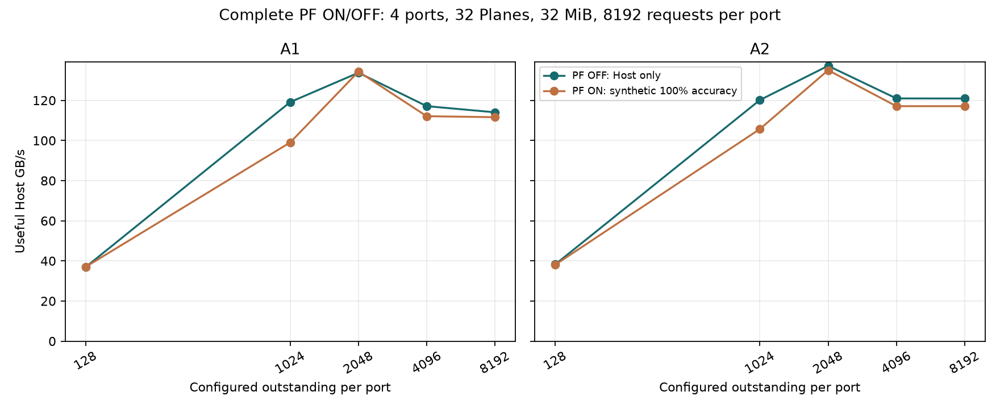

# 높은 QD에서 Host 요청만으로 읽기 성능 평가

성능 평가의 기준선을 PF 자체를 끈 Host-only 실행으로 분리한다. `prefetch=false`는 합성 후보 생성과 선행 Read를 모두 끈다. 이전 92개 실험의 `pf_ahead_limit=0`은 PF가 Demand를 앞서는 추가 예외만 끈 상태였고, 그 실행의 `prefetch`는 계속 true였다.

이번 비교는 4port·공유 32MiB·seed 7·port 내부 in-order를 유지한다. A1은 4KiB stripe와 CA head_locality, A2는 16KiB stripe와 CA locality를 사용하며 연속 우회 한도는 모두 32회다. 각 ON/OFF 쌍은 `prefetch`만 다르다. PF ON은 합성 정확도 100%·offered 기준 lead 10μs·미사용 후보 예산 128개다.

**평가 원칙:** 높은 QD의 목표 성능은 Host-only로 먼저 확인하고, PF의 가치는 같은 조건의 추가 효과로 평가한다. 이 변경은 평가 기준과 실행 프로파일에 적용한다. QD를 읽어서 PF를 실시간 ON/OFF하는 기능은 이번에 추가하지 않았다.

기본 32Plane·QD2,048 이상 6개 ON/OFF 쌍 중 5개에서 PF OFF가 빨랐다. 다만 기본 A1의 QD2,048, 긴 A1 요청열, 64Plane 등에서는 Host 측정 구간 기준으로 PF ON이 빠른 조건도 있다. 따라서 공통 QD 임계값만으로 항상 최고 성능을 고르는 규칙은 이 결과로 확정하지 않는다.

## QD별 같은 조건 비교

기본 요청열은 port당 8,192개다. OFF 변화율은 같은 QD의 PF ON 대비이며 양수면 Host-only가 빠르다.

| 패턴 | QD/port | PF OFF GB/s | PF ON GB/s | OFF 변화 | OFF p99 μs | ON p99 μs |
|---|---:|---:|---:|---:|---:|---:|
| A1 | 128 | 36.866 | 36.981 | -0.31% | 3076.20 | 3078.09 |
| A1 | 1024 | 119.148 | 99.039 | +20.30% | 602.26 | 830.97 |
| A1 | 2048 | 133.772 | 134.339 | -0.42% | 479.11 | 474.87 |
| A1 | 4096 | 117.112 | 112.106 | +4.47% | 621.84 | 673.02 |
| A1 | 8192 | 114.051 | 111.611 | +2.19% | 652.60 | 678.32 |
| A2 | 128 | 38.258 | 38.092 | +0.44% | 2957.64 | 2959.83 |
| A2 | 1024 | 120.167 | 105.715 | +13.67% | 592.71 | 735.56 |
| A2 | 2048 | 137.212 | 135.035 | +1.61% | 453.95 | 469.73 |
| A2 | 4096 | 120.965 | 117.105 | +3.30% | 585.34 | 621.90 |
| A2 | 8192 | 120.927 | 117.111 | +3.26% | 585.68 | 621.85 |

QD8,192는 이 기본 요청열의 port당 전체 요청 수와 같다. 유한 요청열의 시작·종료 영향이 있으며, 설정 QD를 실제 평균 동시 요청 수나 정상 상태 포화의 증거로 사용하지 않는다.



## Host-only 프로파일

기본 요청열의 PF OFF 조건 중 처리량이 가장 높은 설정을 보관한다. 처리량 동률은 p99, QD가 작은 순서로 고른다. 이전 PF ON 프로파일은 과거 결과 재현을 위해 유지한다.

| 패턴 | 관측 최고 Host-only QD | Host-only GB/s | 같은 QD의 PF ON GB/s | 설정 |
|---|---:|---:|---:|---|
| A1 | 2048 | 133.772 | 134.339 | [A1 Host-only](profiles/A1_host_only.json) |
| A2 | 2048 | 137.212 | 135.035 | [A2 Host-only](profiles/A2_host_only.json) |

이 선택은 고정 버퍼·정책·배치·요청열 범위의 관측값이다. PF OFF의 버퍼·CA 정책까지 다시 최적화한 결과나 장치 전체의 최대 성능은 아니다. Host 반환 경로의 명목 상한 256GB/s에 반드시 도달한다는 의미도 아니다.

## 긴 요청열과 Plane 확장 확인

긴 요청열은 port당 16,384개·32Plane, 확장은 port당 8,192개·64Plane이다. 두 확인 모두 QD2,048/port이며 buffer는 32MiB다. ON/OFF는 같은 물리 주소열을 사용한다. Plane 수가 다른 결과끼리는 geometry에 따른 물리 주소 이력도 달라진다.

| 패턴 | 확인 | PF OFF GB/s | PF ON GB/s | OFF 변화 | OFF p99 μs | ON p99 μs |
|---|---|---:|---:|---:|---:|---:|
| A1 | 긴 요청열 | 141.492 | 143.352 | -1.30% | 848.67 | 822.47 |
| A1 | 64Plane | 185.862 | 186.803 | -0.50% | 197.91 | 194.28 |
| A2 | 긴 요청열 | 146.007 | 143.164 | +1.99% | 790.00 | 826.51 |
| A2 | 64Plane | 189.324 | 191.508 | -1.14% | 184.71 | 176.62 |

## PF 사전 작업 시간을 포함한 처리량

앞선 표의 GB/s는 첫 Host 요청 제시부터 마지막 반환까지다. PF ON은 그 전에 NAND 작업을 시작할 수 있다. 다음 표는 같은 QD2,048의 결과에서 첫 NAND 작업까지 포함한 처리량도 함께 표시한다. 작은 PF 이득을 평가할 때 두 측정 구간을 구분한다. 이는 계산 구간의 비교이며 PF의 모든 효과를 초기 준비 시간만으로 설명하는 인과 실험은 아니다.

| 패턴 | 조건 | PF OFF GB/s | PF ON Host 구간 GB/s | PF ON 사전 작업 포함 GB/s | 포함된 사전 작업 μs |
|---|---|---:|---:|---:|---:|
| A1 | 기본 | 133.772 | 134.339 | 133.008 | 10.00 |
| A1 | 긴 요청열 | 141.492 | 143.352 | 142.590 | 10.00 |
| A1 | 64Plane | 185.862 | 186.803 | 184.238 | 10.00 |
| A2 | 기본 | 137.212 | 135.035 | 133.690 | 10.00 |
| A2 | 긴 요청열 | 146.007 | 143.164 | 142.404 | 10.00 |
| A2 | 64Plane | 189.324 | 191.508 | 188.814 | 10.00 |

PF OFF는 Host 요청 이전 NAND Read가 없어 두 처리량이 같다. PF ON의 사전 작업 포함 처리량도 정상 상태 상한을 뜻하지 않는다. 실제 workload에서 준비 구간을 어디에 포함할지는 고객 측정 정의에 맞춰야 한다.

## 실제 수락량과 내부 처리 상태

평균 Outstanding은 요청별 `(반환 완료−수락)`을 합해 Host 측정 시간과 port 수로 나눈 값이다. 이는 수락 후 미완료 요청 수의 시간 평균이다. QD 설정은 상한이며 실제 평균과 구분한다. Peak는 네 port 중 관측 최대다. Ready 공간에는 순서 대기·현재 반환 중·미사용 PF가 포함된다.

| 패턴 | QD | PF | 평균 Outstanding/port | Peak | Long % | 평균 예약 대기 MiB | 평균 ready MiB | sensing 수 | PF 기원 sensing/재출력 수 |
|---|---:|---|---:|---:|---:|---:|---:|---:|---:|
| A1 | 128 | OFF | 126.0 | 128 | 93.97 | 1.154 | 0.490 | 8192 | 0 |
| A1 | 128 | ON | 126.4 | 128 | 94.35 | 2.009 | 0.544 | 8192 | 462 |
| A1 | 1024 | OFF | 930.7 | 1024 | 11.01 | 7.333 | 6.899 | 8192 | 0 |
| A1 | 1024 | ON | 938.7 | 1024 | 18.21 | 6.230 | 9.215 | 8192 | 1339 |
| A1 | 2048 | OFF | 1703.0 | 2048 | 6.30 | 12.963 | 13.330 | 8192 | 0 |
| A1 | 2048 | ON | 1732.4 | 2048 | 7.32 | 13.918 | 13.133 | 8192 | 1856 |
| A1 | 4096 | OFF | 1562.0 | 4096 | 4.67 | 9.063 | 15.079 | 8194 | 0 |
| A1 | 4096 | ON | 1561.3 | 4096 | 5.90 | 7.980 | 16.383 | 8198 | 1822 |
| A1 | 8192 | OFF | 1548.5 | 5654 | 4.29 | 9.092 | 14.849 | 8196 | 0 |
| A1 | 8192 | ON | 1582.4 | 5344 | 5.04 | 7.816 | 16.883 | 8199 | 1822 |
| A2 | 128 | OFF | 125.7 | 128 | 88.99 | 1.017 | 0.566 | 8196 | 0 |
| A2 | 128 | ON | 125.2 | 128 | 90.25 | 2.037 | 0.735 | 8196 | 488 |
| A2 | 1024 | OFF | 923.3 | 1024 | 10.69 | 7.716 | 6.326 | 8196 | 0 |
| A2 | 1024 | ON | 946.2 | 1024 | 15.91 | 7.671 | 8.056 | 8196 | 1415 |
| A2 | 2048 | OFF | 1666.4 | 2048 | 5.72 | 14.884 | 10.776 | 8196 | 0 |
| A2 | 2048 | ON | 1716.5 | 2048 | 7.21 | 14.269 | 12.610 | 8196 | 2071 |
| A2 | 4096 | OFF | 1525.0 | 4096 | 3.92 | 11.226 | 12.284 | 8196 | 0 |
| A2 | 4096 | ON | 1550.8 | 4096 | 5.39 | 8.864 | 15.428 | 8198 | 2105 |
| A2 | 8192 | OFF | 1540.3 | 5116 | 3.92 | 11.330 | 12.420 | 8196 | 0 |
| A2 | 8192 | ON | 1560.3 | 5071 | 5.09 | 8.927 | 15.518 | 8198 | 2105 |

`count_prefetch_started`는 PF로 생성된 작업의 CA 발행 수다. 발행 전에 Demand가 연결될 수 있으므로 실제 발행 시점에 speculative였던 Read 수와 같지 않다. Long 비율이나 이 계수만으로 처리량 차이의 인과 기여도를 분리하지 않는다.

## 다음 튜닝 기준

- 먼저 Host-only에서 buffer·수락 window·CA 정책·배치를 조정한다. 높은 QD에서 PF 이득이 필요하다면 부족한 Demand 가시성, 발행 가능 Plane 수, 수락 제한 중 무엇을 보완했는지 분리한다.
- 동적 PF 제어를 검토할 때는 설정 QD 하나보다 실제 수락된 요청, Plane별 발행 가능한 서로 다른 물리 페이지, ready/예약 공간과 선두 대기를 관측한다. 많은 Host 요청이 같은 물리 페이지를 공유할 수 있다.
- PF가 보완할 조건은 같은 자원에서 별도로 측정한다. QD 128도 포화 속도로 제시한 합성 trace이며 간헐적 실제 Host 부하를 대표하지 않는다.
- 단일 seed·고정 A1/A2 패턴의 결과로 공통 QD cutoff를 확정하지 않는다. A2는 1→3→2의 지역 순열이며 균일 무작위 Read가 아니다.
- PF ON은 미래 offered 요청을 아는 모델이다. QD/버퍼 때문에 수락이 늦어지면 실제 수락보다 훨씬 먼저 후보를 생성할 수 있다. 실제 predictor 성능과 구분한다.

## 재현과 검증

새로운 실행 18개와 동일 모델·동일 설정에서 재사용한 ON 대조군 10개, 총 28개 조건이다. 14개 ON/OFF 쌍에서 Prefetch Boolean 외 설정이 같은지, PF OFF의 모든 PF 계수가 0인지, 원본 CSV·JSON·입력·소스 해시와 재사용 대조군이 일치하는지 검증한다. Simulator 소스는 이전 커밋에서 변경하지 않았다.

```sh
python3 -m znand.pf_qd_sweep --workers 6
python3 -m znand.pf_qd_sweep --validate-only
python3 -m znand.pf_qd_report
python3 -m znand.run --config results/znand/pf_qd/profiles/A1_host_only.json --pattern A1 --per-port 8192 --out results/local/A1_host_only
```

[전체 28개 CSV](sweep.csv), [ON/OFF 쌍 비교](paired.csv), [원본 JSON](rows.json), [실행 조건](cases.json), [실행 해시](manifest.json), [독립 검증](validation.json). `source=reused`와 `source_case`는 이전 scheduling_next 결과의 해당 행을 가리킨다.

호스트 응답 순서, 임시 버퍼링, Plane당 page buffer 1개, 16KiB NAND Data 전송은 유지한다. 실제 GC·동적 L2P·Die 공유 제약이나 NAND 부분 출력은 이번 비교에 추가하지 않았다.
