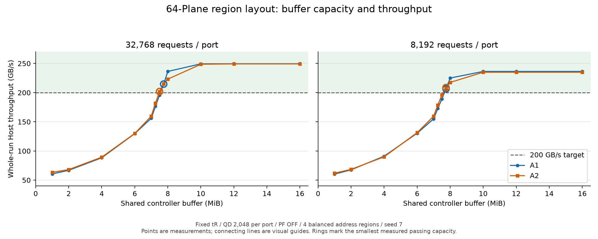

# 개선 배치의 200GB/s Controller Buffer 하한 측정

**측정한 용량 중 A1/A2 × 8,192/32,768요청/port가 모두 전체 평균 200GB/s 이상을 유지한 최소 용량은 7.75MiB다.**

신규 실행 44개와 정확히 같은 조건의 기존 16/32MiB 대조군 8개를 사용했다. 순간 최대치나 중간 완료 구간을 통과 판정에 사용하지 않는다. 첫 Host 요청 제시부터 마지막 반환까지의 유효 byte/시간이 기준이다.

## 고정 조건

| 항목 | 값 |
|---|---|
| 배치 | 기존 개선 배치 snapshot 그대로: 네 논리 영역별 Plane 그룹, 각 영역은 모든 channel 사용 |
| Geometry / page buffer | 4channel × 16Plane = 총 64Plane, Plane당 16KiB page buffer 1개 |
| Controller buffer | 공유 buffer_pages만 변경, 1개 = 16KiB, 1MiB = 64개 |
| Host | 4port, 512bit·1GHz/port, 합산 256GB/s, port 내부 in-order |
| QD / PF / 가용률 | 2,048/port / PF OFF / 85% |
| tR | First 20.69 / Short 2.00 / Mid 2.08 / Long 12.16 / Group 20.69µs |
| A1 | 4KiB 순차 읽기, stripe 4KiB, CA head_locality |
| A2 | 4KiB의 1→3→2 지역 순열, stripe 16KiB, CA locality; uniform random 아님 |
| 길이 / seed | 8,192 및 32,768요청/port / seed 7 |

A1/A2 사이에는 stripe와 CA 정책 차이가 있다. 용량 효과는 같은 패턴·길이 안에서 비교한다. 각 길이의 기존 snapshot을 그대로 사용하며 신규 배치 생성, QD 감소, tR 변경, PF 또는 cache 도입은 없다.

## 전체 평균 처리량

| 공유 버퍼 MiB | A1 8,192 GB/s | A2 8,192 GB/s | A1 32,768 GB/s | A2 32,768 GB/s | 네 조건 모두 ≥200 |
|---:|---:|---:|---:|---:|---|
| 32 | 236.361 | 234.988 | 249.508 | 249.325 | 통과 |
| 16 | 236.361 | 234.988 | 249.508 | 249.325 | 통과 |
| 12 | 236.361 | 234.988 | 249.508 | 249.325 | 통과 |
| 10 | 236.341 | 234.988 | 249.367 | 248.610 | 통과 |
| 8 | 225.014 | 217.521 | 236.348 | 223.187 | 통과 |
| 7.75 | 206.530 | 208.675 | 214.678 | 215.186 | 통과 |
| 7.5 | 189.137 | 196.182 | 195.763 | 201.866 | 미달 |
| 7.25 | 172.882 | 178.763 | 176.505 | 181.993 | 미달 |
| 7 | 155.115 | 159.649 | 156.123 | 159.794 | 미달 |
| 6 | 130.420 | 131.450 | 129.752 | 130.060 | 미달 |
| 4 | 91.053 | 89.926 | 88.359 | 89.463 | 미달 |
| 2 | 67.658 | 68.556 | 66.836 | 68.087 | 미달 |
| 1 | 60.322 | 61.946 | 60.685 | 63.474 | 미달 |



그래프의 선은 측정점을 연결한 시각적 안내이며, 미측정 용량의 예측값이 아니다. 원으로 강조한 점은 각 패턴·길이의 최소 통과 측정점이다.

## 패턴·길이별 관측 경계

| 패턴 | 요청/port | 바로 아래 측정 용량 MiB | 해당 GB/s | 최소 통과 측정 용량 MiB | 해당 GB/s |
|---|---:|---:|---:|---:|---:|
| A1 | 8,192 | 7.5 | 189.136930 | 7.75 | 206.529528 |
| A2 | 8,192 | 7.5 | 196.181740 | 7.75 | 208.675101 |
| A1 | 32,768 | 7.5 | 195.763240 | 7.75 | 214.678011 |
| A2 | 32,768 | 7.25 | 181.992618 | 7.5 | 201.866321 |

위 하한은 측정한 용량 집합에서의 최소 통과점이다. 인접 두 용량 사이의 모든 16KiB 슬롯 수를 전수 조사한 절대 최소값이 아니다. 스케줄링 순서가 변할 수 있으므로 용량과 성능의 단조 증가를 가정하거나 선형 보간하지 않는다. 실제 비단조 구간은 validation.json의 nonmonotonic_steps에 기록한다.

측정한 정수 MiB 중 네 조건 모두 200GB/s 대비 10% 이상 여유를 갖는 첫 용량은 **10MiB**다. 해당 용량의 최저 처리량은 234.988GB/s다. 이 여유는 이번 네 조건에서만 확인된 것이며, 실제 제품의 안전 여유를 검증했다는 뜻은 아니다.

## 긴 요청열의 지연·점유·Long 변화

| 버퍼 MiB | 패턴 | 전체 GB/s | 중간 GB/s | Long % | 평균 버퍼 MiB | Peak MiB | 평균 outstanding/port | 평균 수락 대기 µs | p99 offer µs |
|---:|---|---:|---:|---:|---:|---:|---:|---:|---:|
| 32 | A1 | 249.508 | 254.571 | 0.0000 | 10.613 | 12.016 | 667.5 | 0.000 | 54.629 |
| 32 | A2 | 249.325 | 254.741 | 0.0122 | 10.588 | 11.750 | 674.0 | 0.000 | 56.211 |
| 16 | A1 | 249.508 | 254.571 | 0.0000 | 10.613 | 12.016 | 667.5 | 0.000 | 54.629 |
| 16 | A2 | 249.325 | 254.741 | 0.0122 | 10.588 | 11.750 | 674.0 | 0.000 | 56.211 |
| 12 | A1 | 249.508 | 254.571 | 0.0000 | 10.613 | 12.000 | 667.5 | 0.000 | 54.629 |
| 12 | A2 | 249.325 | 254.741 | 0.0122 | 10.588 | 11.750 | 674.0 | 0.000 | 56.211 |
| 10 | A1 | 249.367 | 255.027 | 0.0000 | 9.738 | 10.000 | 614.0 | 2.675 | 55.844 |
| 10 | A2 | 248.610 | 255.072 | 0.0122 | 9.717 | 10.000 | 619.2 | 3.022 | 56.194 |
| 8 | A1 | 236.348 | 251.819 | 0.0000 | 7.714 | 8.000 | 486.0 | 22.419 | 174.438 |
| 8 | A2 | 223.187 | 248.143 | 0.0122 | 7.729 | 8.000 | 492.2 | 37.035 | 308.386 |
| 7.75 | A1 | 214.678 | 244.480 | 0.0000 | 7.506 | 7.750 | 473.2 | 55.212 | 403.731 |
| 7.75 | A2 | 215.186 | 244.537 | 0.0122 | 7.505 | 7.750 | 477.9 | 53.225 | 397.832 |
| 7.5 | A1 | 195.763 | 237.094 | 0.0000 | 7.292 | 7.500 | 459.3 | 97.290 | 645.362 |
| 7.5 | A2 | 201.866 | 240.599 | 0.0122 | 7.285 | 7.500 | 464.1 | 78.992 | 562.449 |
| 7.25 | A1 | 176.505 | 227.952 | 0.0000 | 7.075 | 7.250 | 446.8 | 157.746 | 944.593 |
| 7.25 | A2 | 181.993 | 231.525 | 0.0122 | 7.069 | 7.250 | 450.4 | 135.193 | 852.872 |
| 7 | A1 | 156.123 | 215.022 | 0.0000 | 6.856 | 7.000 | 432.8 | 254.742 | 1341.682 |
| 7 | A2 | 159.794 | 218.207 | 0.0122 | 6.852 | 7.000 | 436.7 | 230.954 | 1262.672 |
| 6 | A1 | 129.752 | 193.665 | 0.0000 | 5.912 | 6.000 | 372.7 | 479.112 | 2040.594 |
| 6 | A2 | 130.060 | 194.649 | 0.0153 | 5.911 | 6.000 | 376.9 | 472.415 | 2030.778 |
| 4 | A1 | 88.359 | 90.052 | 0.0000 | 3.974 | 4.000 | 250.0 | 1437.742 | 3978.919 |
| 4 | A2 | 89.463 | 91.990 | 0.0153 | 3.973 | 4.000 | 253.0 | 1396.151 | 3903.953 |
| 2 | A1 | 66.836 | 67.179 | 0.0000 | 1.995 | 2.000 | 123.9 | 2883.059 | 5935.522 |
| 2 | A2 | 68.087 | 68.569 | 0.0183 | 1.995 | 2.000 | 126.5 | 2771.843 | 5788.028 |
| 1 | A1 | 60.685 | 60.424 | 0.0000 | 0.999 | 1.000 | 60.2 | 3331.667 | 6744.112 |
| 1 | A2 | 63.474 | 63.680 | 0.0183 | 0.999 | 1.000 | 62.8 | 3092.769 | 6355.560 |

버퍼 점유는 Host 요청 수락 시점부터의 예약 공간을 포함한다. 용량 축소는 대기·sensing·완료 데이터의 공간뿐 아니라 수락 가능한 물리 페이지 수를 제한한다. 실제 수락량, 발행 가능한 Plane 작업, port 선두 대기 및 물리 페이지 재접근이 달라질 수 있다. 원인 설명은 관측한 Long 비율·지연·점유와 함께 읽어야 하며, 성능 저하를 무조건 Long 증가로 단정하지 않는다.

## 작은 버퍼의 Port별 진행 불균형

| 버퍼 MiB | A2 Port 0 완료 µs | Port 1 | Port 2 | Port 3 |
|---:|---:|---:|---:|---:|
| 16 | 2139.409 | 2146.603 | 2153.299 | 2140.792 |
| 8 | 2133.164 | 2133.877 | 2139.906 | 2405.474 |
| 7.75 | 2132.680 | 2133.877 | 2205.695 | 2494.920 |
| 7.5 | 2132.680 | 2133.877 | 2135.526 | 2659.537 |
| 6 | 2132.622 | 2133.003 | 2137.469 | 4127.866 |
| 4 | 2132.301 | 2137.859 | 4123.343 | 6001.041 |
| 2 | 2132.788 | 4128.306 | 6043.247 | 7885.116 |
| 1 | 2330.004 | 4488.665 | 6523.532 | 8458.161 |

32,768요청/port의 총 Host 데이터는 512MiB다. 전체 200GB/s를 넘으려면 마지막 반환이 2684.355µs 이내에 끝나야 한다. 7.5MiB에서 A1 마지막 반환은 2742.450µs, A2는 2659.537µs다. 같은 용량에서 통과 여부가 갈리는 이유를 마지막 Port의 완료 시간으로 확인할 수 있다.

현재 admission은 매번 Port 0→1→2→3 순서로 수락을 시도하고, 공유 버퍼에 각 물리 페이지의 공간을 예약한다. 일반 payload 공간의 port별 공평한 분배를 강제하지 않으며, 별도 진행성 보호 슬롯은 선두가 없는 port를 위한 것이다. 작은 버퍼의 완료 시간 불균형은 이 수락 정책과 영역별 Plane 배치가 함께 작용했을 가능성을 보여준다. 공정 수락 정책으로 바꾼 대조 실험은 이번에 하지 않았으므로 특정 정책만의 인과 효과로 확정하지 않는다. 이번 하한은 현재 admission·스케줄러까지 포함한 값이며, NAND 자체가 요구하는 절대 SRAM 용량으로 해석하지 않는다.

## 범위와 후속 튜닝

- 이번 기준은 네 논리 영역의 균형 부하, A1/A2 4KiB 읽기, 정적 배치와 seed 7에 한정한다.
- 한 영역 집중, 1~3 활성 port, 실제 동적 L2P·GC/WL, write 혼합, 64B 패턴, PF ON은 별도 조건이다.
- 회사의 더 큰 요청 수 원본 조건은 아직 확보하지 않았으므로 해당 길이의 200GB/s 유지 여부를 확인한 결과로 취급하지 않는다.
- 기본 32MiB 및 기존 16MiB 프로파일을 보존한다. 이번 용량별 profiles를 명시적으로 선택해 재현한다.
- 다음 검증은 선택한 용량과 여유 용량을 고정한 뒤 다른 seed·부하 편향·실제 snapshot으로 비교한다.

## 재현 및 검증

```sh
python3 -m znand.host64_buffer_floor --workers 4
# 경계의 추가 용량은 --mib로 지정하며 기존 결과에 추가한다.
python3 -m znand.host64_buffer_floor --validate-only
python3 -m znand.host64_buffer_floor_report
```

그래프는 matplotlib가 있는 환경에서 `python3 -m znand.host64_buffer_floor_plot`으로 생성한다. 수치 실행·검증에는 matplotlib가 필요하지 않다.

cases.json은 실행한 모든 용량·패턴·길이를 보존한다. 추가 경계 용량을 포함해 완전히 재현하려면 `--mib 1 2 4 6 7 7.25 7.5 7.75 8 10 12 16 32`를 지정한다.

모델/계측 코드와 snapshot 해시, 기준 결과의 정확한 재사용, buffer_pages 외 Config 일치, CSV/JSON 일치, 요청량·반환 순서·버퍼/QD 한도·지연 분해·상태별 버퍼 점유 회계를 검증했다.

[전체 CSV](sweep.csv) · [결과 JSON](rows.json) · [검증 및 개별 경계](validation.json) · [공통 경계 요약](summary.json) · [실행 조건](cases.json) · [용량별 프로파일](profiles/)
