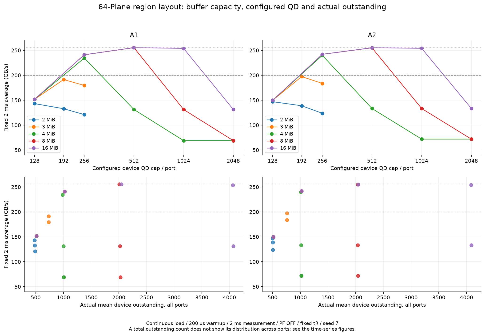
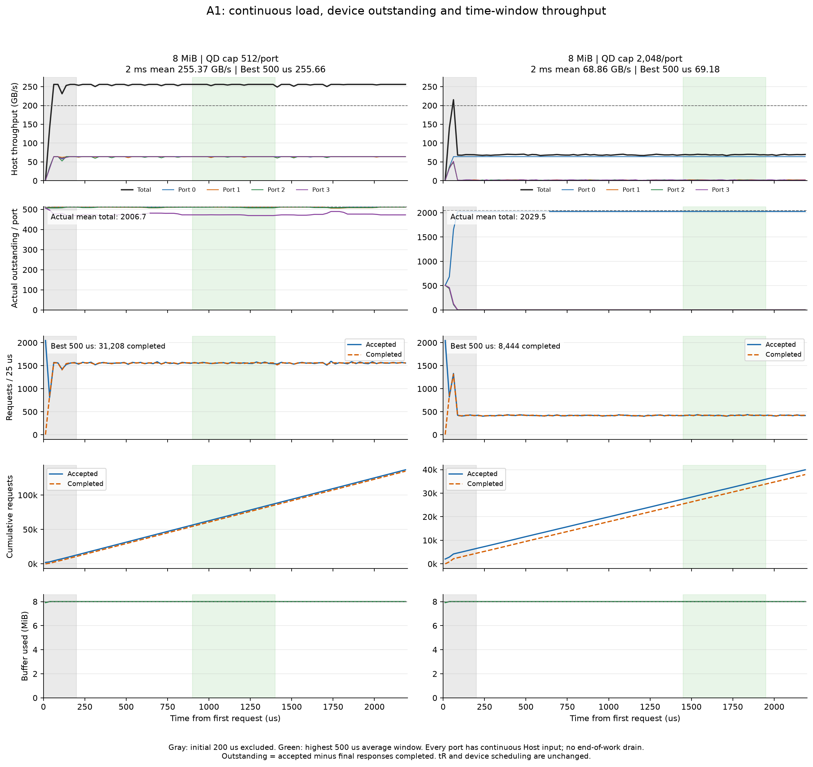
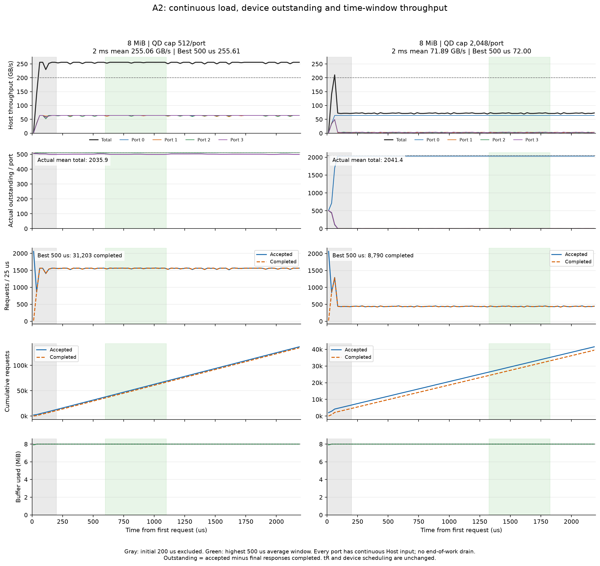

# 지속 부하에서 Outstanding과 시간별 성능

**측정 기준을 전체 요청 완료 시간에서, 지속 부하의 시간 구간별 평균과 실제 Device outstanding으로 변경했다.** 모든 Port에 다음 명령을 계속 공급하며 2.2ms에서 관측을 끝낸다. 미완료 요청은 그대로 남겨 두고 drain 시간을 분모에 넣지 않는다.

신규 42개 조건을 측정했다. 초기 200µs를 제외한 **200~2,200µs의 고정 2ms 평균**과, 그 안에서 가장 빠른 **연속 500µs 평균**을 함께 기록한다. 최고 구간은 25µs 간격으로 검색하며 5개 maintenance 주기를 포함한다. 순간 한 점의 최고값이 아니다.

## 측정 계약

| 항목 | 정의 |
|---|---|
| Device outstanding | 디바이스가 수락했지만 마지막 응답이 아직 완료되지 않은 요청 수: 누적 수락 − 누적 완료 |
| 설정 QD | Port별 디바이스 outstanding 상한. 버퍼 제한 때문에 실제 값은 더 작거나 불균형할 수 있음 |
| 요청 공급 | 각 Port에 다음 AR 명령 1개를 항상 대기시킴. 수락되면 다음 주소를 즉시 제시. QD 슬롯이 반환되면 기존 admission이 다시 수락 |
| 요청 채널 | 기존 next_ar 규칙 유지: 1GHz에서 Port당 최대 1요청/ns. Host 데이터 반환은 Port당 최대 64GB/s |
| 시간 기준 | 첫 AR 제시를 0µs로 표시. 모델 절대 시작 시각 30µs는 maintenance 위상 재현을 위해 유지 |
| 그래프 구간 | 25µs bin. 각 bin의 전송률·수락/완료 수·누적 수·실제 outstanding 평균/최소/최대/끝값·버퍼 점유 |
| 처리량 | 반환 전송 구간과 측정 창이 겹치는 실제 payload byte / 시간. 경계에서 진행 중인 burst는 전송된 부분만 반영 |
| 완료 명령 지표 | 마지막 응답까지 끝난 요청 수와 completed_bandwidth_gbps를 별도로 제공. 전송 byte 지표와 경계의 부분 burst만큼 다를 수 있음 |
| 고정 장치 조건 | 4port, 4channel × 16Plane, 16KiB NAND page, 기존 tR, 가용률 85%, PF OFF, port 내부 in-order |
| 주소 배치 | 기존 영역별 Plane 배치 규칙. A1 stripe 4KiB / head_locality, A2 stripe 16KiB / locality |

Device 수락·NAND·버퍼·반환 정책은 원본 model.py를 그대로 사용한다. 새 모듈은 Host 공급과 관측 시점만 바꾼다. Host에서 기다리는 명령을 Device outstanding에 더하지 않는다. 과거의 유한 요청열은 데이터 반환 속도에 맞춘 offer 시각을 사용했고, 이번에는 요청 채널을 계속 공급하므로 서로 다른 부하 방식의 결과다. 과거 7.75MiB 하한을 이번 조건의 하한으로 사용하지 않는다.

실행 시간은 고정하며 총 요청 수는 결과다. 주소 도메인 65,536요청/Port는 mapping 범위를 확보하기 위한 상한이고, 이 수를 모두 끝내는 실험이 아니다. 반복 주소 wrap 없이 새 주소로 진행하며, 모든 실행이 도메인 끝에 도달하지 않았음을 검증했다.

## 버퍼별 관측 최고 설정

| 버퍼 MiB | 패턴 | 설정 QD/Port | 실제 outstanding 평균 총합 | Port별 실제 평균 | 고정 2ms GB/s | 최고 500µs GB/s | 최고 구간 µs | 구간 완료 요청 수 |
|---:|---|---:|---:|---|---:|---:|---|---:|
| 2 | A1 | 128 | 478.7 | 126.4/126.4/123.4/102.5 | 143.088 | 143.833 | 1225~1725 | 17,558 |
| 2 | A2 | 128 | 501.3 | 127.8/127.6/127.0/118.9 | 146.942 | 148.382 | 225~725 | 18,113 |
| 3 | A1 | 192 | 732.0 | 190.7/190.1/188.2/162.9 | 191.313 | 192.004 | 750~1250 | 23,437 |
| 3 | A2 | 192 | 758.5 | 191.7/191.5/190.8/184.6 | 197.337 | 198.131 | 325~825 | 24,186 |
| 4 | A1 | 256 | 985.1 | 254.9/254.1/253.0/223.1 | 234.484 | 235.289 | 1550~2050 | 28,722 |
| 4 | A2 | 256 | 1012.3 | 255.9/255.8/255.2/245.4 | 239.904 | 240.745 | 1150~1650 | 29,387 |
| 8 | A1 | 512 | 2006.7 | 511.4/510.6/510.3/474.5 | 255.366 | 255.659 | 900~1400 | 31,208 |
| 8 | A2 | 512 | 2035.9 | 512.0/511.8/511.4/500.8 | 255.058 | 255.607 | 600~1100 | 31,203 |
| 16 | A1 | 512 | 2048.0 | 512.0/512.0/512.0/512.0 | 255.372 | 255.820 | 1225~1725 | 31,228 |
| 16 | A2 | 512 | 2048.0 | 512.0/512.0/512.0/512.0 | 255.211 | 255.653 | 600~1100 | 31,209 |

측정한 조합 중 두 패턴 모두 고정 2ms 평균 200GB/s를 넘긴 최소 버퍼는 **4MiB**다. 버퍼별로 설정 QD를 함께 선택한 결과이며, 고정 QD2,048의 버퍼 단독 변경 결과와 구분한다. 이 용량보다 작은 모든 슬롯 수와 모든 QD를 전수 탐색한 절대 하한은 아니다.



## 시간 변화: 8MiB의 포화 설정과 큰 QD 비교

회색 구간은 초기 200µs, 초록 구간은 해당 실행의 최고 500µs 평균 구간이다. 그 이후에도 모든 Port에 입력이 남아 있어, 특정 Port의 입력 소진 때문에 생긴 종료 구간은 없다. 낮은 Port별 처리량은 입력 부족이 아닌 Device 수락/서비스 결과로 읽는다.

### A1

8MiB에서 관측 최고 설정은 QD **512/Port**다. 고정 2ms 평균 **255.366GB/s**, 최고 500µs 평균 **255.659GB/s**다. 같은 버퍼에서 QD2,048은 고정 평균 **68.858GB/s**다.

실제 Port별 평균 outstanding은 최고 설정에서 **511.4 / 510.6 / 510.3 / 474.5**, QD2,048에서 **2026.5 / 1.0 / 1.0 / 1.0**다. 총합만으로 포화 상태를 판단하지 않고 Port별 분포를 함께 봐야 한다.



[포화 설정의 시간별 CSV](timelines/A1_b8_q512.csv) · [QD2,048의 시간별 CSV](timelines/A1_b8_q2048.csv)

### A2

8MiB에서 관측 최고 설정은 QD **512/Port**다. 고정 2ms 평균 **255.058GB/s**, 최고 500µs 평균 **255.607GB/s**다. 같은 버퍼에서 QD2,048은 고정 평균 **71.889GB/s**다.

실제 Port별 평균 outstanding은 최고 설정에서 **512.0 / 511.8 / 511.4 / 500.8**, QD2,048에서 **2033.8 / 2.6 / 2.5 / 2.5**다. 총합만으로 포화 상태를 판단하지 않고 Port별 분포를 함께 봐야 한다.



[포화 설정의 시간별 CSV](timelines/A2_b8_q512.csv) · [QD2,048의 시간별 CSV](timelines/A2_b8_q2048.csv)

## 최고 구간과 고정 구간을 함께 보는 이유

최고 500µs 평균은 사용자 요청에 따른 포화 구간 관측값이다. 검색한 시간 범위와 선택한 시작/종료를 모두 기록한다. 고정 2ms 평균과 전반/후반 1ms 평균도 함께 제공하므로 특정 maintenance 위상이나 일시적인 높은 값만 골랐는지 확인할 수 있다. 20개 maintenance 주기를 관측했지만 모든 seed·장시간·부하 편향의 정상상태를 보장하는 값으로 확장하지 않는다.

기존 admission은 Port 0→1→2→3 순서이고 공유 버퍼를 수락 시 예약한다. 큰 QD가 소수 Port의 예약 점유를 허용하면 다른 Port의 실제 outstanding이 작게 남을 수 있다. 이번에는 admission 공정성을 수정하지 않고 이 상태를 시간축에 드러냈다. 적절한 Port별 QD 상한은 버퍼를 함께 사용하는 양을 제한하는 역할도 한다.

## 전체 조합

| 패턴 | 버퍼 MiB | 설정 QD/Port | 고정 2ms GB/s | 최고 500µs GB/s | 실제 outstanding 총합 | 후반/전반 변화 % |
|---|---:|---:|---:|---:|---:|---:|
| A1 | 2 | 128 | 143.088 | 143.833 | 478.7 | +0.059 |
| A1 | 2 | 192 | 132.814 | 133.481 | 482.5 | +0.092 |
| A1 | 2 | 256 | 121.131 | 121.553 | 486.5 | -0.089 |
| A1 | 3 | 128 | 151.702 | 152.067 | 512.0 | +0.451 |
| A1 | 3 | 192 | 191.313 | 192.004 | 732.0 | -0.031 |
| A1 | 3 | 256 | 179.589 | 180.192 | 734.6 | +0.199 |
| A1 | 4 | 128 | 151.702 | 152.067 | 512.0 | +0.451 |
| A1 | 4 | 256 | 234.484 | 235.289 | 985.1 | +0.341 |
| A1 | 4 | 512 | 131.289 | 131.400 | 999.5 | -0.094 |
| A1 | 4 | 1024 | 68.855 | 68.989 | 1005.5 | -0.241 |
| A1 | 4 | 2048 | 68.855 | 68.989 | 1005.5 | -0.241 |
| A1 | 8 | 128 | 151.702 | 152.067 | 512.0 | +0.451 |
| A1 | 8 | 256 | 241.067 | 241.515 | 1024.0 | +0.131 |
| A1 | 8 | 512 | 255.366 | 255.659 | 2006.7 | +0.042 |
| A1 | 8 | 1024 | 131.224 | 131.400 | 2021.7 | +0.056 |
| A1 | 8 | 2048 | 68.858 | 69.177 | 2029.5 | +0.465 |
| A1 | 16 | 128 | 151.702 | 152.067 | 512.0 | +0.451 |
| A1 | 16 | 256 | 241.067 | 241.515 | 1024.0 | +0.131 |
| A1 | 16 | 512 | 255.372 | 255.820 | 2048.0 | +0.173 |
| A1 | 16 | 1024 | 253.873 | 254.915 | 4059.7 | +0.482 |
| A1 | 16 | 2048 | 131.256 | 131.400 | 4069.7 | +0.006 |
| A2 | 2 | 128 | 146.942 | 148.382 | 501.3 | -0.352 |
| A2 | 2 | 192 | 138.768 | 139.638 | 503.7 | +0.279 |
| A2 | 2 | 256 | 123.665 | 123.883 | 503.6 | +0.023 |
| A2 | 3 | 128 | 149.689 | 150.515 | 512.0 | -0.347 |
| A2 | 3 | 192 | 197.337 | 198.131 | 758.5 | -0.109 |
| A2 | 3 | 256 | 183.593 | 184.036 | 758.0 | -0.292 |
| A2 | 4 | 128 | 149.689 | 150.515 | 512.0 | -0.347 |
| A2 | 4 | 256 | 239.904 | 240.745 | 1012.3 | +0.005 |
| A2 | 4 | 512 | 133.259 | 133.382 | 1015.7 | +0.074 |
| A2 | 4 | 1024 | 71.875 | 72.004 | 1017.3 | +0.165 |
| A2 | 4 | 2048 | 71.875 | 72.004 | 1017.3 | +0.165 |
| A2 | 8 | 128 | 149.689 | 150.515 | 512.0 | -0.347 |
| A2 | 8 | 256 | 241.976 | 242.470 | 1024.0 | -0.079 |
| A2 | 8 | 512 | 255.058 | 255.607 | 2035.9 | -0.151 |
| A2 | 8 | 1024 | 133.259 | 133.382 | 2039.6 | -0.071 |
| A2 | 8 | 2048 | 71.889 | 72.004 | 2041.4 | -0.125 |
| A2 | 16 | 128 | 149.689 | 150.515 | 512.0 | -0.347 |
| A2 | 16 | 256 | 241.976 | 242.470 | 1024.0 | -0.079 |
| A2 | 16 | 512 | 255.211 | 255.653 | 2048.0 | -0.000 |
| A2 | 16 | 1024 | 254.012 | 255.152 | 4084.0 | +0.582 |
| A2 | 16 | 2048 | 133.333 | 133.603 | 4087.9 | -0.037 |

## 검증과 재현

원본 NAND 모델의 해시를 유지했다. 연속 공급·관측 종료·실제 QD·작은 버퍼·관측 계측의 비침습성을 테스트했다. 모든 실행에서 Port 내부 순서, 버퍼/QD 한도, 누적 수락−완료=outstanding, 요청별 체류시간 적분과 시간별 outstanding 적분의 일치, 완료 payload+경계 전송 payload의 회계, snapshot 범위 미소진, 전체 구간에 지속 입력 존재, CSV/JSON 일치를 확인했다.

```sh
python3 -m unittest test_znand_saturation -v
python3 -m znand.saturation_sweep --workers 4
python3 -m znand.saturation_sweep --buffers 2 3 --qds 128 192 256 --workers 4
python3 -m znand.saturation_sweep --validate-only
python3 -m znand.saturation_report
# matplotlib가 있는 환경에서 그래프 생성
python3 -m znand.saturation_plot
```

[실행 조건](cases.json) · [전체 CSV](sweep.csv) · [선택 설정](selection.json) · [시간별 CSV/JSON](timelines/) · [검증](validation.json) · [배치 동일성 검증](layout_validation.json) · [프로파일](profiles/)
