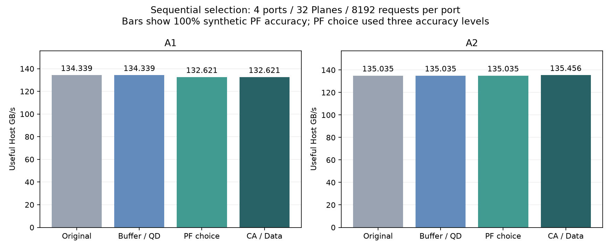
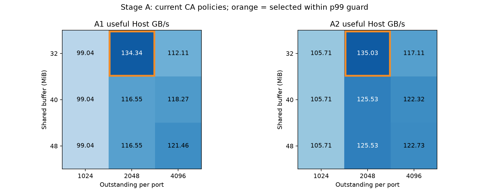
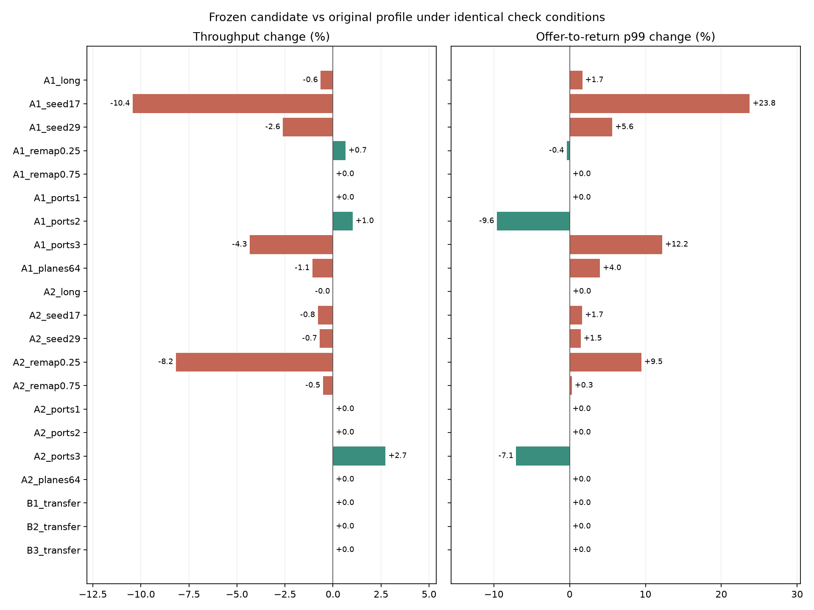

# 버퍼와 QD 재평가 및 PF와 Data 스케줄링 실험

현재 연속 주소 우선 정책에서 자원 설정을 다시 고른 뒤, 제한적인 연속 PF 우선과 NAND Data 선두 우선을 순서대로 비교했다. 18개 자원 비교, 18개 PF 비교, 8개 CA/Data 조합, 42개 추가 확인을 합쳐 기본 86개 조건이다. A1의 PF 우선 OFF 교차 확인 4개와 긴 요청열의 Data ON 2개를 추가해 총 92개를 새로 실행했다. 긴 요청열 Data OFF 대조군 2개는 기본 86개에서 재사용했다. 기본 실험은 4port·32Plane·port당 8,192개 요청·seed 7·비중첩 주소이며 A1은 4KiB stripe, A2는 16KiB stripe다.

**적용 결정: 기존 실행용 프로파일을 유지한다.** 제한적 연속 PF 우선과 NAND Data 선두 우선은 실험 옵션으로 보관하고 기본 OFF를 유지한다. 기본 조건의 작은 이득이 seed·주소 재배치 조건에서 유지되지 않았고, 버퍼·QD 증대도 기존 최고값을 넘지 못했다.

## 기본 조건의 결과

| 패턴 | 이전 설정 GB/s | 선택 후보 GB/s | 변화 | 이전 p99 μs | 후보 p99 μs | 후보 설정 |
|---|---:|---:|---:|---:|---:|---|
| A1 | 134.339 | 132.621 | -1.28% | 474.87 | 487.82 | 32MiB / QD2048 / PF1 / CA head_locality / Data ready |
| A2 | 135.035 | 135.456 | +0.31% | 469.73 | 466.63 | 32MiB / QD2048 / PF0 / CA head_locality / Data ready |

추가 확인 21개 쌍 중 처리량 −2% 또는 p99 +5% 기준을 벗어난 경우는 4개다. 해당 조건: A1_seed17, A1_seed29, A1_ports3, A2_remap0.25.
후보는 기본 workload에서 선택한 오프라인 설정이다. 추가 확인 결과에 맞춰 후보를 재튜닝하지 않았으며, 혼합 부하를 자동 분류하거나 정책을 전환하는 기능은 없다. 전역 최적값이나 제품 실측 성능으로 해석하지 않는다.



## 단계별 선택 기준

- A: 이전 32MiB·QD2,048 설정 대비 offer p99가 5% 이내인 조건 중 처리량 최대. 동률은 p99·버퍼·QD가 작은 순서다.
- B: 정확도 100/75/50% 각각의 PF 제한 우선 OFF와 비교한다. 모든 처리량 비율이 0.98 이상이고 p99 비율이 1.05 이하인 예산 중 처리량 비율 기하평균을 최대화한다. OFF도 후보에 포함한다.
- C: B에서 선택한 설정을 고정하고 CA 선두 OFF/ON × Data 선두 OFF/ON을 비교한다. 해당 B 기준선 대비 p99가 5% 이내인 조건 중 처리량 최대를 선택한다.
- 확인: 후보를 먼저 고정한 뒤 요청 길이·maintenance seed·L2P 재배치·port 수·B계열·64Plane에서 이전 프로파일과 같은 조건으로 비교한다.

5%/2%는 이번 선택·검토 기준이며 제품 SLA가 아니다. 각 단계는 이전 단계의 선택 위에서 수행한 순차 탐색으로, 버퍼·PF·CA·Data의 모든 조합을 전수 탐색하지 않았다.

## A 버퍼와 Outstanding

| 패턴 | MiB | QD/port | GB/s | p99 μs | Long % | 평균 예약 대기 MiB | 평균 진행 중 MiB | 평균 ready MiB |
|---|---:|---:|---:|---:|---:|---:|---:|---:|
| A1 | 32 | 1024 | 99.039 | 830.97 | 18.21 | 6.230 | 0.425 | 9.215 |
| A1 | 32 | 2048 | 134.339 | 474.87 | 7.32 | 13.918 | 0.436 | 13.133 |
| A1 | 32 | 4096 | 112.106 | 673.02 | 5.90 | 7.980 | 0.349 | 16.383 |
| A1 | 40 | 1024 | 99.039 | 830.97 | 18.21 | 6.230 | 0.425 | 9.215 |
| A1 | 40 | 2048 | 116.546 | 627.41 | 9.56 | 11.091 | 0.403 | 16.595 |
| A1 | 40 | 4096 | 118.266 | 610.66 | 5.48 | 12.238 | 0.363 | 16.892 |
| A1 | 48 | 1024 | 99.039 | 830.97 | 18.21 | 6.230 | 0.425 | 9.215 |
| A1 | 48 | 2048 | 116.546 | 627.41 | 9.56 | 11.091 | 0.403 | 16.595 |
| A1 | 48 | 4096 | 121.456 | 580.85 | 5.21 | 15.415 | 0.369 | 18.696 |
| A2 | 32 | 1024 | 105.715 | 735.56 | 15.91 | 7.671 | 0.431 | 8.056 |
| A2 | 32 | 2048 | 135.035 | 469.73 | 7.21 | 14.269 | 0.437 | 12.610 |
| A2 | 32 | 4096 | 117.105 | 621.90 | 5.39 | 8.864 | 0.359 | 15.428 |
| A2 | 40 | 1024 | 105.715 | 735.56 | 15.91 | 7.671 | 0.431 | 8.056 |
| A2 | 40 | 2048 | 125.530 | 544.99 | 7.92 | 13.284 | 0.415 | 13.687 |
| A2 | 40 | 4096 | 122.318 | 573.06 | 5.38 | 13.054 | 0.374 | 17.380 |
| A2 | 48 | 1024 | 105.715 | 735.56 | 15.91 | 7.671 | 0.431 | 8.056 |
| A2 | 48 | 2048 | 125.530 | 544.99 | 7.92 | 13.284 | 0.415 | 13.687 |
| A2 | 48 | 4096 | 122.731 | 569.37 | 4.99 | 15.971 | 0.371 | 17.126 |

평균 공간은 첫 Host 요청 제시부터 마지막 반환까지 페이지 상태의 정확한 시간 적분이다. 예약 대기는 아직 CA를 발행하지 않은 waiting 작업, 진행 중은 CA/sensing/Data 대기·전송/ECC다. Ready는 순서 대기뿐 아니라 현재 반환 중인 데이터와 미사용 PF도 포함한다.



## B 제한적인 연속 PF 우선

같은 Plane에 발행 가능한 Demand가 있고, 그 Demand 등급에 page buffer hit 또는 같은 Group의 q+1 후보가 없을 때만 이미 발행 가능한 q+1 PF를 최대 1/2회 먼저 허용한다. Plane별 예산이며 실제 CA 발행 때만 센다. Demand 발행 등 다른 선택이 발생하면 초기화한다. 기존 age·연속 우회 보호와 48.64μs 이상 기다린 같은 Plane의 선두 Demand를 먼저 보호한다. 실제 예측 정답 여부는 스케줄러 입력이 아니다.

| 패턴 | 합성 정확도 | PF 우선 한도 | GB/s | p99 μs | Long % | PF 우선 발행 횟수 |
|---|---:|---:|---:|---:|---:|---:|
| A1 | 100% | 0 | 134.339 | 474.87 | 7.32 | 0 |
| A1 | 100% | 1 | 132.621 | 487.82 | 7.32 | 94 |
| A1 | 100% | 2 | 130.953 | 500.71 | 7.21 | 126 |
| A1 | 75% | 0 | 127.267 | 530.39 | 7.99 | 0 |
| A1 | 75% | 1 | 127.735 | 526.53 | 8.09 | 18 |
| A1 | 75% | 2 | 127.690 | 526.90 | 8.14 | 20 |
| A1 | 50% | 0 | 127.043 | 532.25 | 7.97 | 0 |
| A1 | 50% | 1 | 129.296 | 513.84 | 7.81 | 3 |
| A1 | 50% | 2 | 129.296 | 513.84 | 7.81 | 3 |
| A2 | 100% | 0 | 135.035 | 469.73 | 7.21 | 0 |
| A2 | 100% | 1 | 127.633 | 527.36 | 7.56 | 107 |
| A2 | 100% | 2 | 128.092 | 523.60 | 7.57 | 160 |
| A2 | 75% | 0 | 127.776 | 526.19 | 7.80 | 0 |
| A2 | 75% | 1 | 128.360 | 521.41 | 7.69 | 24 |
| A2 | 75% | 2 | 127.832 | 525.73 | 7.78 | 30 |
| A2 | 50% | 0 | 128.671 | 518.89 | 8.00 | 0 |
| A2 | 50% | 1 | 128.749 | 518.25 | 7.95 | 6 |
| A2 | 50% | 2 | 128.830 | 517.59 | 7.95 | 8 |

## C CA와 NAND Data 선두 우선

CA 선두 ON의 임계시간은 48.64μs다. Data 선두 ON은 lookup을 마친 현재 port 선두의 페이지가 sensed 상태이면 같은 channel의 준비된 데이터 중 우선한다. 전송 준비 후 1,000μs 이상 기다린 Demand를 먼저 보호한다. 이미 진행 중인 Data 전송은 선점하지 않고, Host의 port 내부 in-order는 유지한다.

| 패턴 | CA 선두 | Data 선두 | GB/s | p99 μs | Long % | CA 선두 선택 | Data 선두 선택 |
|---|---|---|---:|---:|---:|---:|---:|
| A1 | OFF | OFF | 126.882 | 533.59 | 7.61 | 0 | 0 |
| A1 | OFF | ON | 126.696 | 535.14 | 7.60 | 0 | 72 |
| A1 | ON | OFF | 132.621 | 487.82 | 7.32 | 10 | 0 |
| A1 | ON | ON | 128.195 | 522.75 | 7.20 | 13 | 80 |
| A2 | OFF | OFF | 135.035 | 469.73 | 7.21 | 0 | 0 |
| A2 | OFF | ON | 135.035 | 469.73 | 7.21 | 0 | 69 |
| A2 | ON | OFF | 135.456 | 466.63 | 7.17 | 9 | 0 |
| A2 | ON | ON | 135.418 | 466.91 | 7.17 | 9 | 96 |

선두 선택 횟수는 해당 규칙으로 선택한 횟수다. 기존 순서에서도 같은 페이지가 선택됐을 수 있으므로 실제 순서 변경 횟수와 같지 않다.

### A1의 PF 우선 OFF 교차 확인

A1의 B 단계 선택이 정확도 100%에서는 기존 설정보다 느려, PF 우선 OFF에서도 CA/Data 네 조합을 추가 확인했다. 이 추가 결과로 앞서 고정한 C 후보나 42개 확인 조건을 변경하지 않았다.

| CA 선두 | Data 선두 | GB/s | p99 μs | Long % |
|---|---|---:|---:|---:|
| OFF | OFF | 129.174 | 514.82 | 7.15 |
| OFF | ON | 129.173 | 514.83 | 7.15 |
| ON | OFF | 134.339 | 474.87 | 7.32 |
| ON | ON | 129.639 | 511.09 | 7.34 |

[교차 확인 원본](interaction/sweep.csv), [조건](interaction/cases.json), [검증·해시](interaction/manifest.json). Data 우선 OFF인 두 대조군은 이전 모델의 같은 우회 한도 결과와 일치한다.

### A1 긴 요청열에서 Data 우선 재확인

짧은 A1·PF 우회1·CA 선두 ON 비교에서 Data 선두를 켜면 중간 완료 구간의 처리량은 증가했지만 전체 완료시간은 늘었다. 이 차이를 확인하기 위해 port당 16,384개 요청에서 PF 우선 OFF/1회 각각의 Data ON을 추가 실행했다. 중간 완료 구간은 전체 완료 요청 중 가운데 절반으로 계산하며 정상 상태 처리량을 보장하는 지표는 아니다.

| PF 우선 한도 | Data 선두 | 전체 GB/s | 중간 완료 구간 GB/s | p99 μs | 실행 출처 |
|---:|---|---:|---:|---:|---|
| 0 | OFF | 143.352 | 150.141 | 822.47 | 기본 실험 재사용 |
| 0 | ON | 140.442 | 152.166 | 862.85 | 추가 실행 |
| 1 | OFF | 142.425 | 150.514 | 836.24 | 기본 실험 재사용 |
| 1 | ON | 140.581 | 150.897 | 860.96 | 추가 실행 |

긴 요청열에서도 Data 선두 우선은 PF 우선 OFF/1회 모두 전체 처리량을 낮추고 p99를 늘렸다. 중간 완료 구간은 소폭 개선됐지만 이 측정만으로 기본 정책을 교체하지 않는다.

[긴 요청열 Data 비교](data_long/sweep.csv), [조건](data_long/cases.json), [검증·해시](data_long/manifest.json). 후보와 기본 42개 확인 조건은 이 추가 비교에서도 변경하지 않았다.

## Long 발생 시점의 후보 상태

| 패턴 | 단계 | Long CA 선택 | 다음 페이지 미수락 | 다음 PF가 등급에서 밀림 | Lookup 미완료 | 선두 규칙이 연속 후보 우회 |
|---|---|---:|---:|---:|---:|---:|
| A1 | 이전 | 600 | 361 | 87 | 17 | 8 |
| A1 | 자원 선택 | 600 | 361 | 87 | 17 | 8 |
| A1 | PF 선택 | 601 | 393 | 35 | 17 | 9 |
| A1 | 최종 후보 | 601 | 393 | 35 | 17 | 9 |
| A2 | 이전 | 591 | 332 | 112 | 16 | 0 |
| A2 | 자원 선택 | 591 | 332 | 112 | 16 | 0 |
| A2 | PF 선택 | 591 | 332 | 112 | 16 | 0 |
| A2 | 최종 후보 | 588 | 343 | 98 | 16 | 9 |

위 표는 일부 상태만 표시한다. 나머지는 이미 준비·소비된 다음 페이지나 요청 범위 밖 등의 경우다. 후보 선택 후에 전체 trace를 조회하는 오프라인 진단이며 스케줄러가 미래 정보를 사용하는 기능이 아니다. 상태별 건수는 즉시 관측 분류이고 독립적인 인과 기여율은 아니다. Host 측정 종료 때 CA가 진행 중이면 Long CA 선택 수가 완료된 tR 분류보다 최대 channel 수만큼 많을 수 있다.

### 다음 연속 페이지가 미수락 상태일 때

다음 표는 원래 프로파일에서 같은 시점에 관측된 제약을 분류한다. QD와 buffer가 동시에 가득 찬 경우는 별도 열로 둔다. 아직 Host가 제시하지 않은 요청도 있으므로, 미수락 상태를 전부 admission 변경으로 해결할 수 있다고 해석하지 않는다.

| 패턴 | 미수락 / Long 선택 | Buffer full | QD full | QD + Buffer full | 아직 미제시 | 미제시 + QD full | 기타 |
|---|---:|---:|---:|---:|---:|---:|---:|
| A1 | 361/600 | 133 | 10 | 198 | 19 | 1 | 0 |
| A2 | 332/591 | 110 | 27 | 173 | 21 | 1 | 0 |

## 고정한 후보의 추가 확인

| 조건 | 이전 GB/s | 후보 GB/s | 변화 | 이전 p99 μs | 후보 p99 μs | p99 변화 | 검토 범위 내 |
|---|---:|---:|---:|---:|---:|---:|---|
| A1_long | 143.352 | 142.425 | -0.65% | 822.47 | 836.24 | +1.67% | 예 |
| A1_seed17 | 130.520 | 116.908 | -10.43% | 504.11 | 623.84 | +23.75% | 아니오 |
| A1_seed29 | 134.376 | 130.874 | -2.61% | 474.60 | 501.33 | +5.63% | 아니오 |
| A1_remap0.25 | 36.505 | 36.744 | +0.65% | 3110.34 | 3098.32 | -0.39% | 예 |
| A1_remap0.75 | 25.728 | 25.728 | +0.00% | 4622.01 | 4622.01 | +0.00% | 예 |
| A1_ports1 | 61.071 | 61.071 | +0.00% | 25.21 | 25.21 | +0.00% | 예 |
| A1_ports2 | 114.512 | 115.684 | +1.02% | 61.82 | 55.88 | -9.61% | 예 |
| A1_ports3 | 120.879 | 115.640 | -4.33% | 308.54 | 346.27 | +12.23% | 아니오 |
| A1_planes64 | 186.803 | 184.798 | -1.07% | 194.28 | 202.07 | +4.01% | 예 |
| A2_long | 143.164 | 143.143 | -0.01% | 826.51 | 826.78 | +0.03% | 예 |
| A2_seed17 | 132.592 | 131.541 | -0.79% | 488.03 | 496.13 | +1.66% | 예 |
| A2_seed29 | 134.832 | 133.904 | -0.69% | 471.22 | 478.12 | +1.46% | 예 |
| A2_remap0.25 | 40.511 | 37.199 | -8.18% | 2766.84 | 3029.01 | +9.48% | 아니오 |
| A2_remap0.75 | 25.470 | 25.337 | -0.52% | 4660.25 | 4673.84 | +0.29% | 예 |
| A2_ports1 | 60.969 | 60.969 | +0.00% | 26.13 | 26.13 | +0.00% | 예 |
| A2_ports2 | 114.536 | 114.536 | +0.00% | 61.69 | 61.69 | +0.00% | 예 |
| A2_ports3 | 119.592 | 122.864 | +2.74% | 317.50 | 295.08 | -7.06% | 예 |
| A2_planes64 | 191.508 | 191.508 | +0.00% | 176.62 | 176.62 | +0.00% | 예 |
| B1_transfer | 2.522 | 2.522 | +0.00% | 818.43 | 818.43 | +0.00% | 예 |
| B2_transfer | 2.499 | 2.499 | +0.00% | 824.21 | 824.21 | +0.00% | 예 |
| B3_transfer | 3.235 | 3.235 | +0.00% | 635.83 | 635.83 | +0.00% | 예 |



- `long`: port당 16,384개 요청. 생성 규칙상 port별 주소 범위도 함께 늘어난다.
- `seed17/29`: maintenance 위상을 바꾼다. 고정 A1/A2 요청 순서를 무작위 Read로 바꾸는 실험은 아니다.
- `remap0.25/0.75`: 기존 합성 L2P 재배치 비율이다. 실제 SSD의 GC·wear leveling을 실행한 결과는 아니다.
- `ports1/2/3`: 활성 port만 변경하고 port당 요청 수를 유지한다. 각 쌍은 동일한 요청열이며 서로 다른 port 수끼리는 총 요청량이 다르다.
- `planes64`: channel당 16Plane. 동일한 논리 요청열을 확장 geometry에 다시 매핑하며, 32Plane과 동일한 물리 주소 이력을 고정한 실험은 아니다.
- `B*_transfer`: B1/B2는 A1, B3는 A2에서 선택한 버퍼/QD·PF·Data 설정을 옮겨 본다. B계열의 CA는 기존 locality를 유지한다. B계열 자체를 최적화한 결과는 아니다.

## 결과 해석과 다음 실험

1. **32Plane에서는 32MiB·QD2,048/port를 유지한다.** 예약 대기 약 14MiB와 ready 약 13MiB가 평균 점유의 대부분이다. Ready에는 반환 중·미사용 PF도 포함되므로 전체를 순서 대기 손실로 계산하지 않는다. 버퍼가 크다는 사실보다 어느 요청에 공간을 묶어 두는지가 다음 가설이다.
2. **Long 횟수만 최적화하지 않는다.** 연속 PF를 먼저 읽거나 Data 선두를 우선하면 일부 Long을 줄여도 Demand 준비·Plane 해제·버퍼 수락·마지막 port 완료 순서가 달라져 총 처리량이 낮아질 수 있다. 전체 GB/s와 p99를 우선하고 중간 완료 구간 처리량은 보조 지표로 사용한다.
3. **우선 검토할 구현은 요청 정보와 payload 예약의 분리다.** 요청 메타데이터를 더 보더라도 모든 요청에 즉시 16KiB를 예약하지 않는 방식을 비교한다. Port 선두 진행에 필요한 공간을 보장하고, 수락→발행 window와 물리 buffer를 별도로 제한해야 한다. 공유 페이지와 in-order 조건에서 교착 없는 진행성을 먼저 검증한다. 이번 실험에는 이 변경을 구현하지 않았다.
4. **64Plane은 자원 확장 효과를 별도로 평가한다.** 32Plane의 정책 변경과 구분하고, 64Plane에서 buffer×QD를 다시 탐색해야 한다. 이 모델은 Plane을 독립 자원으로 다루므로 실제 Die 공유 제약을 반영하면 결과가 달라질 수 있다.

| 기존 정책의 Plane 확장 | 32Plane GB/s | 64Plane GB/s | 변화 | 32Plane Long % | 64Plane Long % |
|---|---:|---:|---:|---:|---:|
| A1 | 134.339 | 186.803 | +39.05% | 7.32 | 14.72 |
| A2 | 135.035 | 191.508 | +41.82% | 7.21 | 14.32 |

이 표는 동일 논리 요청열을 다른 geometry에 매핑한 결과다. Buffer·QD·정책은 같지만 물리 주소 이력은 같지 않으며, 64Plane의 최적 설정이나 제품 성능 상한을 확정하지 않는다.

## 설정과 재현

[A1 후보](profiles/candidate_A1.json), [A2 후보](profiles/candidate_A2.json), [A1 이전 설정](profiles/baseline_A1.json), [A2 이전 설정](profiles/baseline_A2.json)을 구분해 제공한다. 모델 기본값은 `pf_ahead_limit=0`, `data_policy=ready`이며 새 기능은 명시한 설정에서만 켜진다.

```sh
python3 -m unittest test_znand test_znand_expansion test_znand_locality test_znand_head test_znand_scheduling -q
python3 -m znand.scheduling_sweep --workers 6
python3 -m znand.scheduling_interaction
python3 -m znand.scheduling_data_long
python3 -m znand.scheduling_report
python3 -m znand.validate_scheduling
python3 -m znand.run --config results/znand/scheduling_next/profiles/candidate_A1.json --pattern A1 --per-port 8192 --out results/local/scheduling_candidate_A1
```

동일한 모델·계측·실행기 해시와 조건에서만 checkpoint를 이어서 사용한다. 과거 head_locality 결과는 보존하며 변경된 모델로 재실행할 때는 별도 출력 폴더를 지정한다.

원본: [92개 통합 CSV](all_results.csv), [기본 86개 CSV](sweep.csv), [조건](cases.json), [전체 계측 JSON](rows.json), [추가 확인 쌍](paired_checks.csv), [A 선택](selection_A.json), [B 선택](selection_B.json), [C 선택](selection_C.json), [manifest](manifest.json), [63개 테스트 기록](code_validation.json), [통합 검증](validation.json). 통합 CSV의 `source_dataset`과 `source_case_id`로 각 원본 행을 찾을 수 있다.

`manifest.source_commit`은 실행 작업트리의 기준 커밋이며, 실제 실행한 모델·계측·실행기는 `hashes`로 고정한다. 이전 모델 기본 동작 비교와 버퍼 상태 시간 적분의 단일 Read 분석값 검증을 포함해 63개 테스트가 통과했다.

모델의 실제 predictor·동적 L2P·실제 GC·Die 공유 제약·상세 UCIe 프로토콜은 이번 변경에 포함하지 않았다. PF 정확도는 합성 입력이며 정확도와 실제 선행 완료 coverage는 다르다. 64B 저장 분산과 소비 후 controller cache는 기존 합의대로 도입하지 않았다.
